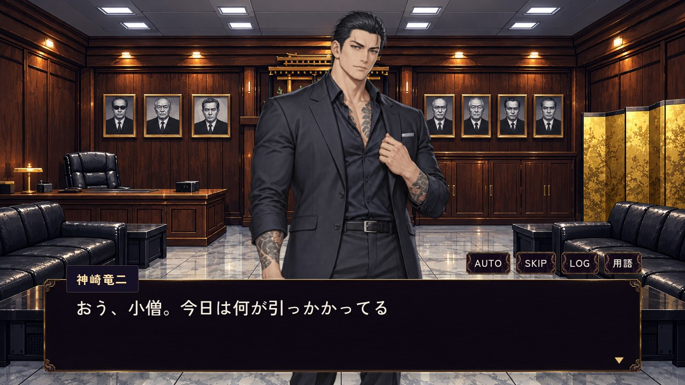
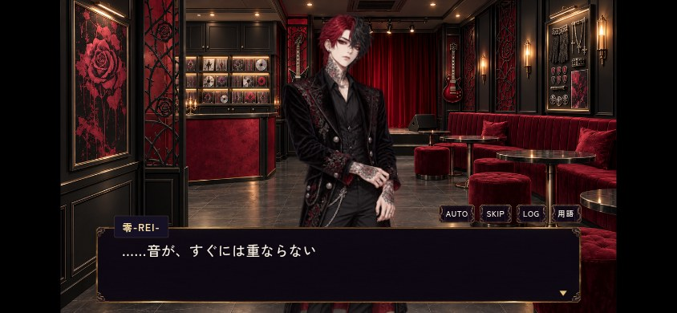

# Issue #563 — 既存表情参照の実表示・保存QA

基準main `7d63fbdc5ce75e57c3cca438476452b7238bd12e`、worker `codex-563-20261015-01a13c35`、claim `38697952277`。ユーザー「563は既存」に従い、既存本人normalを選択する。旧smile／serious原本や不採用生成候補を使わない。

## 使用画像と変更場面

| 人物・場面 | 参照変更 | 選択した既存画像・理由 |
| --- | --- | --- |
| 神崎：`remake_ch2_kumicho_followup` の2／12行目（迎え・助言） | smile → normal、2箇所 | `chr_kumicho_normal.png`／同名WebP。本人の落ち着いた表情で丁寧な助言を保つ。既存差分はnormalのみ |
| REI：`remake_ch2_rei_followup` の4／6／7／8行目（曲の間について語る） | serious → normal、4箇所 | `chr_rei_normal.png`／同名WebP。静かな眼差しで曲への集中に合わせる。既存差分はnormalのみ |

これまでも未登録faceはnormalへfallbackしていたため、表示画像を新しく変える実装ではない。今回の明示選択に合わせ、未登録指定をなくし、normalを直接参照する。台詞、ID、行数、会話順、既存3会話の接続・読了・費用・保存ロジックは変えない。

## 実施結果

- 3会話の実ブラウザ回帰 **9/9 PASS**：旧セーブからの完走、費用・読了・同日再訪、SAVE復帰、途中／最終行の中断・再訪、関係・所持品等の保持。REI完走は横持ちタッチ。
- 追加の実表示・手動SAVE/LOAD **2/2 PASS**：組長PC、REI844×390タッチ。行き先選択中の実saveFlowでslot1へ保存→対象行を表示→reloadしてタイトルのslot1から復帰→再訪して同じ行を表示。requested/resolvedともnormal、実画像読込896×1200、active表示、同一URL・寸法・配置をassert。会話完走とauto SAVE復帰も確認。ブラウザ例外・資源要求失敗は最終全ケース0。
- 対象JSON lint **ERROR0/WARN0**、target tidy dry-run提案0。mainとの差はface6箇所のみ、他の全データは一致。
- 2人のPNG／WebPと3室背景のGit blobをmainと照合。PNGとWebPのRGBAも完全一致。画像・manifestは変更しない。保存後の画面を目視し、本文と人物の表示を確認。
- 全14 Open PRの対象JSONとの変更パス重複0。#683の共有manifestは保持。#564の全体添削・#548のDAY14は変更しない。

| 組長：手動LOAD後 | REI：手動LOAD後 |
| --- | --- |
|  |  |

## 検証環境と再現資料

古いローカル枝を最新mainと扱わず、検証専用HTTPスナップショットを使用。mainと一致するテキスト172ファイルをキャッシュから再利用し、必要なJS/CSS/JSON等116ファイル（2,564,368 bytes）だけをAPI取得。288ファイルのblob一致確認後、対象JSONだけを提案内容へ変更。画像／音声の一括取得はせず、対象画像と背景はmain一致のキャッシュを再利用した。これは最新main全体のGit checkoutではない。

[実結果・画像解決・配置・制約](results.json)と[追加確認スクリプトの実行原文](display-check.mjs.txt)。追加スクリプトは検証snapshotの `remake/test/browser/ch2_existing_expressions.mjs` として実行し、既存 `support.mjs` を使った。通常回帰は既存 `remake/test/browser/ch2_followups.mjs`。環境変数は `BASE_URL=http://127.0.0.1:8128/remake/`、`CHROME_EXECUTABLE_PATH=/usr/bin/chromium`、成果は一時QAディレクトリへ保存。raw runnerのref欄は未指定だが、基準mainと提案データの同一性を別途照合した。

初回のfixtureはicon.svg配置漏れ404で失敗し停止。main一致の246-byteキャッシュを補い、9件すべて再実行PASS。tidyの未対応--help実行で別の旧ローカル台詞1箇所へ生じた自分の差分は、その箇所だけ戻しcleanを確認した。本PRには含まない。失敗した試行を成功とは扱わない。

## 受入範囲と残件

- **今回完了（PRのレビュー・統合待ち）**：既存画像の実見・選定、対象6参照の明示normal化、実表示とSAVE復帰／回帰。
- **既に統合済み・保持**：PR #603の採用3会話。今回再実装していない。
- **保留のまま**：3店の夜専用室内、営業中器具差分の必要場面・採否。実装・生成へ広げない。
- **今回方式の依存から除外**：旧smile／serious原本の403転送。不取得の履歴・識別は残すが、既存normalの採用を妨げる残件とはしない。
- **未実施**：実機Safari、公開版、全章通し、AUTO/SKIP全組合せ。マージ・公開・Issue終了・予約変更はしていない。
