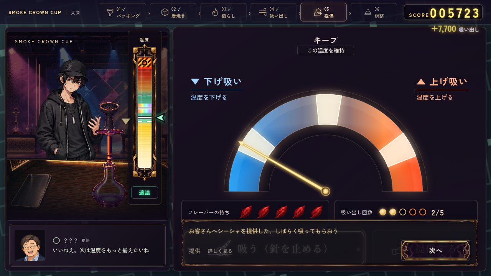
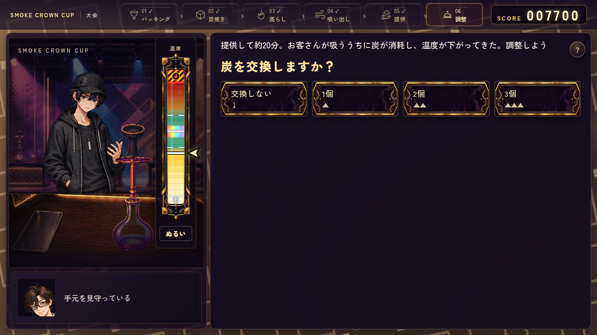
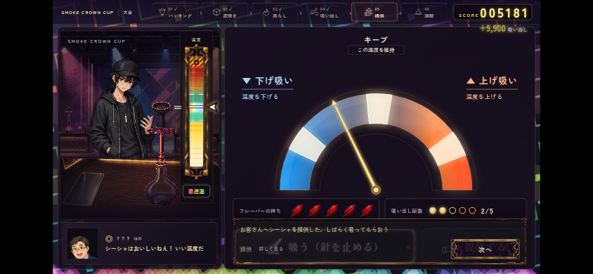
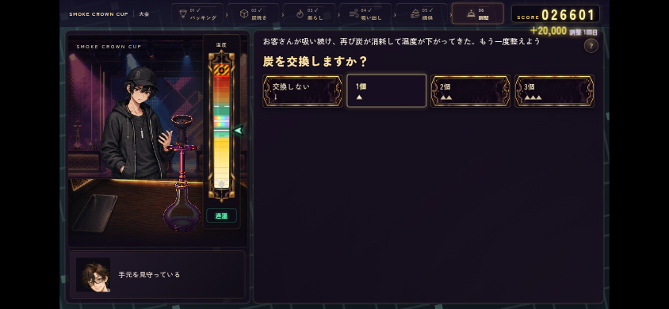

# Issue #399 制作フローの確認

worker: `codex-craft399-20261012-0905-c8a1` / claim run `38227276123` SUCCESS。
開始main: `ea243fd208ff2df91458dea35e0c15191012e514`。

ヘッダーのcare/care1/care2を「調整」へ集約し、pullを含む工程セットにだけ「提供」を補う。成功した提供後は「提供」をactiveにし、提供した旨を結果カードにも表示する。失敗時のpullDoneは既存のままで、提供表示へは進めない。提供後も吸い出しと同じ画面配置を保つ。

初回の調整準備は「提供して約20分」、次回は「再び炭が消耗して温度が下がった」という文章。既存の交換個数選択・炭焼き・交換での昇温・吸引をそのまま使い、タイマーや温度係数を追加していない。practice.jsとch1.jsの2回ループ、careHistory、score.js、保存スキーマは変更なし。

## 検証済み

`CHROME_EXECUTABLE_PATH=/usr/bin/chromium node remake/test/browser/craft_progress.mjs` — 4/4 PASS。

- PC 1280×720とタッチ横持ち844×390。実際の吸う／提供ボタンを操作し、提供前はpull、押した後はserveになることを確認。ヘッダーのラベル・結果文章・次へ・交換選択が画面内に収まる。
- 両careの開始／終了で同じcareセルがactive、ラベルと読み上げは「調整」。初回／次回の文脈を確認。交換する炭を1個選び、既存テスト自動操作で炭焼きと吸引を実行する。
- careHistoryが2件残り、初回を上書きしない。次回開始温度は既存の`max(.14, 前回温度 - .075)`、各20%・arcade各200の得点計算は従来どおり。制作表示によるlocalStorage/sessionStorage変更なし。
- 実ゲームの焦げ失敗はpullDoneが立ってもpullのまま。穴／炭／蒸らし単工程はそれぞれ1セル、吸い出し単工程は吸い出しと提供のみ、careの各別名は調整1セル。
- JS構文、`git diff --check`、Git Safety、`python3 tools/check_agent_docs.py` PASS。

結果JSON: [craft-progress.json](craft-progress.json)。PCとタッチエミュレーションで確認したもので、実機スマートフォンではない。

| PC提供 | PC初回調整 |
| --- | --- |
|  |  |

| 横持ち提供 | 横持ち次回調整 |
| --- | --- |
|  |  |

## 最終確認の進行

既存ch1_tournament、steam_forecast、save_loadを実行中／予定。最終PRのCI、最新mainとの競合、レビュー条件を確認するまでマージしない。

再現には`npm ci --prefix remake/test/browser`、`python3 remake/tools/serve_preview.py --port 8123`を使用。ルート直下のテストは`NODE_PATH="$PWD/remake/test/browser/node_modules" CHROME_EXECUTABLE_PATH=/usr/bin/chromium`を指定する。Heat feedback CIに新規検証とch1_tournamentを接続した。
