# 制作UI 実装比較・第1単位（#662）

工程名と「今やること」を盤面直上に常時表示しました。詳細ヘルプを同じ案内行へ移し、炭壺との重なりを解消。穴あけテンプレートは既存の選択状態に合わせて「✓ 選択中」を表示します。

**これは第1単位の実装報告です。依頼全体の完成報告ではありません。公開サイトへの反映はまだありません。**

- before: main `d069102e6dac96368665972bf417744f3b60239f`
- after（実装コミット）: `b613228f7bb94cb87ea4dfab05755c0899339373`
- 撮影: Chromium、PC 1280×720／タッチエミュレーション 844×390、reduced-motion。
- 同じ新規セッション、seed=662、葉・機材・穴・炭・温度条件、同じ工程を起動。動く盤面の比較はテスト内だけ時計を固定。実際のユーザーセーブを読んだ撮影ではありません。
- `remake/test/browser/craft_guidance.mjs` の同じfixtureを変更前後に使用。18組の実DOMスクリーンショットです。架空のafter画像は使っていません。
- 提供Library画像は配合・炭焼きのメタデータ／OCRのみ取得。画像本体の取得に失敗したため、目視参照済みとは扱っていません。

## 変更点と検証

|変更|実装|検証|
|---|---|---|
|工程ごとの操作が常に読める|既存STEP_BRIEFS・チュートリアル文を再利用。タイマーに短文を追加|9工程×2サイズ、案内の表示・文字収まり・盤面との非重複18件PASS|
|詳細説明を開く位置|ヘルプを盤面外の案内行へ移動|蒸らしの開閉・タッチ非干渉PASS。時間停止仕様は変更していません|
|穴あけの選択が明瞭|既存aria-pressedに枠・チェック・文字を対応|選択とプレビュー一致、PC Space／マウス／タッチで実際に25穴・リング遷移・仕上げPASS|
|追加行で下端が切れない|詰め方の余白、蒸らし操作欄を圧縮|詰め方7件PASS。蒸らし盤面784×414は維持。マウス／同時2点タッチ・精密切替・回復PASS|
|進行・判定を保つ|採点・乱数・温度計算・保存処理を変更しない|吸い出し・調整2回4件PASS、大会コメント統合1件PASS。温度引継ぎ・タイマーリセット・実況・結果◎○△の既存craft_focus試験PASS|

再実行コマンド（既存PlaywrightをNODE_PATHへ設定し、previewを8127番で起動）:

```sh
BASE_URL=http://127.0.0.1:8127/remake/ node remake/test/browser/craft_guidance.mjs
BASE_URL=http://127.0.0.1:8127/remake/ node remake/test/browser/craft_materials.mjs
BASE_URL=http://127.0.0.1:8127/remake/ node remake/test/browser/craft_progress.mjs
BASE_URL=http://127.0.0.1:8127/remake/ CASE_FILTER=coals-two-care-and-comments node remake/test/browser/ch1_tournament.mjs
BASE_URL=http://127.0.0.1:8127/remake/ node remake/test/craft_focus.mjs
BASE_URL=http://127.0.0.1:8127/remake/ CHROME_EXECUTABLE_PATH=<既存Chromium> node remake/test/steam_forecast.mjs
```

初回試験の失敗はlogsに保持。詰め方の説明欄不足・既存装飾のはみ出しを修正して最終試験は成功しました。steam_forecastの旧「工程名は非表示」・旧ボタン寸法期待値は、この変更に合わせて更新しました。操作速度・論理盤面の検証は維持しています。

## 同条件のbefore／after

画像はクリックして原寸で確認できます。

### PC 1280×720

|工程|before|after|
|---|---|---|
|配合|[](before/pc-mix.png)|[](after/pc-mix.png)|
|詰め方|[](before/pc-pack.png)|[](after/pc-pack.png)|
|穴あけ|[](before/pc-holes.png)|[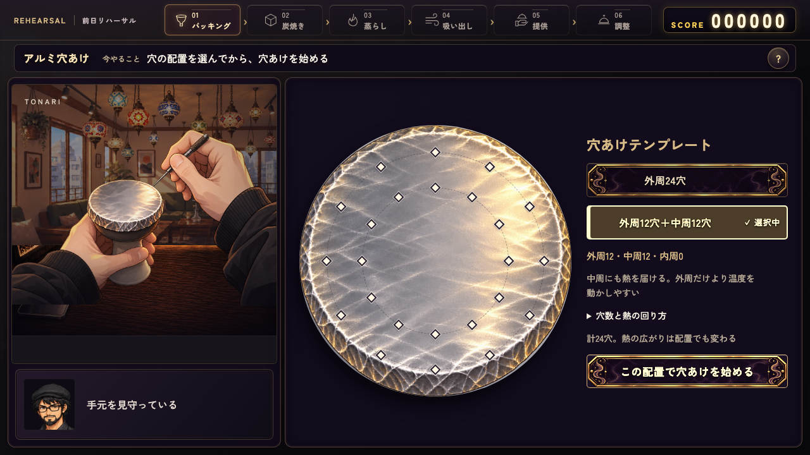](after/pc-holes.png)|
|炭配置|[](before/pc-place.png)|[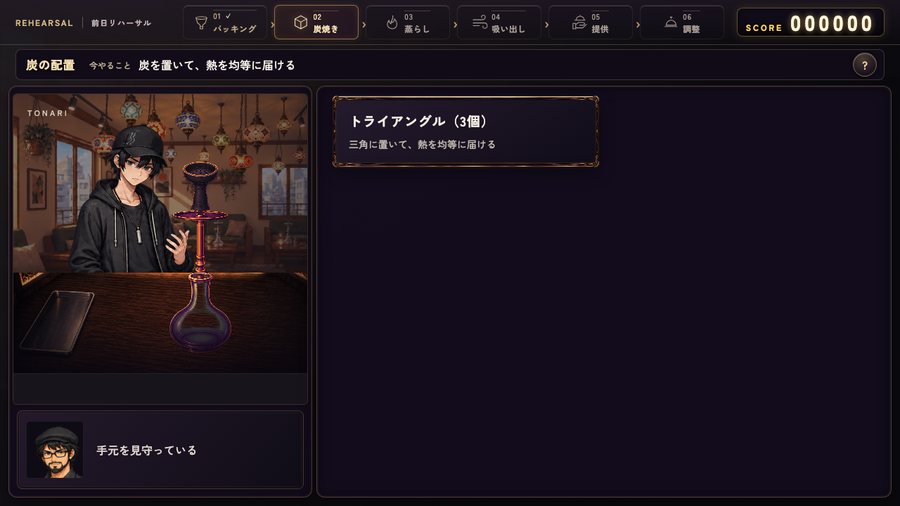](after/pc-place.png)|
|炭焼き|[](before/pc-heat.png)|[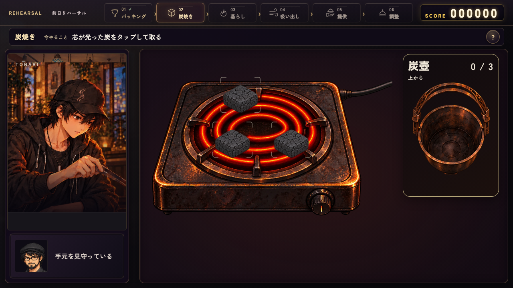](after/pc-heat.png)|
|蒸らし時間|[](before/pc-timer.png)|[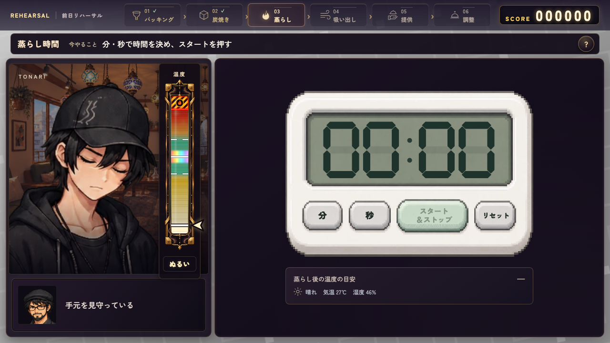](after/pc-timer.png)|
|蒸らし|[](before/pc-steam.png)|[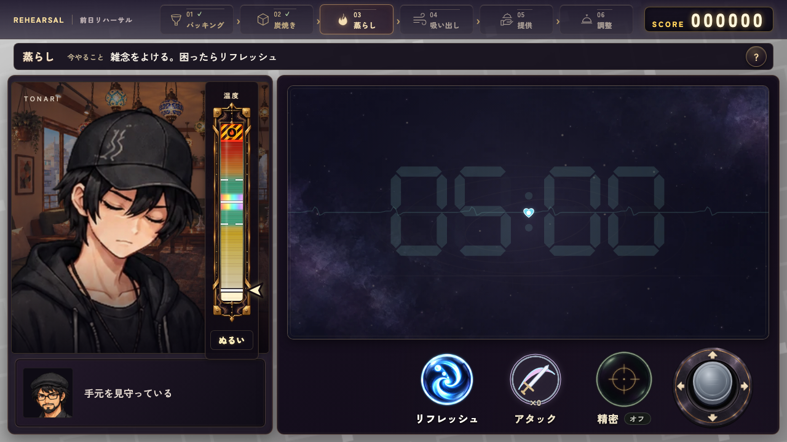](after/pc-steam.png)|
|吸い出し|[](before/pc-pull.png)|[](after/pc-pull.png)|
|調整|[](before/pc-care.png)|[](after/pc-care.png)|

### 横持ちタッチエミュレーション 844×390

|工程|before|after|
|---|---|---|
|配合|[](before/touch-mix.png)|[](after/touch-mix.png)|
|詰め方|[](before/touch-pack.png)|[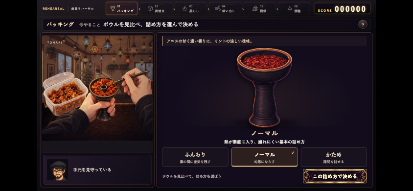](after/touch-pack.png)|
|穴あけ|[](before/touch-holes.png)|[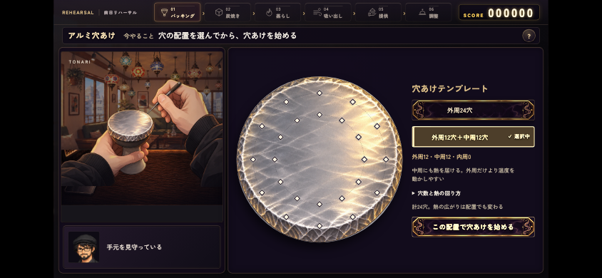](after/touch-holes.png)|
|炭配置|[](before/touch-place.png)|[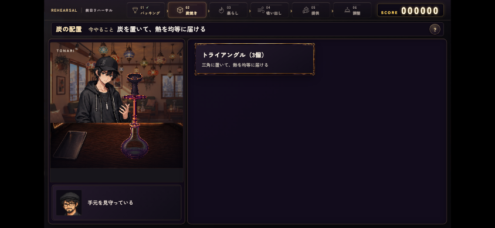](after/touch-place.png)|
|炭焼き|[](before/touch-heat.png)|[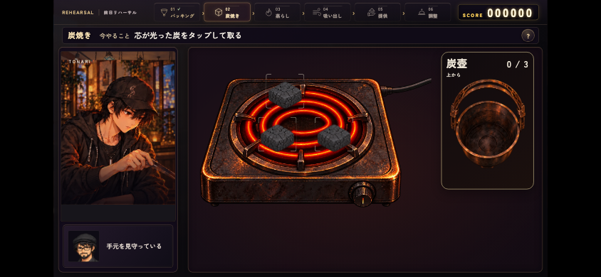](after/touch-heat.png)|
|蒸らし時間|[](before/touch-timer.png)|[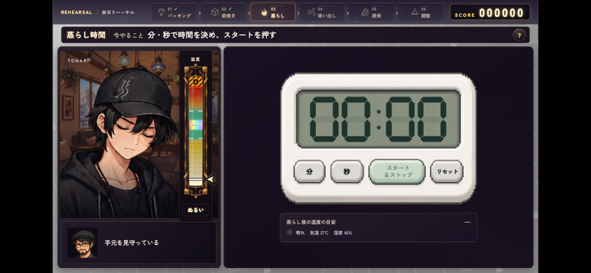](after/touch-timer.png)|
|蒸らし|[](before/touch-steam.png)|[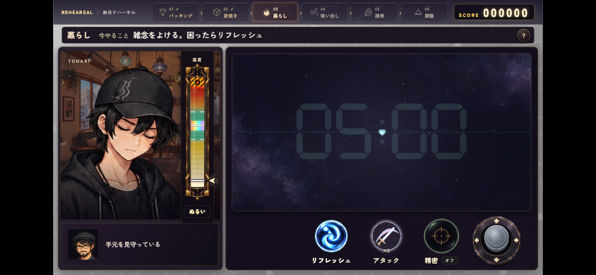](after/touch-steam.png)|
|吸い出し|[](before/touch-pull.png)|[](after/touch-pull.png)|
|調整|[](before/touch-care.png)|[](after/touch-care.png)|

## 実時間・実況を含む補足画面

固定時計の比較とは別に、既存の実操作試験で撮影しています。これは同条件before/afterではありません。

|実況|結果|実時間の蒸らし（タッチ）|
|---|---|---|
|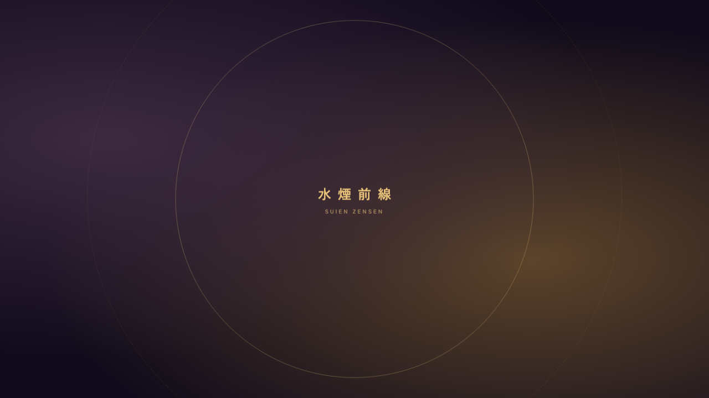|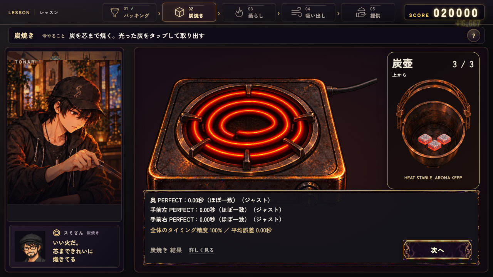|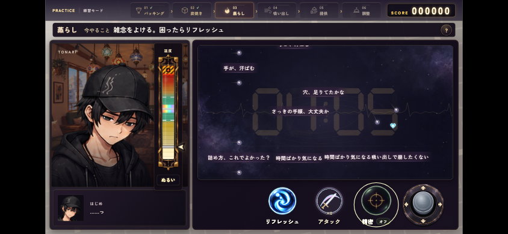|

## 続く変更・未検証

温度計とダイヤルの近接、配合の不足理由、最低回数表示、白帯の意味、工程別ステージ配置、スマホ専用配置は次の変更単位です。熱管理・採点・葉消費・価格・保存互換は変更していません。

通常プレイを入口から最後まで手動で通す検証、全工程の戻る・中断再開・SAVE/LOAD、ヘルプ中の時間進行を含む不利の有無、実機スマートフォンは未検証です。単体起動と部分統合の成功だけで全ルート完成とは扱いません。

炭配置1択のスキップ、工程統合、タイマー前回値保存／初期値変更は未実装。戻る・チュートリアル・各モード・SAVE/LOADへの影響を別途整理します。
