# 判断材料の表示・第2単位（#662）

配合の決定ボタン直下に「あと何g必要か」「課題フレーバーの不足」「容量がいっぱい」「手持ちの上限」を表示しました。既存の決定可否、容量、系統別g判定、在庫上限を使い、採点や葉消費は変更していません。

吸い出し・調整の温度計は既存の1本をダイヤルの左へ移動。提供／調整終了ボタンには既存の最低回数から「あと○回」を表示します。吸い出しは2回、調整は1回という現在の条件を変更していません。

白帯の説明は「左右は変化が大きい／中央はキープの目安」です。左右の基礎変化±0.10／±0.16に共通補正+0.015などが入るため、実際の温度変化を一律1.6倍と表示しません。中央も針位置により微増減します。炭交換は既存の点線予測を残し、焼け具合で変わる目安であることを添えました。

- before: 第1単位 `0d7c936206e71f70971c3b1ec539824168b9a309`
- after 実装SHA: `5c26f62636374755d418af92e55fb2035bba82a9`
- 同じfixtureとPC1280×720／タッチエミュレーション844×390、seed662。比較用だけ時計固定。元のmainとの比較は[第1単位のbefore](../README.md)を参照。
- 実機スマホの証拠ではありません。公開サイトへは未反映です。

## 比較画像

|工程・画面|before（第1単位）|after（第2単位）|
|---|---|---|
|PC 配合|[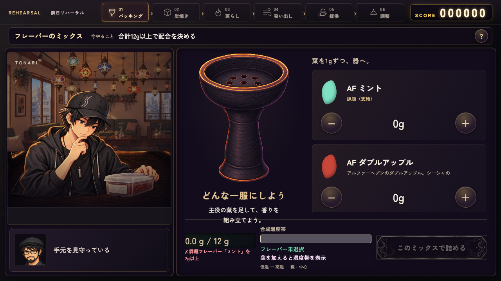](../after/pc-mix.png)||
|PC 吸い出し|[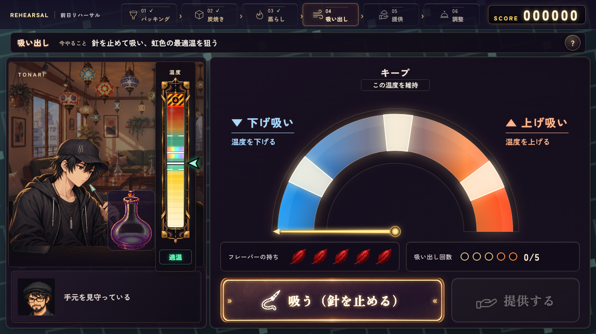](../after/pc-pull.png)|[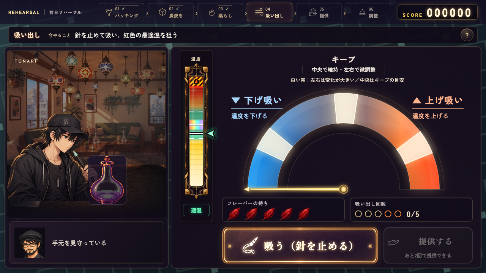](after/pc-pull.png)|
|PC 調整|[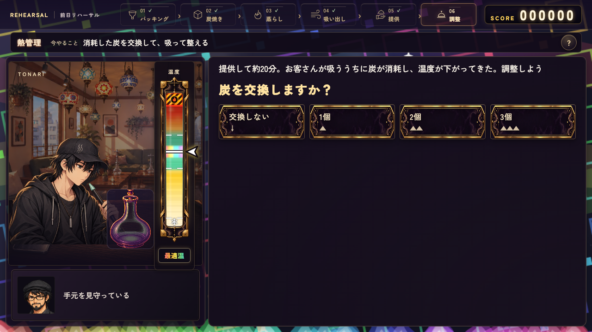](../after/pc-care.png)|[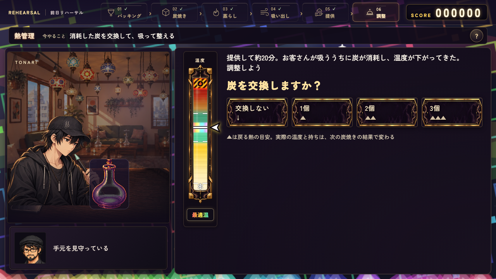](after/pc-care.png)|
|横持ち 配合|[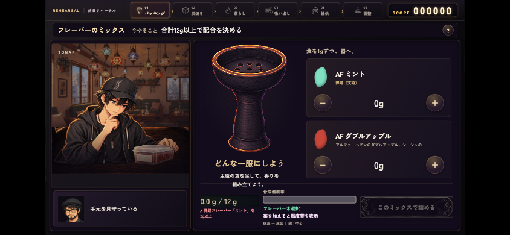](../after/touch-mix.png)|[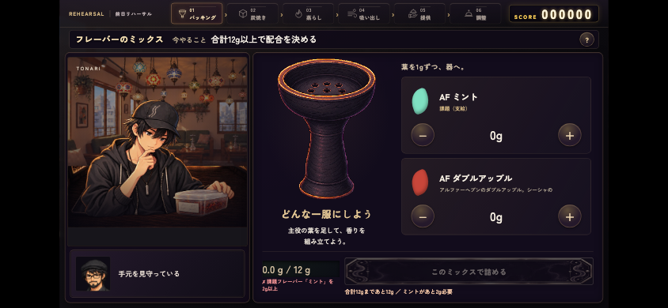](after/touch-mix.png)|
|横持ち 吸い出し|[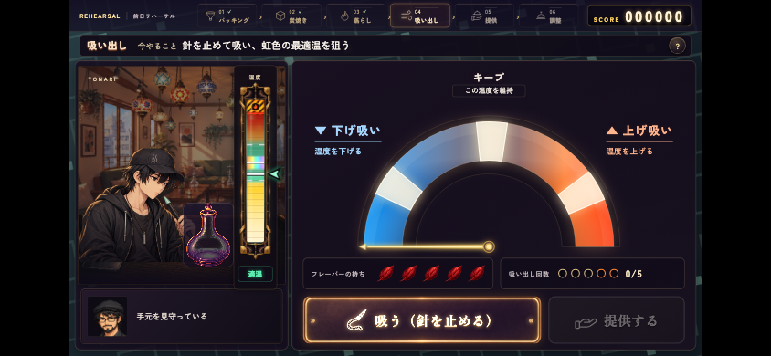](../after/touch-pull.png)|[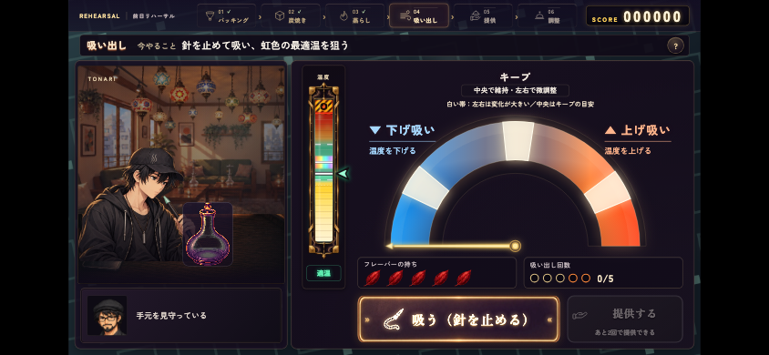](after/touch-pull.png)|
|横持ち 調整|[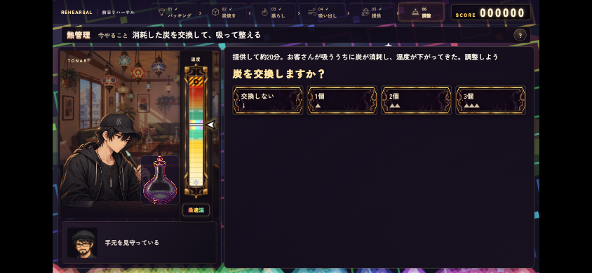](../after/touch-care.png)|[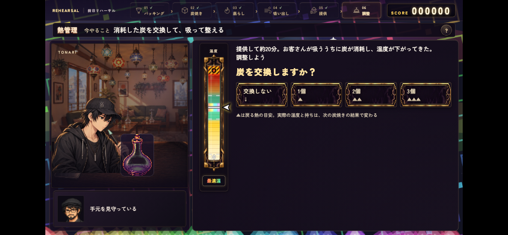](after/touch-care.png)|

## 検証

- craft_decisions 2件PASS: PC／タッチで12g未満・課題不足・満杯・在庫不足を実操作。決定可否との一致、選ぶだけでは在庫・保存が変わらないことを確認。
- craft_progress 4件PASS: 実際に2回吸うと提供でき、調整2回の履歴・配点を維持。温度計は1本だけ、ダイヤルの隣、白帯説明と残回数が画面内。
- mix_temperature 8件PASS: 配合→温度→調整、支給ミント、旧セーブ、温度帯境界、セッション分離、自動操作。
- steam_forecast PC／タッチPASS: タイマー／弾幕は従来位置、吸い出し／調整は共通の新位置。実マウス・同時2点タッチの操作速度と回復を維持。
- craft_guidance 18件PASS: 全9工程の案内・選択・非重複。

空の配合温度帯は未選択中だけ畳み、1gでも入ると従来計算の温度帯を表示します。テストの初期表示期待値と温度計の位置期待値を変更し、温度・操作そのものの検証は残しました。

## 未完・制約

工程別ステージ配置、スマホ横の専用配置、ヘルプ中の時間停止と再開、入口からの全工程通過・戻る・中断・再開・SAVE/LOADの包括検証は続く単位です。炭配置スキップ・工程統合・タイマー保存は実装していません。
