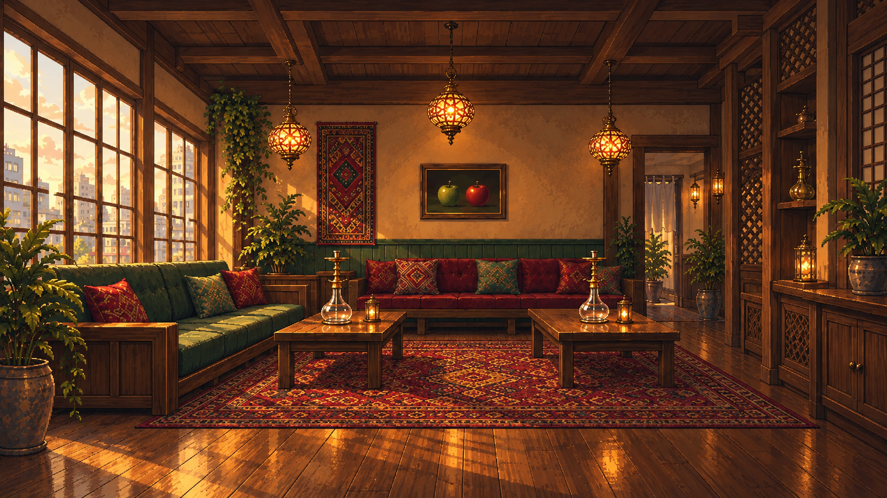
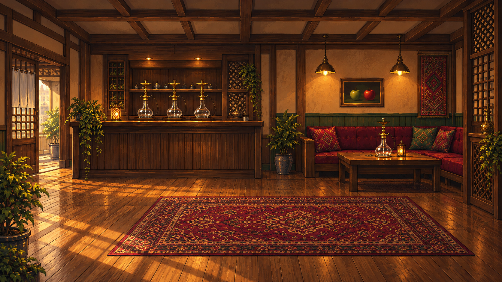

# EDEN 内装候補 A・C

オーナーが選んだ2案の確認用画像。ゲーム本体への組み込み前の候補です。

- ダブルアップルは、見る側から左が緑りんご・右が赤りんご（今回のオーナー指示。古い設定資料の逆配色より優先）。
- シーシャ台は硬いテーブル・棚・カウンター上に配置し、ソファの座面に置かない。
- 既存の他店背景を画風参考に、16:9の独立画像として生成。
- 開店前の準備・展示状態。ボウル・HMD・炭・ホースは未装着。

## A：ラウンジ中心

[PNG原寸](eden-A.png?raw=true)

## C：カウンター中心

[PNG原寸](eden-C.png?raw=true)

## 確認

両案とも、対のりんごの左右と、台の支持面がソファではなく木製の家具であることを目視確認。
元のゲーム画像・設定・参照コードは変更していません。
