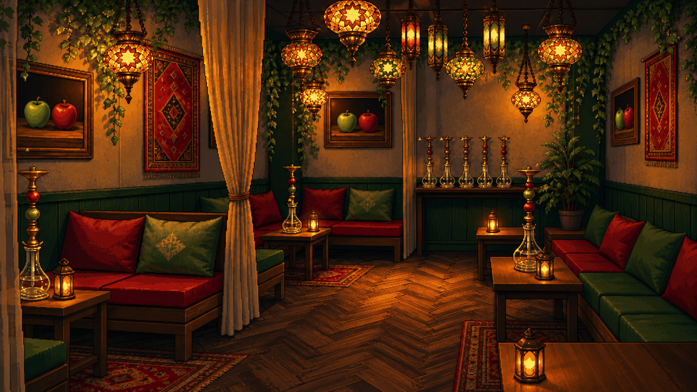
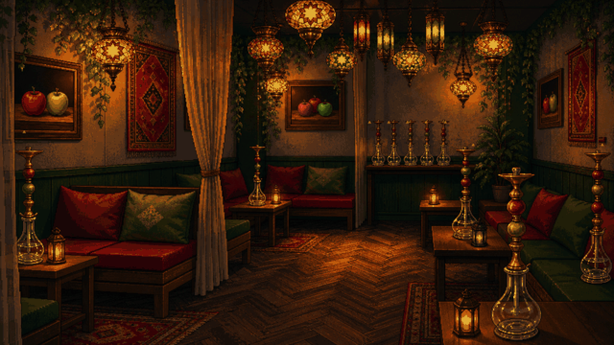

# EDEN 内装修正版：現行の雰囲気を維持

オーナー訂正：窓は不要。前のA・Cは雰囲気を変えすぎたため、現行ゲームのEDEN背景を直接参照し、構図と店の暗めの暖色照明を残した案に修正。

## 最新の修正版

[修正版PNGを開く・保存](eden-faithful-windowless.png?raw=true)

- 窓・外光を追加しない。
- 中央左のカーテン、左右と奥のソファ、モザイクランプ、壁飾り、ヘリンボーン床、配色と基本構図を維持。
- 右端のソファ座面に置かれていたシーシャ台を除去。台は木製テーブル・奥の展示台で支持。
- 3か所のりんごの絵はそれぞれ2個にそろえ、画面左が緑・右が赤。
- 過密な細部と輪郭を整理し、他店と合わせたピクセルペインター調に調整。
- 開店前の準備・展示状態。ボウル・HMD・炭・ホースは未装着。

## 比較用：現在のゲーム内背景

## 前案（履歴・今回の方向性には使わない）

- [A：窓のあるラウンジ](eden-A.png)
- [C：窓のあるカウンター主体案](eden-C.png)

## 確認・実装状況

修正版を目視し、窓なし、元の構図、台の支持面、各絵のりんごの左右を確認。アップロードしたPNGのblob SHAとローカルファイルのGitハッシュは一致。確認用画像のみの変更でゲームテストは対象外。ゲーム本体の画像・設定・コードは未変更です。
