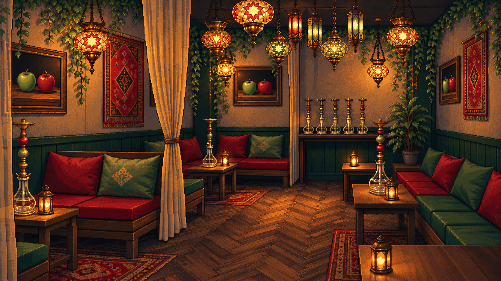
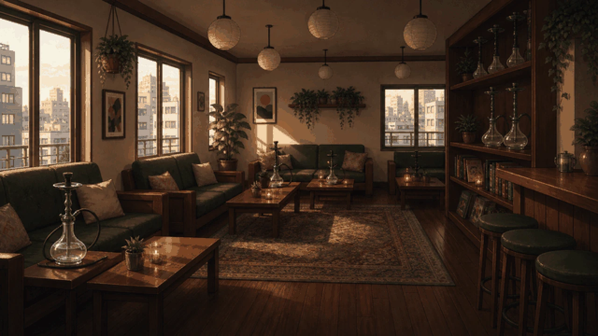
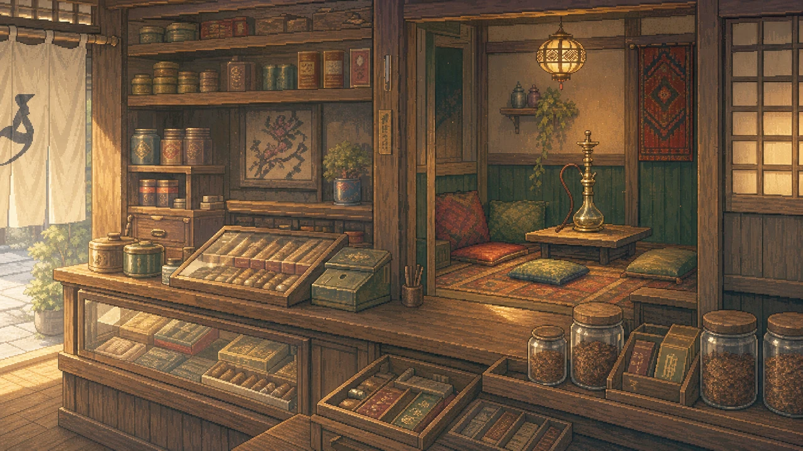

# EDEN 内装：ドットの描き方を他店に合わせる

## 最新：ドット感の調整版

[調整版PNGを開く・保存](eden-pixel-matched.png?raw=true)

窓なしの修正版を内容の基準とし、他店の背景はドットの描き方だけの参考にして生成。壁・布・木部の不均一な大きな塗りの塊を細かく整理し、輪郭の段差と色のまとまりをそろえています。完全な固定グリッド変換ではなく、画像生成による描画調整です。

維持する条件：窓なし、現行に近い構図・カーテン・ランプ・ソファ・暗めの暖色照明。各りんごの絵は左が緑・右が赤。シーシャ台は木製テーブル・展示台上に配置し、ソファ座面へ置かない。

## 比較：一つ前の修正版

## 画風参考：ゲーム内の他店

### となり（内装・照明をコピーするための参考ではありません）

### 神崎煙草店

## 比較：現在のゲーム内EDEN

## 以前の方向性検討（不採用の履歴）

- [A：窓のあるラウンジ](eden-A.png)
- [C：窓のあるカウンター主体案](eden-C.png)

## 確認・実装状況

出力を目視し、基本構図・窓なし・りんごの左右・台の支持面を確認。アップロードPNGのblob SHAとローカルGitハッシュが一致。ゲーム本体の画像・設定・コードは未変更。確認用画像と説明のみのためゲームテストは対象外です。
