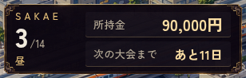
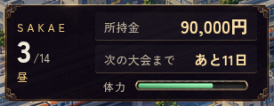
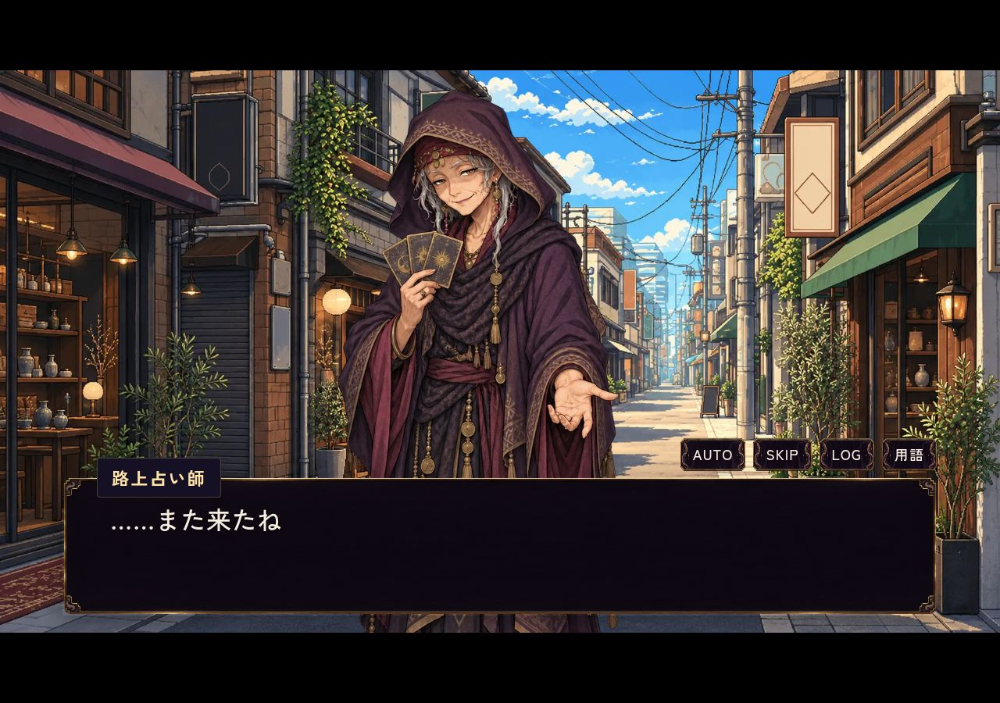
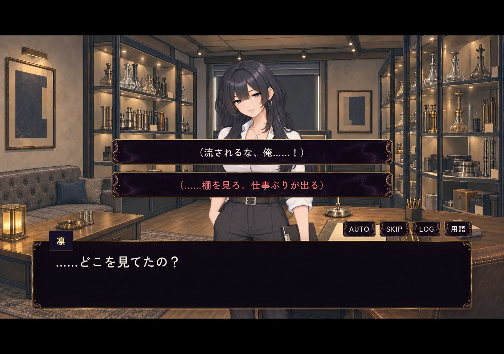

# #682 HUD・昼限定占いの確認

## 変更前後（同じ条件）

DAY3・昼、seed=131、所持金90,000円、体力70。PC 1280×900／スマホ横844×390／縦390×844、通常表示とDS表示で比較。変更前は36c855f3（HUD実装前）、変更後は609d6e0cf（最新mainのDSパッキング修正取り込み済み）。

| 変更前 | 変更後 |
| --- | --- |
|  |  |

| 表示 | 変更前 | 変更後 |
| --- | --- | --- |
| PC・通常 | [画像](before-pc-normal.jpg) | [画像](after-pc-normal.jpg) |
| PC・DS | [画像](before-pc-ds.jpg) | [画像](after-pc-ds.jpg) |
| 横・通常 | [画像](before-landscape-normal.jpg) | [画像](after-landscape-normal.jpg) |
| 横・DS | [画像](before-landscape-ds.jpg) | [画像](after-landscape-ds.jpg) |
| 縦・通常 | [画像](before-portrait-normal.jpg) | [画像](after-portrait-normal.jpg) |
| 縦・DS | [画像](before-portrait-ds.jpg) | [画像](after-portrait-ds.jpg) |

日付・時間帯・所持金・大会までの日数・体力を1枚に統合。既存の体力DOMを移動し、回復処理は維持。6条件で体力の表示・パネル内への収まり・操作との非重複・状態非変更を確認。通常の縦画面は既存の端末回転案内が出るため、操作性は横持ち／縦DSで確認した。

## 占い

- [承認済みトリビア56件（8人計56種）](trivia-draft.md)。各キャラの全候補を一巡するまで重複せず、旧5bit整数マスク保存からの移行に対応し、ゲーム本編の乱数を進めない。
- 従来の出店日（週3・6日目）は維持し、昼限定、夜は「昼のみ営業」。料金3,000円・1日1回・時間消費なし・次回交流の好感度×1.5を維持。
- 占った相手に届く返答を赤字で示す。購入日を含む3日間（DAY3ならDAY5まで）。好感度×1.5を消費しても継続し、セーブ／ロード・章跨ぎに対応。
- 赤字は台詞を確認して登録した通常会話10箇所。恋愛／友情の進路・好きな味・購入には唯一の正解を定めていないため表示しない。登録外や将来改稿された2択に推測で印を付けない。既存の選択肢報酬は変更しない。
- 対象8人はスミ・なる・アダム・みんと・つむぎ・凛・ひより・さめちゃん（各10/7/5/8/8/7/5/6件、除外5件 `sumi_14`・`naru_8`・`naru_14`・`adam_11`・`samechan_14` 不使用）。第2章のなるとの決裂イベント（`ch2_naru_confrontation`）後は、なるを占いの対象から外し、KEMURIKUSAも定休日を含め継続して「本日臨時休業」とする。
- 立ち絵は深紫のフード・白髪・皺・タロットを持つ年配の怪しい占い師。元画像・生成条件・PNG／WebPを保存。背景透過、PNG元画素一致、WebPのアルファ一致を確認。

[スマホ横：立ち絵](portrait-touch.jpg)／[赤字](hint-touch.jpg)、[縦DS：立ち絵](portrait-ds.jpg)／[赤字](hint-ds.jpg)。選択肢画像は実際の凛の台詞データの2択を短い導入から表示したもので、2番目の返答が赤くなることを確認。

## 検証

- PASS `node remake/test/fortune_readings.mjs`：承認済み56件・除外5件不使用・可変長非重複・旧5bitマスク移行・保存・乱数非変更、3日間と期限切れ、章跨ぎ、対象限定、既存ボーナス独立、登録済み分岐との一致、営業時間、第2章なるとの決裂後の占い除外・KEMURIKUSA継続臨時休業、素材透過。
- PASS `node remake/test/browser/hud_fortune.mjs`：PC／横／縦×通常／DSの6条件。変更前後の測定は[before.json](before.json)／[after.json](after.json)。
- PASS `node remake/test/browser/fortune_readings.mjs`：PC／横タッチ／縦DS。実際の支払い、残金不足・辞退・対象なし・同日再実行の無課金、夜閉店、3日目と期限切れ、赤字の第2選択肢、旧マスク移行後の新規トリビア抽選、決裂後のなる除外・KEMURIKUSA臨時休業、保存、立ち絵読込、ページエラー0。[結果](fortune-browser.json)。
- PASS 既存 `node remake/test/browser/lime_badge.mjs`：6表示条件。LIMEの既存動作を維持。
- 部分PASS 既存 `node remake/test/gameplay_polish.mjs`：レッスンスキップ・地図帰還後の体力回復・ウォームアップ時間は通過。その後、炭位置の既存期待値 `[[50,30],[38,45],[62,45]]` と現行座標 `[[36.8,24],[33.5,57],[58,57]]` の不一致で失敗。本PRでは該当実装・既存テストを変更していない。全体PASSとは扱わない。
- PASS `node --experimental-vm-modules remake/test/data_loading.mjs`：追加2ファイルを含む40 JSON、最大4接続・進捗・通信失敗・タイムアウトと占い結果の登録。
- Git Safety PASS。CIへ専用の検証ステップと必要な元画像の限定checkout／Pillowを追加。

施設・LIME調整の別PR #675には変更を加えていない。ゲスト出勤（第1章ヒント・第2章経済追加）はオーナー指示に従い既存PRへ無理に混在させず担当境界を分離。常連の買い出しは不採用。

