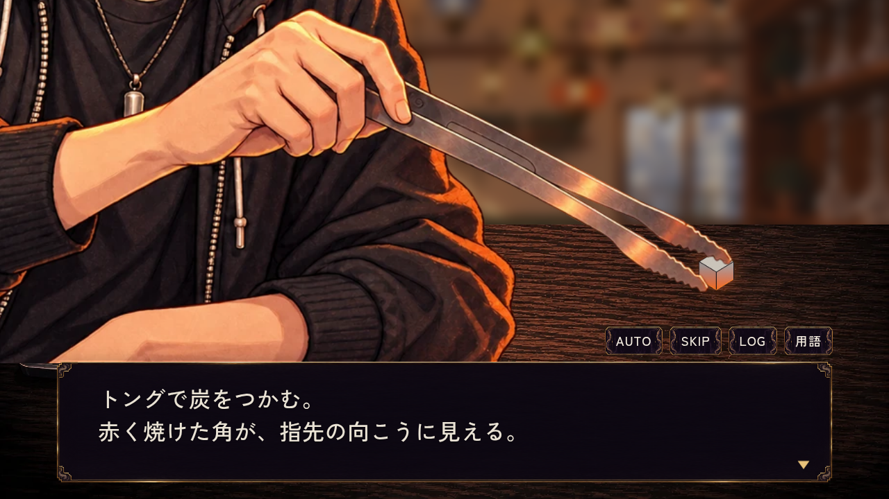
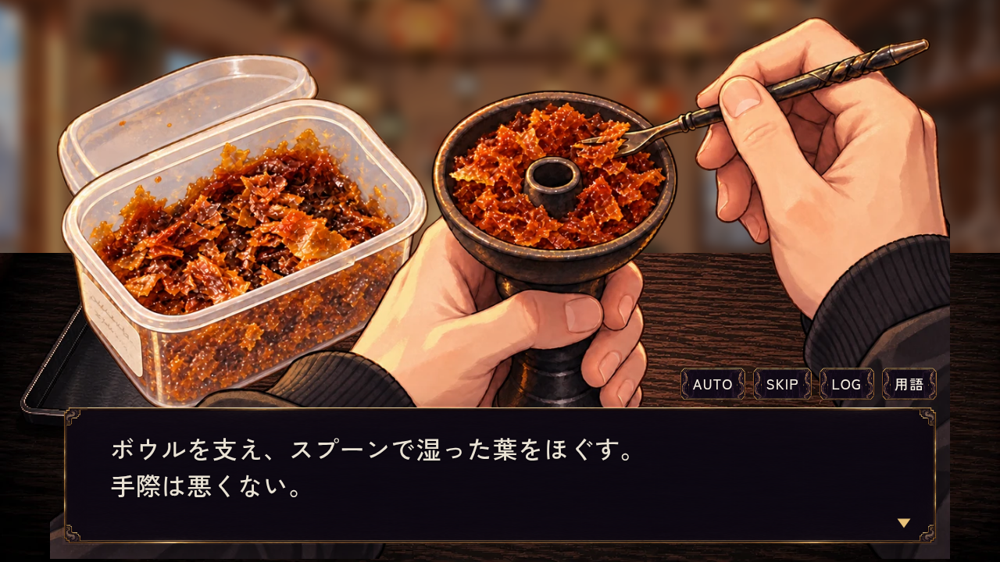
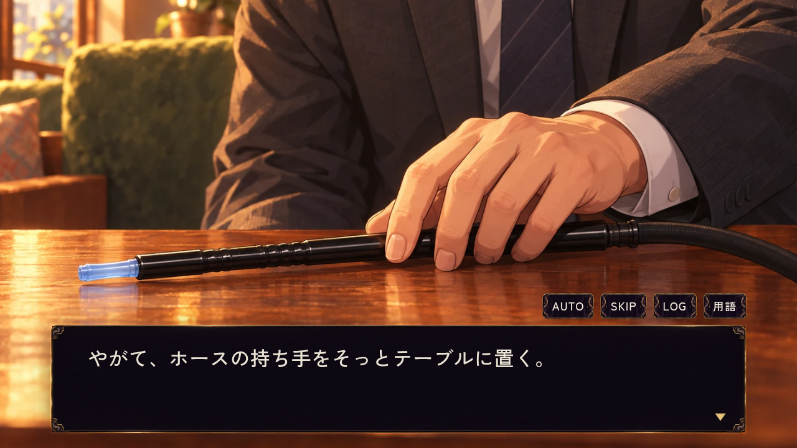
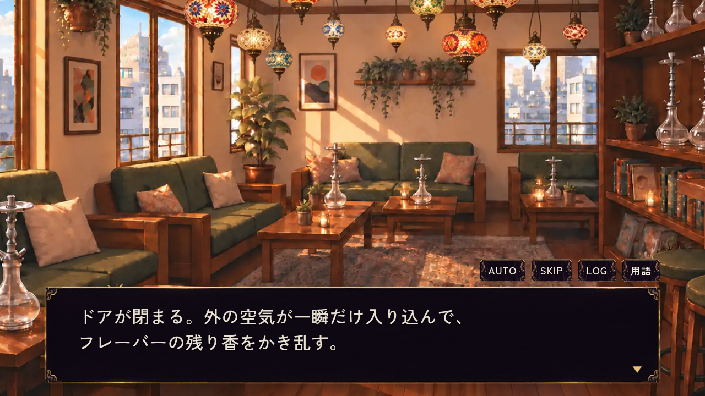
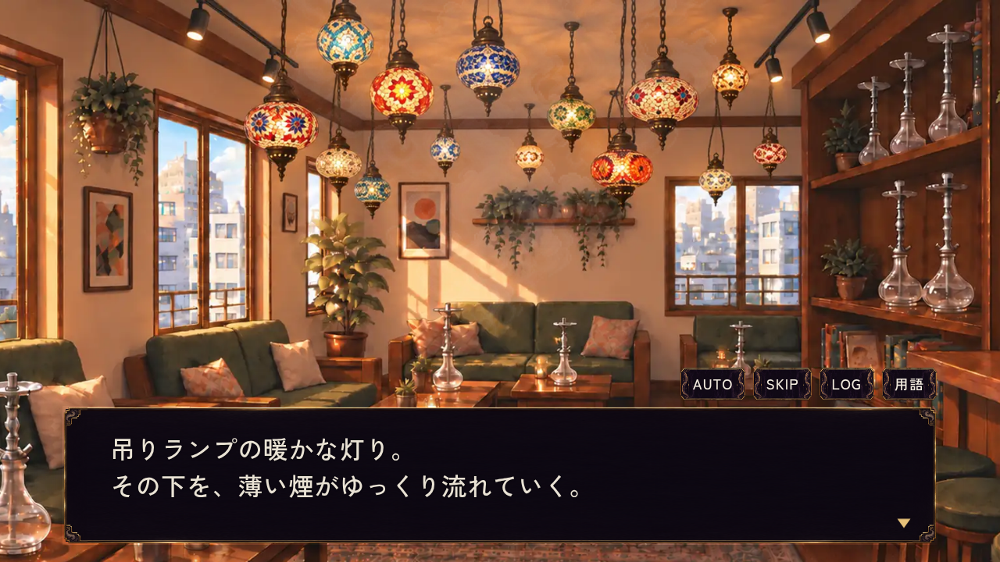
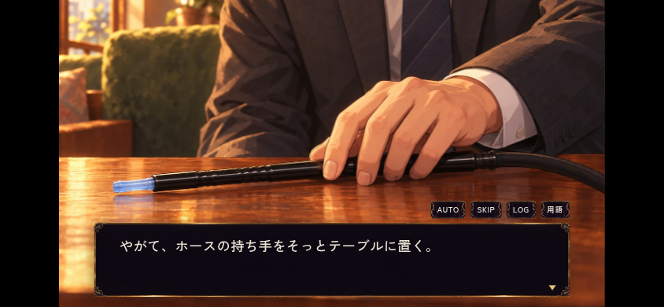

# #531 冒頭の調理・接客カット

[画面一覧](index.html)／[冒頭だけ再生](../../../remake/opening-preview.html)／[PR #532](https://github.com/haseatsu114514-dot/shisha-game/pull/532)

PC 1280×720 と横持ちタッチ 844×390で、実際の台本を通常送りして撮影。画像は本編と同じ演出・本文枠によるもの。撮影のために初登場カードは既読にしている。カードと進行・保存の確認は別途NEW GAMEから実施した。

| 炭の手元 | ボウル |
| --- | --- |
|  |  |
| 常連の手元 | 退店後の席 |
|  |  |





## 確認内容

- 専用ブラウザ5ケース：PCのEnter送り、スマホのタップ送り、全カットの順序と通常店内への復帰、本文枠・操作ボタンの収まり、SKIP、動きを減らす設定、中断と次会話のフック復元、画像デコード失敗時の代替表示、プレビュー再生／終了／再生し直しとAUTO送り、既存セーブ・手動スロット・sessionStorageの非干渉。
- `ch1_opening_resume.mjs` の `new-game-first-scene-save-replays-opening`：NEW GAME直後の保存→再読込→冒頭→必須接客→日常への到達と保存を確認。
- 対象台本lint ERROR 0。`ch1_main` WARN 6／`ch1_sumi` WARN 7／`ch1_bonds` WARN 0は変更前と同じ。整形dry-runは変更範囲外の既存oneesan 1行のみ。
- 本文組版6292テキスト、変更JSONの読込、JS構文、差分空白検査。分岐・選択肢・報酬と後続イベントは保持。素材目録は新規1枚の追加のみで、既存項目の脱落なし。
- mainの大会会場設定 PR #529 を統合。要望台帳の両方の記録を保持し、大会の行き先変更と冒頭の呼出変更を共存させた。
- raw.githackのブランチURLでも実ブラウザで再生し、常連の手元カットまで表示・ブラウザ例外0を確認。初回の「External Content Notice」は「Open the page」で開く。画像一覧はGitHubの本ページからも確認できる。

再実行:

```sh
python3 remake/tools/serve_preview.py --port 8123
node remake/test/browser/tonari_opening.mjs
TEST_CASES=new-game-first-scene-save-replays-opening node remake/test/browser/ch1_opening_resume.mjs
node remake/test/text_wrap.mjs
```

この環境では `CHROME_EXECUTABLE_PATH=/usr/bin/chromium` を使用。CIにも専用5ケースを登録。全章通しプレイや全ブラウザの保証はこの変更の検証範囲に含めない。

## 2026-10-14：正式移管後のmain統合

新担当 `codex-e-finish532-20261014-07a5f67642`。オーナーが旧担当停止と新管理者承認を確認し、[新承認6157994329](https://github.com/haseatsu114514-dot/shisha-game/issues/531#issuecomment-6157994329) → [transfer38489426796](https://github.com/haseatsu114514-dot/shisha-game/actions/runs/38489426796) → そのrunを指定した [status38489596088](https://github.com/haseatsu114514-dot/shisha-game/actions/runs/38489596088) の成功後に統合。旧Work向け承認は流用していない。

保存head `8e9e22eb402162d1d522a3415941d12c26bbae62` とmain `20187ded261582716ab3f9a2a2cb530812d9a760` を統合。競合した要望台帳は両方の記録を保持。manifestはmainから背景1点のみ追加し、TRPG、人物、炭、第2章、既存23タイトルなどの登録とアンカーを保持。保存済み常連原画PNG／WebPは同一バイト。上の初回QAは履歴として残す。

炭の挿入だけは旧アイコンからmainで採用済みの `heat_cube_lit.png` に同期し、共通のbbox描画で手・トングに対するサイズを保つ。炭焼き本体、採点、装備、価格、保存形式は変更しない。[変更前後](integration/coal-before-after.jpg)／[PC](integration/desktop-coal.png)／[タッチ](integration/touch-coal.png)／[常連の手元](integration/touch-hose.png)。

| 検証 | 結果 |
| --- | --- |
| 冒頭PC／タッチ、LOG表示中の送り停止・復帰、AUTO、SKIP、低モーション、中断、画像欠落、プレビュー保存不変 | [5ケースPASS](integration/tonari-opening.json) |
| NEW GAME、練習の選択／未選択、旧形式、制作・炭取り出し途中のPC／タッチ保存復帰、必須接客、日常到達 | [11ケースPASS](integration/ch1-opening-resume.json) |
| 炭の描画同期後にNEW GAME直後の保存・冒頭復帰を再確認 | [1ケースPASS](integration/final-first-resume.json) |
| 工程の必要素材のみ準備、キャッシュ、次工程待ちの非干渉、混在炭・キーボード・自動取り出し | [3ケースPASS](integration/craft-readiness.json) |
| 第2章への移行・訪問・タッチ・自動／手動保存・読込失敗からの再試行・人物名・旧セーブ | [9ケースPASS](integration/ch2-main.json)／[移行後画面](integration/ch2-city-day1.png) |
| 章境界の所持品・関係・経過日と一度限りの移行 | `node remake/test/ch2_progress.mjs` PASS |
| 台詞、組版、JSON、共通指示、構文・空白 | lint ERROR 0／既存WARN329、6582テキスト、72JSON、agent docs／JS／diff check PASS |

全11復帰ケースは統合直後、炭の描画同期後は冒頭5と最初の保存復帰1を再実行。台詞データの分岐・条件・効果は保持し、バイトはナレーションの`result`1文字列だけを修正。整形dry-runに出る既存oneesan1行は範囲外として維持した。ソースハッシュとrunは [verification.json](integration/verification.json)。既存の第2章QA画像を今回の撮影で上書きせず、元の履歴を復元した。

最終headのCI・レビュー・Pages・release結果はIssue #531とPR #532へ記録する。今回のローカル検証で全章通しや未実装の第2章全内容を完成扱いしない。
