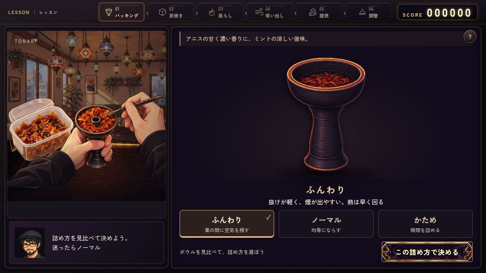
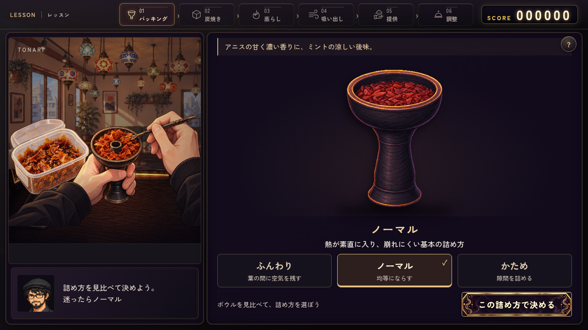
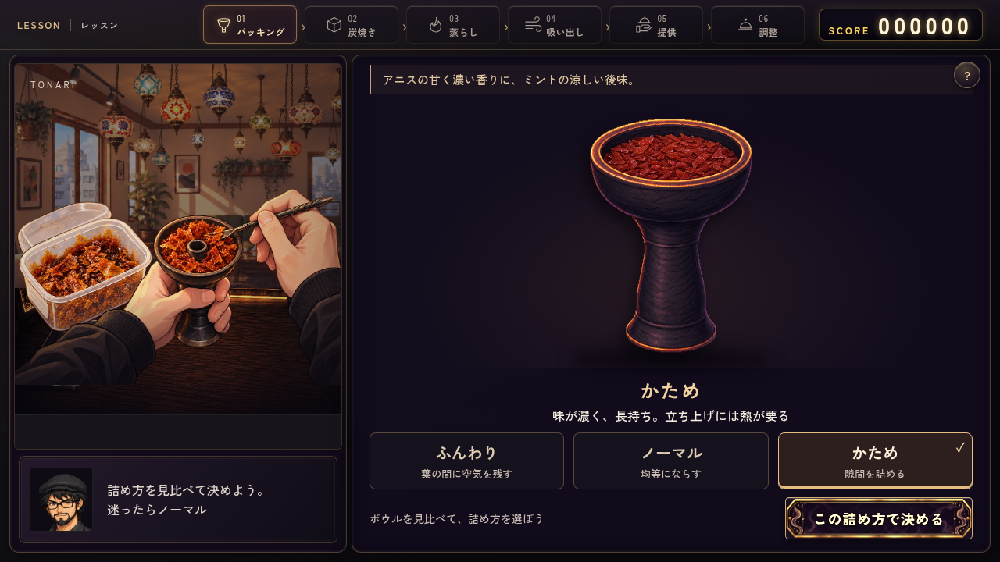
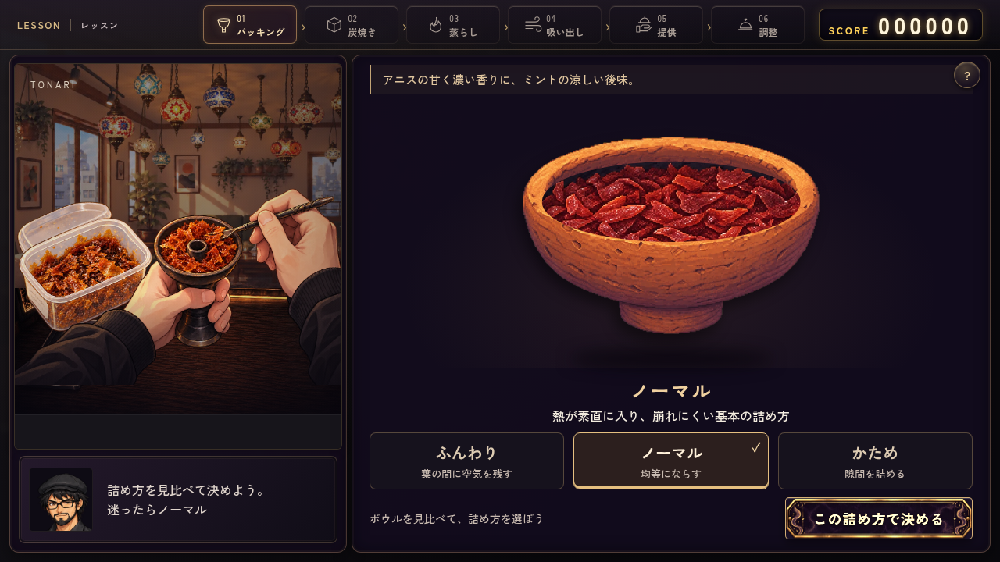
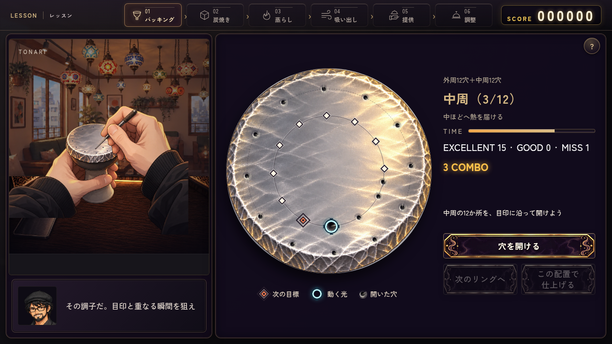
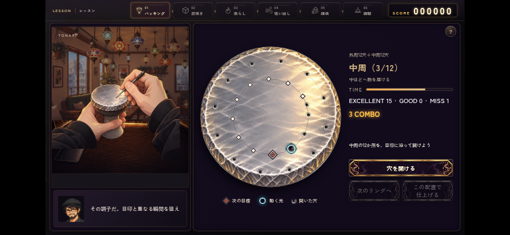

# #533 制作ミニゲームの操作対象

[試遊：詰め方から](https://raw.githack.com/haseatsu114514-dot/shisha-game/codex/533-craft-focus/remake/craft-preview.html) / [穴あけから](https://raw.githack.com/haseatsu114514-dot/shisha-game/codex/533-craft-focus/remake/craft-preview.html?step=holes) / [PR #535](https://github.com/haseatsu114514-dot/shisha-game/pull/535)

初回に外部コンテンツの案内が出た場合は「Open the page」で開く。本編セーブを読み書きせず、実際のパッキングと穴あけの工程を操作する。

## 詰め方を見比べる

中央のボウルの葉面を切り替え、短い特徴説明を読んでから確定する。選択中は配合・在庫・確定値を変更せず、確定後は選択を固定する。通常・ファンネル・素焼き系の器に対応。素焼きは採用済みの器と葉面を重ねる。葉の質感は既存の3差分を再利用している。

| ふんわり | ノーマル | かため |
| --- | --- | --- |
|  |  |  |



## アルミと穴あけの目印

既存の手元絵と実物写真を参照して、真上のアルミ表面を生成。右側の暖かい反射・左側の銀色の影・縁の細かな折り込みを揃えた。[生成前メモ・出典・検品](../../../asset_sources/craft-focus-issue533/README.md)。

目標は濃い輪郭のひし形。次の目標は二重枠と中央点、動く光は中が抜けた水色の輪。実際に開いた穴は小さな黒い穴・凹み・短い傷になり、失敗した穴も次のリングまで残る。次の目標の強調は操作案内だけで、開ける順番を強制しない。判定範囲内では実際の採点対象を強調する。





## 検証

2026-10-13、Chromium、PC 1280×720 / タッチ 844×390。変更コード `0436163`。画面は本番関数を呼び出して実際に操作したもの。

- `craft_materials.mjs`：7ケースPASS。3種の器×3種の詰め方、確定前の状態不変、確定後の固定、キーボード／実タッチ、目標と判定の一致、成功24穴＋失敗1穴の保持、手元絵との穴数一致、試遊の遷移と再読込でlocalStorage/sessionStorage不変、自動操作の既定ノーマル。
- `ch1_presentation.mjs`：10ケースPASS。既存の配合・確認後の味・在庫・素焼き葉面・評価画面を含む。新しい確定操作へ更新。
- `craft_templates_timing.mjs`：PC／横持ち／縦長3ケースPASS。テンプレ選択前は時計が動かず、キーボードで開始し、外12＋中12で従来どおり99点。既存の炭タイミング表示と枠内配置もPASS。
- `foil_holes.mjs`：PASS。24/0/0・12/12/0、未完成の仕上げ・リング飛ばし防止、時間切れ後の継続、解放フラグ、均等度・密度・共通温度への接続。見た目の追加で必要なDOMスタブだけ拡張し、採点の期待値は変更していない。
- 公開raw.githack試遊：初回案内の「Open the page」から開き、ふんわり選択→確定→穴あけ開始→Spaceで1穴を開けるまでPASS。ブラウザ例外・HTTPエラー0。[公開確認結果](public-preview.json)。
- `mix_recognition.mjs`、JS構文、`git diff --check`、`check_agent_docs.py`、Git Safety：PASS。
- ブラウザ7ケース・既存10ケースとも実行例外と失敗した素材リクエストは0。初回検査で目印凡例のはみ出しを検出し、余白を修正して再検証した。

本編の章通しプレイ・本番mainへの公開は未実施。初期レッスンの工程関数、試遊、関連回帰を確認した範囲。金色の装飾枠・配合量・採点・制限時間・穴テンプレート・温度計算は変更していない。

[操作テスト結果](craft-materials.json) / [既存画面の結果](ch1-presentation.json)

```bash
CHROME_EXECUTABLE_PATH=/usr/bin/chromium node remake/test/browser/craft_materials.mjs
CHROME_EXECUTABLE_PATH=/usr/bin/chromium node remake/test/browser/ch1_presentation.mjs
CHROME_EXECUTABLE_PATH=/usr/bin/chromium node remake/test/craft_templates_timing.mjs
node --experimental-vm-modules remake/test/foil_holes.mjs
node remake/test/mix_recognition.mjs
```
