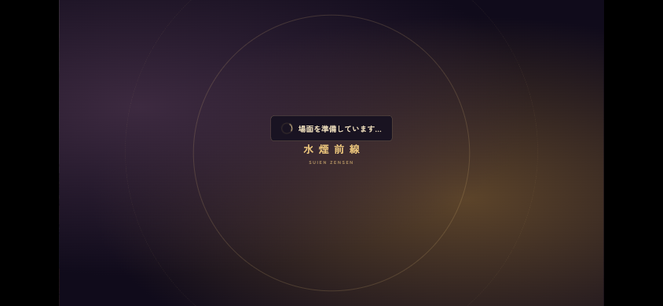
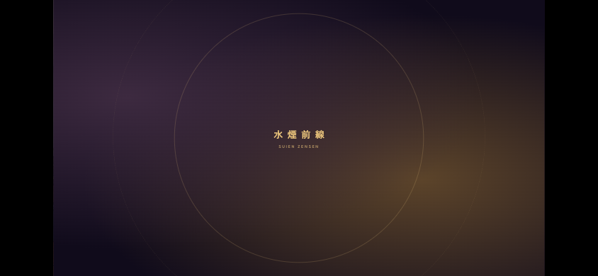
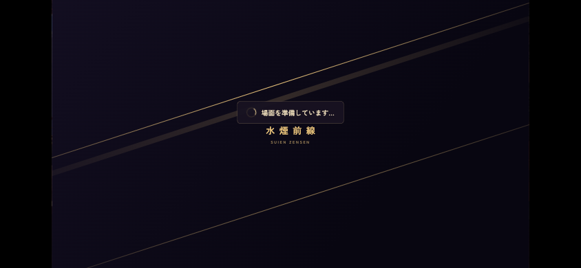

# 第1章の素材待ち表示 — Issue #609

旧8ファイルは元と同一のcommit `a2cf2bb49f8c294ef302782e4b79c6eab0c31c32`としてAPI保全した。Draft PRは #672。今回の統合基準は `913520169855dbe90208fdfd8d7186bb88abf4e1`。巨大pack取得・新clone・force pushはしていない。

## 原因と修正

実表示はVNの「場面を準備しています…」と制作の「作業台を準備しています…」。起動の「読み込み中……」、章題、ロゴ入り場面転換は別に観測した。

1. `setBg`の戻り値は画像取得・decodeだけでなく幕の演出完了まで待つ。VNの500ms／制作の220msの表示判定もその全体を待つため、取得済みでも準備表示が出た。`assetsReady`を分離し、表示は素材待ち、入力解禁は従来どおり演出完了を待つ。
2. `firstPortraits`が冒頭行に不要な後続表情まで開始条件にしていた。最初の実表示行に必要な立ち絵だけを待ち、後続は既存上限16枚の先読みと使用行の待ちに任せる。無言の同席者と話者が別なら両方を待つ。

既存15秒上限・エラー時再取得・演出時間・入力ガード・Promiseの戻り値を維持。CSSで表示を隠す、assertionやtimeoutを緩める、全素材を一括preloadする変更はない。

## 同一条件の章全体比較（旧base）

比較元 `4834e9eccb54d7aff466cac03bf784b5227e5735` と修正 `a2cf2bb`。Chrome155.0.8059.80／Playwright1.62.1、PC1280×720／touch844×390、localhost gzip・Range・600秒cache。外部HTTPを遮断し、外部CONTINUE曲は既存WebAudio fallbackを利用。Math.random=0.5、既存runnerのweatherSeed=4・seed/reel.seed=1を固定した。

既存playthroughを変更せずDay1–14、章題、昼夜、店移動、買い物、制作、大会敗北→再挑戦→優勝、CONTINUE/手動SAVE・LOADを通過。VN turbo・制作autoの固定経路であり、通常の読書時間・全分岐の測定ではない。

| 条件 | VN 回数／合計 | 制作 回数／合計 | 結果 |
|---|---:|---:|---|
| before-pc | 64回／50.966秒 | 15回／15.240秒 | PASS |
| after-pc | 0回／0.000秒 | 0回／0.000秒 | PASS |
| before-touch | 64回／50.951秒 | 15回／15.246秒 | PASS |
| after-touch | 0回／0.000秒 | 0回／0.000秒 | PASS |

両環境とも終了stateはsavedAt以外すべて一致（所持金107975、能力・在庫・flags・進行も一致）。修正前のVN64回／制作15回は、表示区間に画像通信・decodeが重なった回数がともに0。4条件の外部取得量は0bytes。会話ID91種を記録した。

意図的な場面転換130回／約141秒は維持している。準備表示の合計約66秒の削減を、そのまま章全体の時間短縮に換算しない。起動、章題、入店、decode、longtaskの詳細は[evidence.zip](evidence.zip)内のhistorical/summary.json。

## 初回・暖cache・制限回線

PC/touch × 通常localhost/128KiB毎秒・150ms × 初回/暖cacheを同じ手順で前後比較。制限は起動後に適用したため、制限回線でのboot測定ではない。初回は未読込の必須立ち絵232216bytesで、背景の既存先読みは維持。

- 暖cacheは画像リソース取得0件。準備表示は修正前約723–739msから0へ。最初の台詞hookは前後とも約1.23–1.24秒で、演出時間を維持。
- 制限回線の初回は必須画像を待ち、修正後も約1.43–1.45秒の準備表示が残る。台詞hookは前後とも約2.25–2.26秒。
- 実台本remake_tutorial_resultの後続スミ表情を1.8秒遅延した局所試験では、立ち絵のない冒頭hookがPC1845.4→3.7ms、touch1846.4→3.4ms。使用行では画像を待つ。これは人工遅延の再現値。

700ms時点の同条件比較（旧base、touch）：

| 修正前・暖cache | 修正後・暖cache |
|---|---|
|  |  |

低速回線の初回画像待ちでは表示を維持：

## 最新main統合と回帰

統合基準9135201の変更済みJS/CSS・第1章の読込JSONをAPIで取得しGit blob SHAを照合。未変更テキストも配信時に同SHAを検査した。今回の3ソースは統合候補を配信し、画像・音声は既存のローカル素材を再利用した。画面遷移の初回検証は新規商品画像8枚の404で1件失敗したため、その8枚（計182616bytes）だけをAPI取得・blob SHA照合して再実行した。失敗記録も保存した。新しい素材全体や公開版を検証したとは扱わない。外部ブラウザ通信は遮断。既存Chromeとアプリ同梱Playwright1.57.0を使用した。

| suite | 結果 |
|---|---:|
| ch1-loading | 14/14 PASS |
| ch1-title-motion | 12/12 PASS |
| save-load | 6/6 PASS |
| craft-readiness | 3/3 PASS |
| navigation-transitions | 7/7 PASS |

新しい統合後の章通し比較は実行していない。上の章全体数値は旧baseでの比較として保持し、今回の最新mainの数値に置き換えない。統合suiteの実結果は[integration.json](integration.json)、個別case・source hash・外部遮断記録はevidence.zip内integration/。旧実装での局所14件と既存回帰26件も保存している。

- #612は専用ch1-title-motionを呼び、ui.jsは共通依存。#612単体ではui.js/vn/engine.js/craft/session.jsは編集していなかった。今回はさらに最新mainの共通chapterTitleの動き（#643）をそのまま保持し、章題前後のAUTO/SKIP、画像遅延/破損/15秒timeout、取消し、LOAD中断・復帰を検証した。
- #646のsceneArtUrlsを含む背景cache keyを保持。家練習のbenchBgRef、runDrill venueも保持。
- #662/PR #666と共通のsession.jsは、#609のreadiness PromiseとAの見出しDOM/案内が別範囲。記録したHEADで3-way合成は衝突0。Aの未マージUIは本PRへ取り込んでいない。その後#662は取消・not plannedでclose、PR #666/#669/#671は未マージclose、予約run39095950394でreleaseされたことを最新台帳で確認した。比較記録は参考として保持する。

## 過去対策と残る範囲

PR #362 (#308)は同一背景での遅い初回立ち絵の案内と待機上限の再消費を改善したが、演出時間との混同と後続表情の開始前待ちは対象外だった。PR #541 (#503)は制作工程に必要な素材へ絞ったが、再入場テストは同じ背景で、背景変更後の演出待ちを検出しなかった。PR #302のSKIP/CG/実画像準備の保証は維持する。

素材容量・外部音声転送量・起動全体の改善は主張しない。物理端末/Safari、修正版公開、全物語分岐は未検証。独立レビュー用Draftを維持し、このタスクではマージしない。

最初の外部遮断設定がblob音源まで止めた失敗run、および接続断で途中終了したtouchはPASSから除外しローカルで保全した。旧公開版warm-probeのResourceTimingは既定buffer上限の可能性があるため、それ単独を全通信0件の証拠にしない。localhostのrequest/CDP観測を根拠とし、matrixのbufferは10000にした。

## 再現

既存PlaywrightをNODE_PATH、既存ChromeをCHROME_EXECUTABLE_PATHへ設定。最終HEADのcheckoutで`python3 remake/tools/serve_load_audit.py --port 8609`を起動し、BASE_URL=http://127.0.0.1:8609/remake/で上表の既存suiteを実行する。外部遮断の実使用ハーネスはevidence.zipのrecorded-harness/に保存した（実行当時のMac/taskパスを含む）。

新しい同条件比較には`remake/tools/serve_loading_baseline.py --ref 913520169855dbe90208fdfd8d7186bb88abf4e1 --port 8610`、`measure_ch1_loading.mjs`、`measure_loading_matrix.mjs`を使う。baselineサーバーは対象外のruntime差分がある場合に停止し、異なる版を同じ基準として配信しない。
