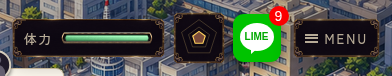
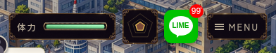
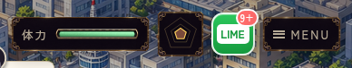
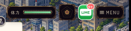
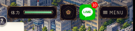
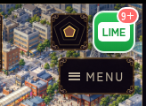
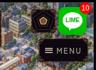
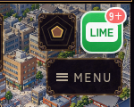
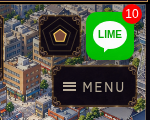
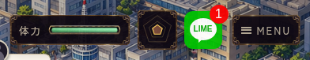

# LIMEの赤丸修正（#670）

緑の本体を縮まない48×48pxの正方形と白い吹き出しへ整えました。ui-art.cssの横長ラベル指定も除去しています。未読バッジを右上に重ね、添付参考に合わせて白ふちなしの赤い円と細い白数字にしました。赤丸は20×20px・right/top -8pxへ寄せ、数字は円の中心に固定。赤丸直径はアイコン48pxの約42%で、添付の約40%に合わせた比率です。円の中心はアイコン右端から2px内側・上端から2px下に位置します。外側に広がる波紋アニメーションも外しています。1桁は14px、2桁は12pxとし、1桁の余白が広く見える点を調整しています。1〜99件は実数、100件以上は中央の99と、その右上の小さい+（6px）を表示します。+は絶対配置にし、数字の中央位置を動かしません。`daily.css`に2か所あった位置・寸法指定を1か所へ統合しています。

- 変更前: `928dd4c3e5b27f1668c107b045212fadc56e785b`
- 実装・最終ブラウザ検証: `2998fe5327e78edc0d900bfcc0ff984797dd48e7`
- 予約: worker `codex-lime-badge-20261018-0354` / [成功run 39102811864](https://github.com/haseatsu114514-dot/shisha-game/actions/runs/39102811864)。現在bot台帳との一致と実noticeを確認してから編集。

本体の変更はCSSと`setPhoneBadge`の描画DOMです。オーナーの追加指定により、従来の9+上限を99+へ変更しています。未読計算・0件非表示・ARIAの実件数・既読処理・保存形式は維持しています。#579の施設素材・本編接続、#540の店舗ロゴ・来店演出、解禁条件、#661/#667の一括案も変更していません。

## 同条件の画像比較

1件の参考表示: 

| 9件 | 10件 |
| --- | --- |
|  |  |
| 99件 | 100件（99+） |
|  |  |

各行は同じviewport・DAY4昼・seed131・所持金90000・未読10件（変更前9+／変更後10）・フォント・reduced-motion設定で撮影したHUDの切り抜きです。画像リンク先は全画面です。

| 条件 | 変更前 | 変更後 |
| --- | --- | --- |
| PC 1280×900・通常 | [](before-pc-normal.jpg) | [](after-pc-normal.jpg) |
| PC 1280×900・DS | [](before-pc-ds.jpg) | [](after-pc-ds.jpg) |
| タッチ横844×390・通常 | [](before-landscape-normal.jpg) | [](after-landscape-normal.jpg) |
| タッチ横844×390・DS | [](before-landscape-ds.jpg) | [](after-landscape-ds.jpg) |
| タッチ縦390×844・DS | [](before-portrait-ds.jpg) | [](after-portrait-ds.jpg) |

タッチ縦390×844・通常表示は、既存の「スマホは横向きでお楽しみください」が全面に出ます。[変更前](before-portrait-normal.jpg) / [変更後](after-portrait-normal.jpg)。この条件は背面HUDの寸法だけを測定し、実タップ成功には含めていません。案内の撤去や縦専用UI化は今回の範囲外です。DS縦表示では実タップを確認しています。

## 検証結果

専用ブラウザチェックは変更前6条件・変更後6条件すべてPASS。Chromiumのマウス／タッチエミュレーションで、実機Safariではありません。

- 変更後0→1→9→10→99→100→999→9→0件: 表示／非表示、実数と99+の境界、ARIAの実件数を確認。変更前は0→1→9→10→0件を記録。
- 9・10・99・99+で、数字の縦横中心と円の中心の差が0.1画面px未満。+は数字の右上にあり、数字の半分の大きさ。
- 変更前の9+は24.6406×20 CSS px。変更後は20×20 CSS pxで、ステージ縮小後も縦横比1:1を維持。
- 1桁・2桁・99+の全件数で、赤丸の座標と直径が完全一致することを各条件で確認。
- アイコン本体の縦横比1:1と、右上への赤丸の重なり、文字の収まり、viewport内への収まり、STATUS/MENUとの矩形重複なしを確認。
- 既読フラグ→既存`unreadCount()`→`setPhoneBadge()`の連携で1→0となり、バッジが消えることを確認。
- 表示更新でゲームstateが変わらないことを確認。バッジ表示中もSTATUS・LIME・MENUの実クリック／タップが各1回届くことを5条件で確認。
- ページ実行エラー0。未読の配信・既読時点・保留・再配信などの既存回帰`lime_consistency.mjs`もPASS。
- `git diff --check` PASS。

測定値: [変更前JSON](before.json) / [変更後JSON](after.json)。数値の矩形は画面上のpxで、通常表示は1280×720ステージの拡縮を含みます。既読チェックはフラグと表示の接続確認で、全LIMEシナリオの通しプレイではありません。

## 再実行

リポジトリルートで既存プレビューを起動し、実装コミット上で次を実行します。

```sh
python3 remake/tools/serve_preview.py --port 8123
# 別ターミナル
TEST_REF=$(git rev-parse HEAD) CHROME_EXECUTABLE_PATH=/usr/bin/chromium node remake/test/browser/lime_badge.mjs
node --experimental-vm-modules remake/test/lime_consistency.mjs
```

変更前画像は上記baseコミットのCSSを使って`BASELINE=1`で記録しました。現在のCSSで`BASELINE=1`を使うと変更前記録を上書きするため、比較を取り直す場合はbase用worktreeと別の`ARTIFACT_DIR`を使ってください。この専用チェックはCIワークフローへ追加していません。

## 参照

オーナー添付のアプリ画面と[Appleの通知バッジの説明](https://developer.apple.com/design/human-interface-guidelines/notifications)を参照。円形固定・99+上限・+の右上配置は今回の明示指定で、OS標準の全挙動を再現するものではありません。

## 添付に合わせたサイズ調整

赤丸を24pxから20pxへ縮小。1桁の数字は16→14px、2桁は14→12px、+は7→6pxへ比例調整しました。1桁・2桁・99+で円の位置とサイズは共通です。

| 件数 | 調整前 | 調整後 |
| --- | --- | --- |
| 1件 |  |  |
| 99件 |  |  |
