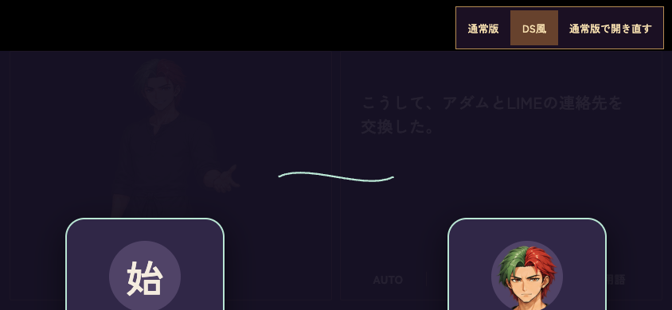
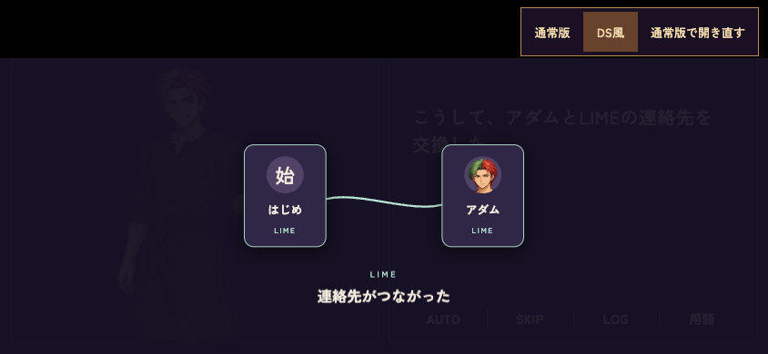
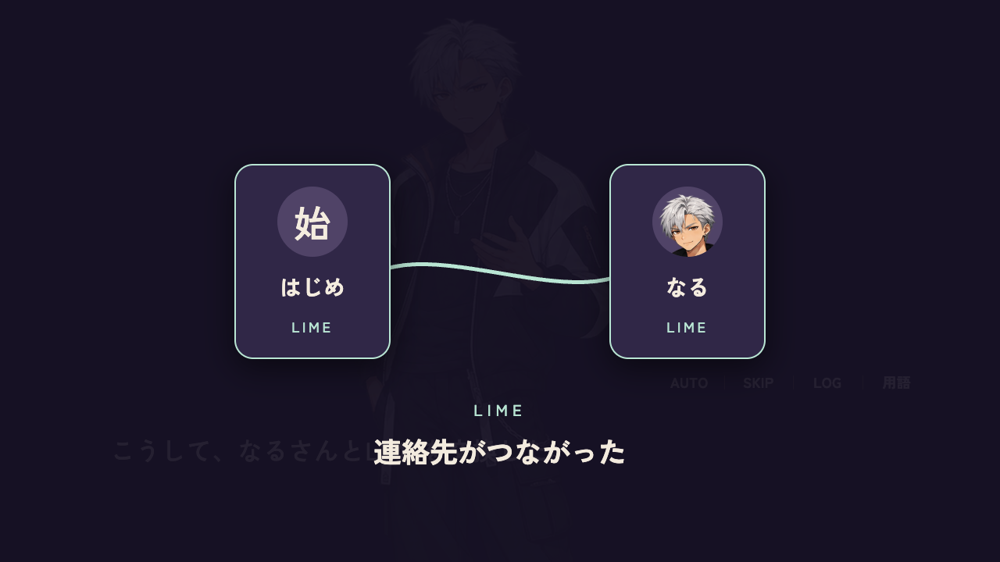

# LIME交換演出のstage fitting — #774 / PR #778

1280×720固定構図の採用済み交換演出を可変stage全体へfitする。
既存画像・文字・音・交換条件・一度きり判定・保存schemaは変更しない。

## 実ブラウザで確認した欠陥

DS横844×390ではstageが844×326になる一方、修正前のカードはtop210px・高さ250px、
見出しはtop510px。元のmotionを同じ本番VN/DSレイアウトで実行すると、
カードは下端で切れ、見出しは画面外になる。収容assertionも修正前だけ失敗した。





修正はLIME専用1280×720コンテナの中央fitとResizeObserverの終了時解除だけ。
背景はstage全面を維持する。報告者本人の相手・画面・設定・セーブ状態は情報不足で未特定。
本記録は再現できたstage欠陥の修復証拠であり、元報告の全経路を特定した証拠ではない。

## 検証結果

- `node --experimental-vm-modules remake/test/lime_fit_774.mjs`: PASS。
  PC1280×720・横DS844×326・縦390×622、resize、正常/例外cleanup、SE1回、
  初回/繰返し抑止、旧contacts、SKIP、動き軽減。main統合でengineが変わったため今回再検証。
- `node --experimental-vm-modules remake/test/lime_save_774.mjs`: PASS。
  実state/save/load/手動枠/migrateとengine分岐、Map storage/代替演出による局所検証。
  なる/アダム初回・交換後LOAD抑止、schema17旧contacts、SKIP後LOADを確認。
- `node remake/test/browser/lime_exchange_774.mjs`: PC/横持ちタッチ2ケースPASS。
  本番shell/CSS、VN engine、実際の交換branch、scene wrapper/motion、DS layout、
  saveFlow/loadFlow/slot保存・読込を使う局所ブラウザ検証。
  手動枠を実clickし、交換前SAVE→新state→LOAD→初回演出1回、
  交換後SAVE→新state→LOAD→再演出0回、savedAt以外の全state復元を確認。
  PCはscale1、横DSはscale0.452777…、カード/見出しの実rect収容を確認。
  pageerror0。favicon404のみ対象外として記録し、ゲームresourceの404は0。
  [生の測定結果](results.json)。スクリーンショットも目視確認した。
- 修正前moduleを同じ横DSテストへ渡すと収容assertion失敗（上記before画像）。
- 構文検査、diff whitespace、Git Safety: PASS。

ブラウザテストは本編boot/loadAll・全章・実visitChar・実機Safariを走らせない。
実交換branchだけを本番エンジンに渡す。モジュール、DOM、animation、storage、保存UIは代替しない。
Chrome/Playwrightは既存導入分、sandbox有効。先のsandbox内SIGABRT後、実行環境の変更承認を
受けたため再確認できた。初回fixtureのサーバーパス誤りと不足resourceは検査対象を確認して修正し、
同条件の不明な再試行ではない。assertionは緩和していない。

実行例（既存Playwright/Chromeを使う場合のみ環境変数を指定）:

```sh
PLAYWRIGHT_MODULE=/path/to/playwright-core/index.mjs \
CHROME_PATH='/path/to/Google Chrome' node remake/test/browser/lime_exchange_774.mjs
```

`LIME_SOURCE`で修正前lime.js、`QA_ONLY=touch`で修正前の横DSだけを検証できる。
`QA_OUT`は証拠出力先。全ゲーム起動や全章検証の代替とはしない。

## 保存・予約・境界

担当 `codex-b-lime-20261021-774`、pickup39500193768 success、bot6301843686のowner/run一致を
再開時に確認。旧handoff39486565024 stopped/pushedと保存HEAD4b863d9を保全し、同じbranchを継続。
main `ea0229dbd6635299b78faba04c4956f28a9e0577` をmerge commit d6f7e749で統合済み。
#775/PR794・並行PRの製品ファイルには追加編集しない。

通信量の旧上限超過（累計本文/pack18,393,686 bytes）はIssueに保全する。
その後07:32–07:33 JSTの本人承認で上限・GitHub書込み禁止・main merge禁止は撤回された。
これは未検証のmerge条件を免除する承認ではない。

提出HEADのCI、最新main、正式なSequential merge read-only preflightとサーバー強制条件を
最終確認する。preflightは現policy未承認、main保護APIはBranch not protectedと返している。
これらを緑色checkや手動確認で置き換えない。公開はmergeされるまで未確認。
