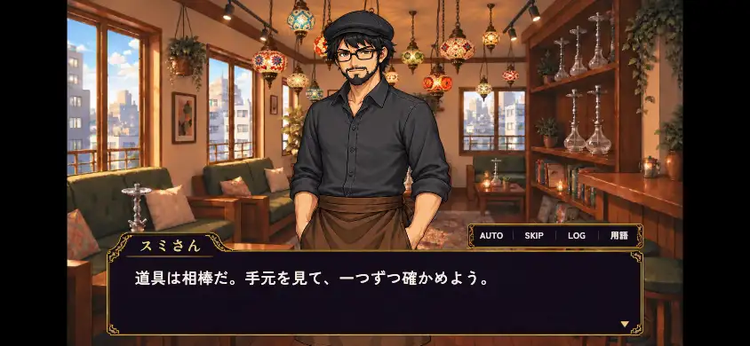
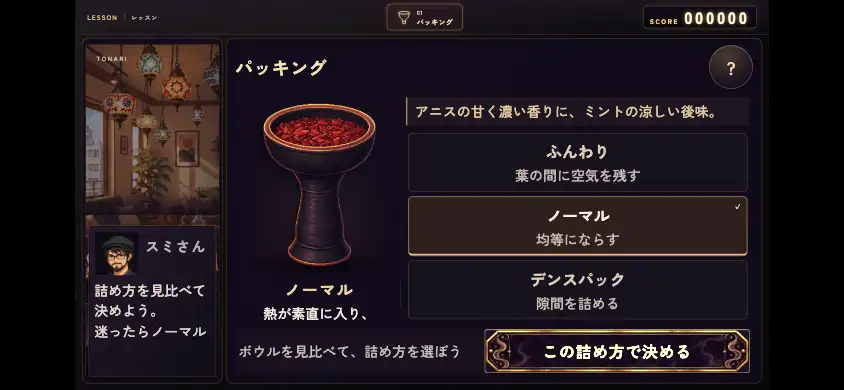
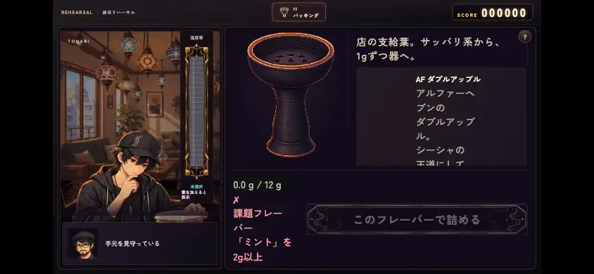
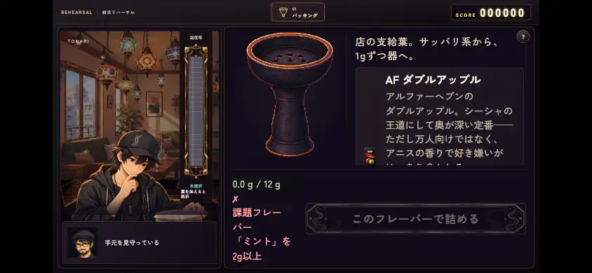
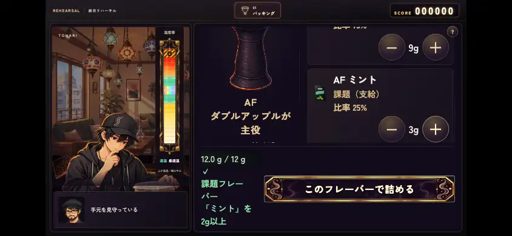
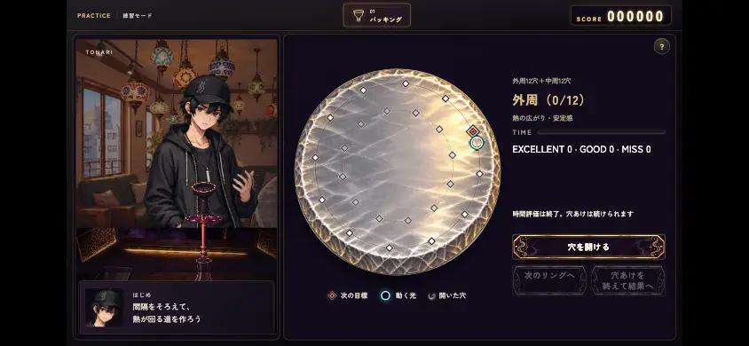
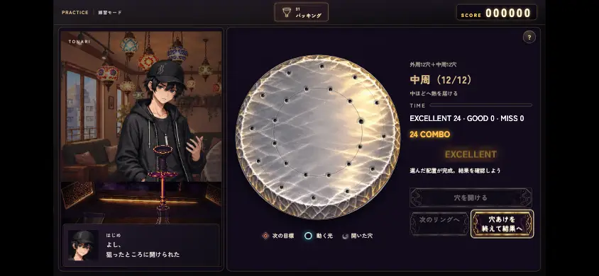
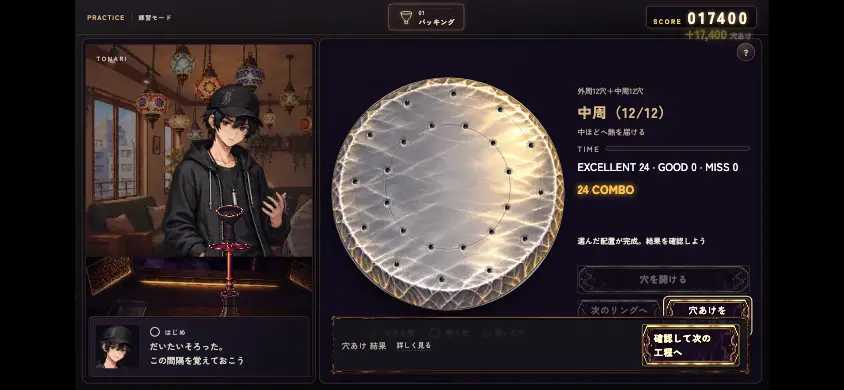

# Three focused UI checks with production modules

The scope is PR748 dialogue-window placement, PR757 foil completion wording, and PR759 normal-phone landscape setup/mix/pack/place. This is an isolated production-module/input check with real bundled fonts and adopted art, not a chapter playthrough, public deployment check, or physical-device test. No main boot, chapter, resumeGame, image generation, CI, install, account configuration, or existing browser profile was used. Image PR752 remains explicitly held and was not operated on.

The shared runtime/data/art are pinned to `df3d9897b94a9f4d8e5a628ebb85b890ba7255a9`; each PR's changed file is an exact-head overlay. Latest-main integration is untested: `state.js`, `audio.js`, chapter/daily code and coordination infrastructure changed since that base. Main at pre-save recheck was `da2c4a17263a8332301961b9713c59c1cdee6595`. Existing source/cache files were reused only after Git-blob verification. [Source manifest](source-manifest.json), [asset manifest](asset-manifest.json).

| Target | Production source and result | Limits / retained failures |
| --- | --- | --- |
| 748 | HEAD4195bc7; real VN engine, five font faces and adopted dialogue SVG/portrait/background/button art. Base/head × PC1920×1080 and Chrome coarse844×390. Normal advance, AUTO, exclusive SKIP, choice callback, actual saveToSlot/loadFromSlot and same-scene reopen passed in all4. The window/controls moved2 design px: PC+3 physical, phone+1.08333; dimensions/x/choice position unchanged. | Strict Ctrl-held→AUTO remains FAIL in both desktop cases and PASS in both touch cases. Mouse trace is pointerdown/mousedown/contextmenu/pointerup/mouseup, with no click delivered to AUTO. Dialogue is still active: not an end-reset. This is macOS native control-click in this environment, present in both base/head; it does not identify the separately reported Linux/732 failure. Expected assertions were not weakened. Reopen is not per-line or chapter resume. |
| 757 | HEADaeff796, holes blob `f0168cef799879ebf79aaeda1b7e2cbc1d647537`. PC1920×1080 and Chrome coarse844×390, keyboard-zero-time and mouse/touch runs:4 PASS. Actual35-second wait, no virtual clock or direct hole-state assignment. UI outer12+middle12, all24 punched by actual CDP inputs. Ring/finish/result rapid inputs, disabled extra punches, exactly one resolution, two-stage wording and Tab focus checked. | Existing scaled phone layout is small; this is not a14px/44px guarantee. Audio, physical phone, chapter, public site and chapter LOAD untested. No holes source changed. |
| 759 before this commit | HEADc709f2a:20 actual step-input cases complete after3 localhost-bootstrap retries. Actual2-flavor DOM additionally exposed a CSS cascade failure: old caption+2-row rule won, giving29.25px buttons, narrow name columns. This FAIL is retained. | Initial38/41 static fixtures did not cover this production row-count rule. A component PASS was not treated as real-module completion. |
| 759 fix in this commit | CSS blob `7b1b8986196bcb0ec29f9609f7888885a4bef483`; test blob `ed8d34854f6c000c0796553c89fcdbcdc3c5ec3c`. Five phone-mix-only overrides repair that exact rule. Static53 PASS, oldc709 fails the new2-row case. Actual mix PC/phone × preview hidden/visible:4 PASS, native +/-→12g confirm. Phone buttons44.095px/name16px/children fit. PC decoded pixels and outer/guide/thermometer/legend/label geometry unchanged. Independent review confirms the old/new cause,44px result, touch-tail reach and focus. | Common CSS, steps, temperature/timer/score/save/progression and other steps unchanged. Mix's existing small audience/help and other-stage mobile work remain other-owner boundaries. Ordinary production worker caption/name text is intentionally hidden; footer rectangle non-overlap is not a claim of visible worker-name text. |

The two product files changed are `remake/css/craft-landscape.css` and `tools/test_craft_landscape_static.mjs`. The runtime index link is unchanged from the existing PR. The static helper uses pure production text wrapping; actual checks import unmodified production modules and call `loadAll`, VN, session and individual steps. Disposable QA state and fixed text/audio timing are local to fresh contexts; existing user/account settings and saves were not read or changed.

## Selected actual screens

| Dialogue, 844×390 | Packing, 844×390 |
| --- | --- |
|  |  |

| Mix before the cascade fix | Mix after the fix / scrolled controls |
| --- | --- |
|  |   |

| Foil time0 | All24 / result confirmation |
| --- | --- |
|  |   |

PNG foil screens were only converted to WebP at unchanged dimensions; no generative image editing was used. [PC dialogue](748-vn-pc.webp) and [evidence manifest](evidence-manifest.json) record originals/hashes. Additional equivalent PNGs remain local and are not part of this small upload.

## Evidence and reproduction

- [VN/original craft report](vn-craft-original-qa.md), [foil report](holes-qa.md), [foil compact results](holes-summary.json), [mix fix report](mix-fix-qa.md), [independent mix review](independent-mix-review.md), [invariants/pixel comparison](comparison.json), [old-source expected failure](expected-c709-failure.json).
- `raw/*.json.gz` preserves full assertions, measurements and failures. Decode with Python standard-library `gzip`/`json`; hashes and uncompressed sizes are in the evidence manifest. Initial missing-art, localhost connection, and old-source CSS failures are retained, not overwritten or changed to PASS. The QA server backlog was increased5→128 after the local bootstrap failures; those were harness infrastructure failures, not product findings.
- `harness/` contains the actual-module wrappers and CDP runners. They need an already-present system Chrome/Node and a localhost snapshot assembled from the pinned manifests/cache. They do not install dependencies. The snapshot server uses `/base`, `/748`, `/757`, `/759` roots, with exact changed-file overlays. Do not run its code against a different tree while claiming these results, reuse a real browser profile, or fetch additional inputs without the applicable communication approval. The scripts are QA artifacts, not a new public game entrypoint.
- New static regression: use the checked-in `tools/test_craft_landscape_static.mjs` with `CRAFT_SOURCE_ROOT` pointing at the verified existing snapshot/checkout, `CRAFT_REGRESSION_CSS` selecting old/new CSS, `CRAFT_ARTIFACTS` a disposable output folder. It uses installed Chrome and no game progression.

## Network, reservation, CI and remaining gates

All external acquisition/upload is through the parent broker and one20MiB ledger. Known file sizes are checked before each pinned raw request, curl/stream size is bounded and every downloaded asset is hash-verified. Unknown external page origins are blocked, no warm-all-UI/title/chapter flow is called. Final launch flags also disable proxy/domain reliability and map external DNS to NOTFOUND. Earlier launches had background networking/component update disabled and page interception; browser-wide wire traffic and tool/TLS/proxy framing are unmeasured.2MiB of the20MiB is held unused for unmeasured transport. Loopback request counts/body sizes are separate local traffic, not an external fetch. [Ledger before this evidence upload](transfer-before-save.json); final Issue701/PR comments record later measured upload/metadata stages within the same budget.

747 stays parked under its original worker;748 code was not edited. 754 and756 retain their original claims. This is saved on756's existing branch with expected-head comparison and `[skip ci]`; no automatic/manual CI dispatch or rerun was requested.748's existing11 exact-head SUCCESS checks are reused.757 and the new759 head have no Actions result; local tests are not Actions SUCCESS. Existing Draft/review/ownership/dependency/conflict conditions remain. Main protection/queue conditions are not bypassed. The unapproved sequential-merge prototype is not an additional general-PR reviewer-count/allowlist requirement.

Original13 and additional4 requests remain tracked in Issue701. Other reserved dialogue, inventory/save, thermometer, foil layout/audio and coal work are not restarted or completed by these focused checks. No merge or publication verification has occurred.
