# 施設絵の地図接続（#579）

観音堂・家・喫茶・斧投げBar・チョイザップ・路上占い・ボドゲカフェを、場所を表す施設絵にしました。絵の透過輪郭に3pxのアイボリー（#fff3df）のふちと、下方向3px・ぼかし6px・不透明度45%の柔らかい影を付け、施設の背後にあった四角い看板を外しています。通常は96px、DSは56px。大きさは前回のまま、ふちを2→3pxへ少し太くしました。柔らかい影も維持しています。選択した施設だけ淡い金色に光ります。

既存の`assets/ui/map-facilities-579.png`は原画とバイト一致のまま再利用。追加絵は採用背景を参照して作成し、原画・生成指示・参照順・ハッシュを`asset_sources/map-facilities-579/`へ保存しました。配信用WebPは465,736 bytes、透過のアルファ値は生成原画と完全一致です。

## 対象と素材

| 場所 | 使用する絵・参照 |
| --- | --- |
| 観音堂 | 既存シート左の寺院を再利用 |
| 家 | 既存シート中央の部屋を再利用 |
| 喫茶こはく | 既存シート右のコーヒーと焼き菓子を再利用 |
| 斧投げBar | `bg_axe_lounge_night.png`の木の的・金網・暖色照明・赤い座席 |
| チョイザップ | `bg_choizap.png`の緑白の内装・ランニングマシン・運動器具 |
| 路上占い | `bg_street_day.png`の木の店先と路上タロットの施設設定 |
| ボドゲカフェ | 採用プレビュー`bg_cafe_day.png`の木・籐椅子・赤い席とボードゲーム卓 |

シーシャ店、Dr.fookah、C.STATIONの既存ロゴと来店演出は保持。チョイザップも来店時の採用ロゴは維持し、地図だけ施設絵に変更しました。人物・ゲスト・イベント通知は既存の行へ残しています。未解禁と未対面の「？」は絵や施設名に置き換えません。

施設の座標は、文字や営業状況の高さに左右されず、絵の中心が背景の地点に合うようにしました。未解放の「？」も同じ地点です。店舗の座標・来店演出は保持し、マップのロゴ窓を92×52→82×46px、看板幅を100→90pxへ縮小。顔は店名を含むボタン全体ではなく、看板の左上を基準に配置。長い店名でも顔と店ロゴの位置がずれません。3人並ぶときは通知マークを右側で少し下げ、顔との重なりを避けます。DSの人物行は従来の位置です。

| 施設 | 絵の中心座標（%） | 配置の目安 |
| --- | --- | --- |
| 観音堂 | 18, 57 | 背景左下の大きなお堂の屋根 |
| 家 | 89, 44 | 右側の住宅ビル |
| 喫茶こはく | 72, 45 | 中央右の商店街沿い |
| チョイザップ | 20, 24 | 左上のビル街 |
| 斧投げBar | 38, 74 | 下側の路地の店舗 |
| 路上占い | 63, 69 | アーケード脇 |
| ボドゲカフェ | 48, 15 | 上側の街区。第2章の店舗とも離して配置 |

新スポットが判明して地図へ戻ると、ピンが約0.64秒弾み、白金の輪とNEWが現れます。複数なら90msずつずらし、1.6秒で装飾を片付けます。演出中も選択可能。動きを減らす設定では拡縮しません。[演出中の実画面](larger/unlock-pop.jpg)。

再生履歴は読み込んだゲームのオブジェクトに紐付く表示専用メモリで管理します。既存セーブの最初の地図は静かに表示し、その後の解禁・正体判明・第2章追加だけを再生。地図の開き直しや占い師の定期再出店では繰り返しません。保存データへ演出フラグを追加せず、別ゲームには持ち越しません。

施設の解禁条件、営業時間、料金、体力、移動先、報酬、保存形式、#661/#667の一括UIは変更していません。

今回の追加調整では7施設それぞれに、不透明な絵の右側の輪郭上へ通知の基準点を指定しました。矩形の右上には置かず、「！」の丸がふちに少し重なる位置へ隣接させています。横長のお堂や、透明な余白の多いコーヒーでも離れません。DSでも通知サイズを保ち、絵と接する位置を再計算します。丸の中の「！」もArial・余分なpaddingなしで中央に揃えました。占いとボドゲカフェは拡大後の営業表示・第2章店舗との間隔だけ微調整しています。

LIMEの白い吹き出し内の文字は上paddingを2px足し、字面を約1px下げて中央に補正。赤い未読バッジのサイズ・位置・件数処理は変更しません。

| LIME（同じPC・未読99件）変更前 | 変更後 |
| --- | --- |
| 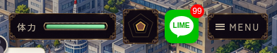 | 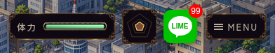 |

## 同条件の変更前後

今回の変更前はPR #675の96px・ふち2px版（ソース`501c3876`、QA追加後head `b6fdec00`）、変更後の実装は`cd6be0ce`。各組は同じviewport・表示方式・DAY3・seed131・所持金90000・昼/夜・面識/解禁状態で撮影しています。通常のタッチ縦表示は既存の回転案内をそのまま撮影しています。

| 条件 | 変更前 | 変更後 |
| --- | --- | --- |
| PC 1280×900 昼 | 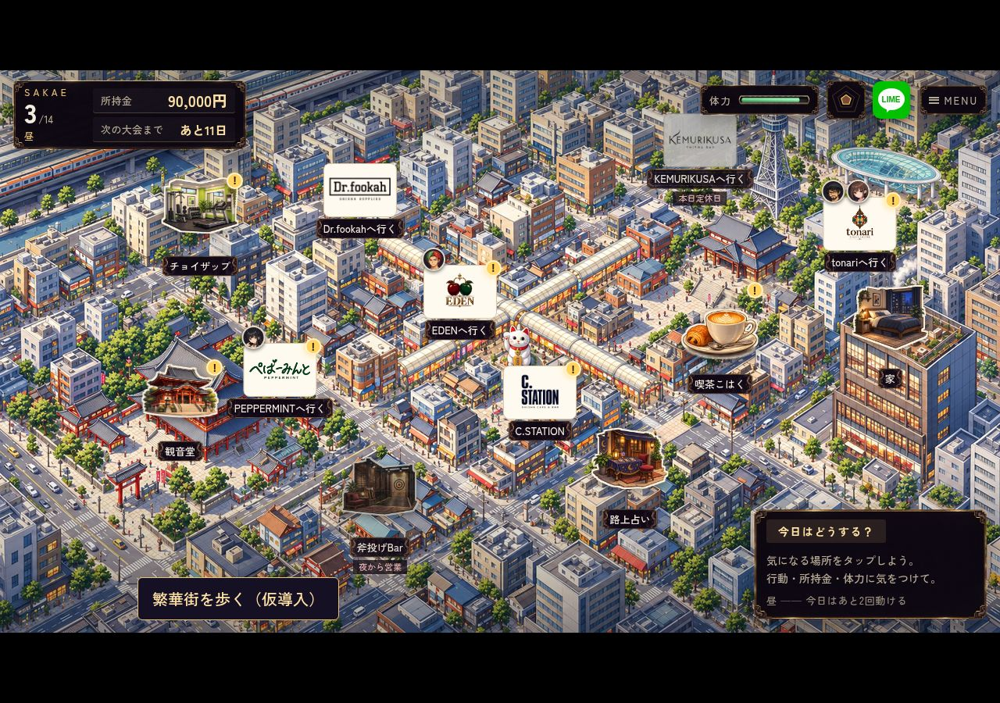 | 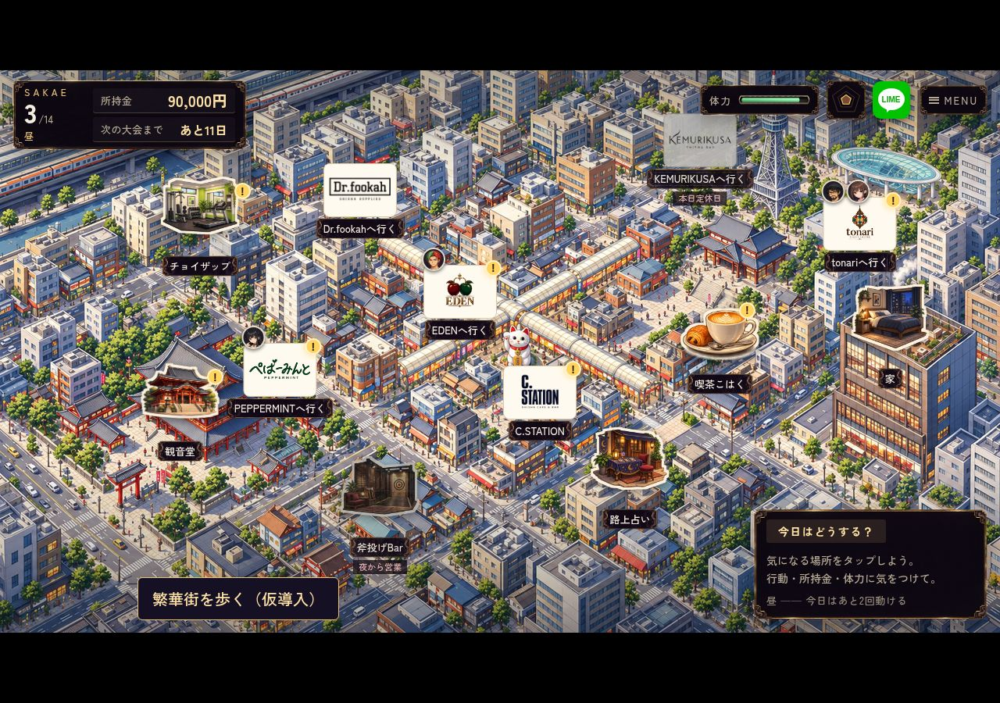 |
| PC 1280×900 夜 |  | 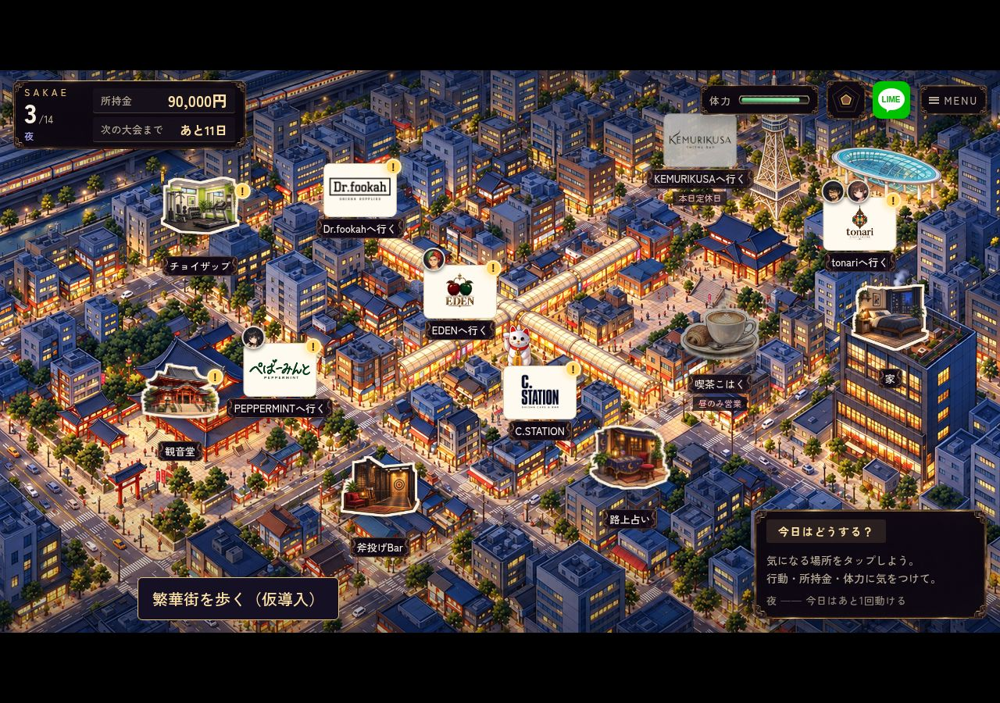 |
| PC DS | 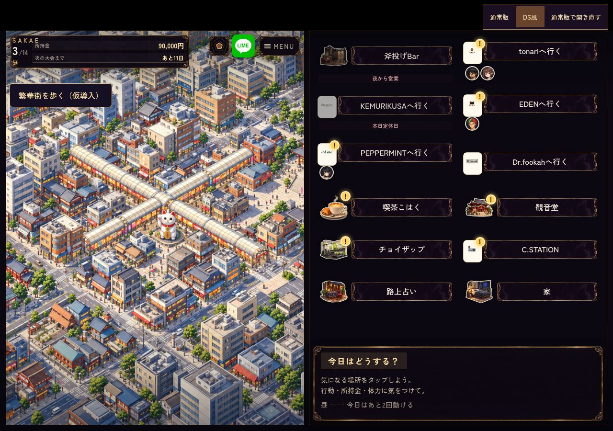 | 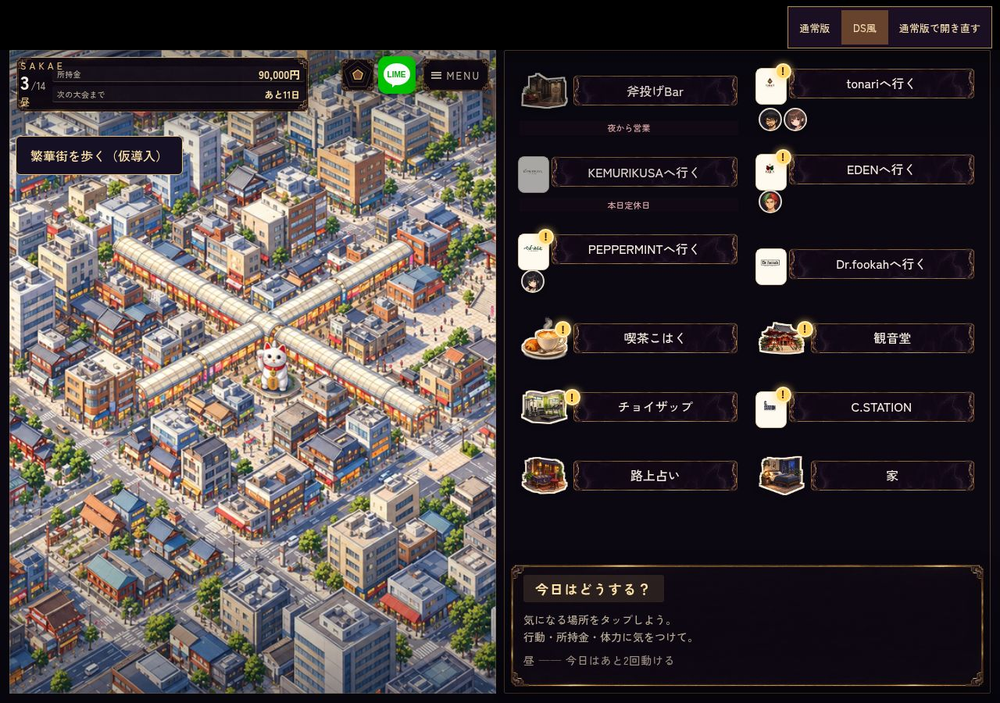 |
| タッチ横844×390 |  | 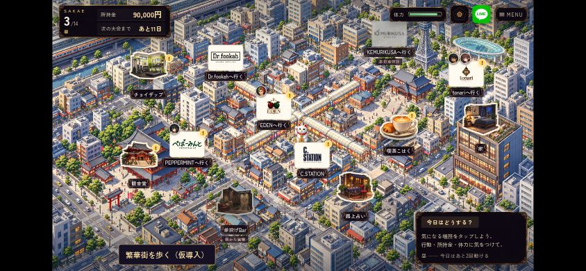 |
| タッチ横DS |  | 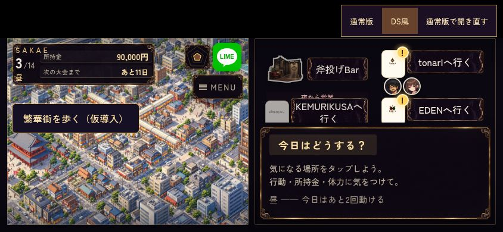 |
| タッチ縦390×844 DS | 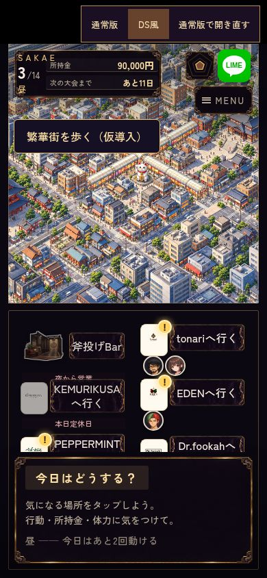 |  |
| 第2章の施設表示fixture |  | 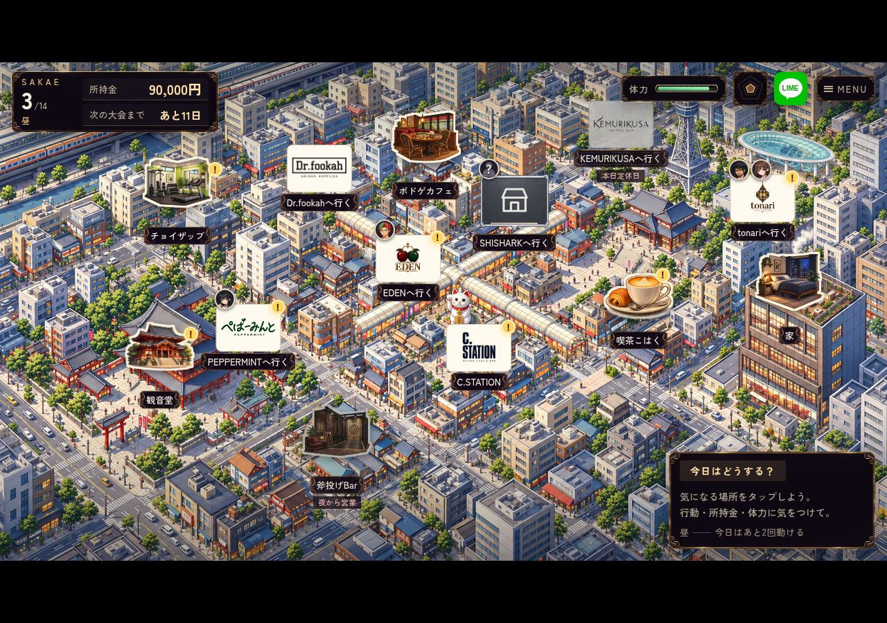 |
| 未解禁・未対面 | 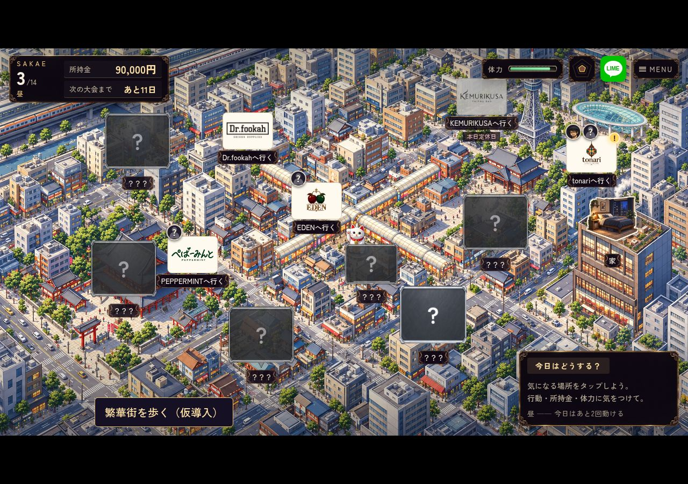 |  |

[通常縦の変更前](larger/after-portrait-normal-day.jpg) / [変更後](contact/after-portrait-normal-day.jpg)。通常縦は背面DOMと回転案内の維持だけを検証し、実タップ成功には含めていません。DS縦では実タップを検証しました。


<details>
<summary>7施設それぞれの「！」の接し方</summary>

各スポットへeventPinを指定した検査画像です。常時すべてに通知を出す変更ではありません。

| 施設 | 検査画像 |
| --- | --- |
| 観音堂 | 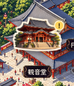 |
| 家 | 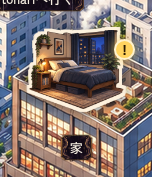 |
| 喫茶 | 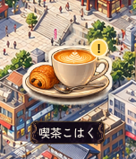 |
| 斧投げBar | 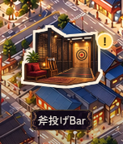 |
| チョイザップ | 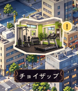 |
| 路上占い | 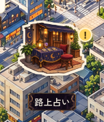 |
| ボドゲカフェ | 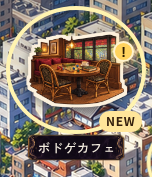 |

</details>

## 検証

- `facility_icons.mjs`: 既存PNGの完全一致・元ハッシュ・アルファ領域・隣の絵の混入なし・追加WebPの透過一致・配信容量・施設対応と縦横比 PASS。
- `browser/facility_icons.mjs`: asset_sourcesなし、`/shisha-game/`配下に実行用5ファイルだけを置く公開相当検査。PC/タッチ横/縦×7施設×明暗×6サイズ＝各84選択、計252選択PASS。保存sentinel不変、ページ/通信エラー0。[測定](contact/preview/browser-results.json)。
- `browser/facility_map.mjs`: PC/タッチ横/縦×通常/DSの6条件それぞれ昼・夜・第2章・未解禁・旧アクセスフラグ相当の5状態＝30状態PASS。前後で同じfixtureを使用。絵の表示・秘密の非表示・店舗ロゴ維持・論理タッチ領域・通常縦以外の画面上44px以上・施設ピン同士の重なりなし・表示/選択でstate不変を確認。
- 通常縦以外の5条件で、施設6か所の実クリック/タップ選択と、夜の旧アクセスフラグを持つ斧投げBarの行き先確定PASS。旧アクセスフラグfixtureであり、全世代のセーブ移行や自然進行の通しプレイではありません。
- `browser/map_guests.mjs`: 在店/未知人物・ゲストとイベントバッジ・保存・移動の6ケースPASS。
- `store_logos.mjs`: 地図・全7ブランドの来店演出・SKIP/動きを減らす設定・読込失敗等18 UIケースPASS。地図のジム表示への期待値だけ更新し、来店ロゴの検査対象は減らしていません。
- `navigation_transitions.mjs`: 通常速度の家/店/問屋・遅い画像・場面の置換・動きを減らす設定の7ケースPASS。
- `compact_gains_map.mjs`: 3画面サイズの通知・報酬・施設・既読・休業・移動PASS。地図のジム絵への期待値を更新。
- `browser/map_reveals.mjs`: PC・横タッチ・縦DS・動きを減らすDSの4条件PASS。面識による施設解禁、占い師の正体判明、第2章の追加、斧投げBarの解禁を確認。初回/再表示/定期再出店/別ゲームでの誤再生なし、演出中の選択成功、state不変。[測定](larger/unlocks.json)。
- 今回の30状態・顔表示6ケース・来店ロゴ18ケース・解放演出4条件・独立配信252選択を再実行PASS。顔表示では長い店名でも看板左上へ揃うことを追加検証。通知3サイズは前回の検証です。施設絵の中心と地図座標の一致、未解禁表示、各操作領域の重なりも確認しました。演出と地図30状態の検査はCIにも追加。
- `browser/lime_badge.mjs`: PC/横タッチ/縦タッチ×通常/DSで0・1・9・10・99・100・999件と再表示を確認PASS。未読0非表示、99+の位置、隣接操作、既読後の非表示、state不変を維持。[測定](larger/lime/after.json)。
- 今回は昼夜等30状態と、7施設×6表示の通知強制表示42条件を検証PASS。元画像のalphaを調べ、全7基準点が不透明な絵の右端にあることを確認。画面上でも「！」の中心がその輪郭に隣接することと、保存不変を確認しました。通知の出る条件は変更していません。
- `git diff --check` / Git Safety PASS。

Chromiumエミュレーションで、実機Safariは未実施。AUTOを使った全シナリオ通し再生は未実施です。素材・地図表示の変更で、VN・会話送り・乱数・解禁判定は変更していません。

[変更前測定](larger/after.json) / [変更後測定](contact/after.json) / [独立配信検査](contact/preview/browser-results.json)。実装検証コミットは`contact/after.json`の`ref`を参照してください。初回接続時のmainとの比較は[元の変更前](before-pc-normal-day.jpg) / [初回接続後](after-pc-normal-day.jpg)に保全しています。

## 担当切替の記録

オーナーの「既存担当はもうわからない　ここでやって」に基づく引継ぎ作業です。[#579への記録](https://github.com/haseatsu114514-dot/shisha-game/issues/579#issuecomment-6246937158)。保存済みPR #585の絵と成果を保全して別ブランチで進めています。

bot予約は旧worker/run38764988212のままで、正式移管済みではありません。旧workerの停止や未公開差分の有無を確認したとは記録していません。CLI認証と接続ツールの制約によりActions切替は未実行。bot markerの手書き・旧ID流用・旧ブランチへの書込みは行っていません。

## 再実行

既存プレビュー`python3 remake/tools/serve_preview.py --port 8123`を起動した別端末で:

```sh
node remake/test/facility_icons.mjs
ARTIFACT_DIR=docs/qa/map-facilities-579/contact/preview CHROME_EXECUTABLE_PATH=/usr/bin/chromium node remake/test/browser/facility_icons.mjs
TEST_REF=$(git rev-parse HEAD) CHROME_EXECUTABLE_PATH=/usr/bin/chromium ARTIFACT_DIR=docs/qa/map-facilities-579/contact node remake/test/browser/facility_map.mjs
```

変更前はbase用worktreeで`BASELINE=1`と別の`ARTIFACT_DIR`を指定してください。現在のコードで変更前画像を上書きしないでください。

解放演出の再実行: `CHROME_EXECUTABLE_PATH=/usr/bin/chromium node remake/test/browser/map_reveals.mjs`。
