# 施設絵の地図接続（#579）

観音堂・家・喫茶・斧投げBar・チョイザップ・路上占い・ボドゲカフェを、場所を表す施設絵にしました。絵の透過輪郭に3pxの白ふちを付け、施設の背後にあった四角い看板を外しています。通常は64px、DSは半分の表示サイズです。

既存の`assets/ui/map-facilities-579.png`は原画とバイト一致のまま再利用。追加絵は採用背景を参照して作成し、原画・生成指示・参照順・ハッシュを`asset_sources/map-facilities-579/`へ保存しました。配信用WebPは465,736 bytes、透過のアルファ値は生成原画と完全一致です。

## 対象と素材

| 場所 | 使用する絵・参照 |
| --- | --- |
| 観音堂 | 既存シート左の寺院を再利用 |
| 家 | 既存シート中央の部屋を再利用 |
| 喫茶こはく | 既存シート右のコーヒーと焼き菓子を再利用 |
| 斧投げBar | `bg_axe_lounge_night.png`の木の的・金網・暖色照明・赤い座席 |
| チョイザップ | `bg_choizap.png`の緑白の内装・ランニングマシン・運動器具 |
| 路上占い | `bg_street_day.png`の木の店先と路上タロットの施設設定 |
| ボドゲカフェ | 採用プレビュー`bg_cafe_day.png`の木・籐椅子・赤い席とボードゲーム卓 |

シーシャ店、Dr.fookah、C.STATIONの既存ロゴと来店演出は保持。チョイザップも来店時の採用ロゴは維持し、地図だけ施設絵に変更しました。人物・ゲスト・イベント通知は既存の行へ残しています。未解禁と未対面の「？」は絵や施設名に置き換えません。

ボドゲカフェは既存のEDENと重なっていたため、そのピンの地図座標だけを`(48,46)`→`(52,20)`へ調整。施設の解禁、営業時間、料金、体力、移動先、報酬、保存形式、#661/#667の一括UIは変更していません。

## 同条件の変更前後

base: `a34c074ef86616738b66312b359b3b6dcb31a15e`。各組は同じviewport・表示方式・DAY3・seed131・所持金90000・昼/夜・面識/解禁状態で撮影しています。通常のタッチ縦表示は既存の回転案内をそのまま撮影しています。

| 条件 | 変更前 | 変更後 |
| --- | --- | --- |
| PC 1280×900 昼 | 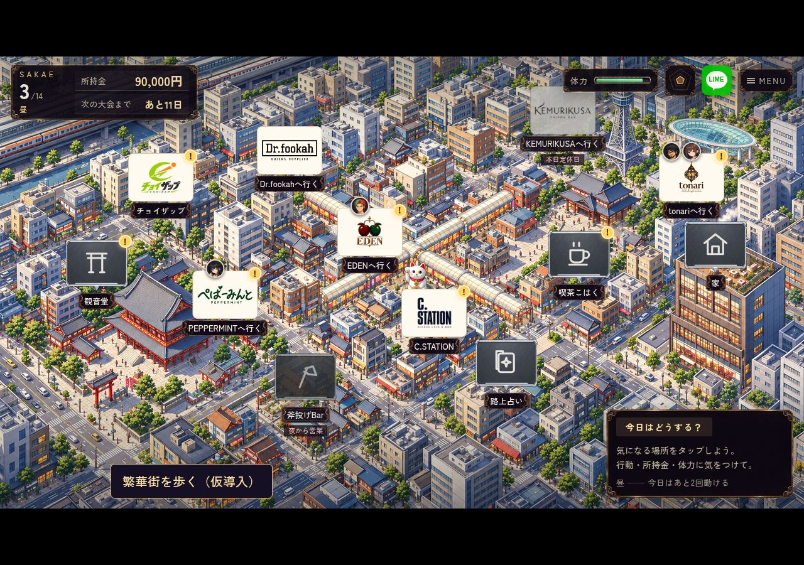 | 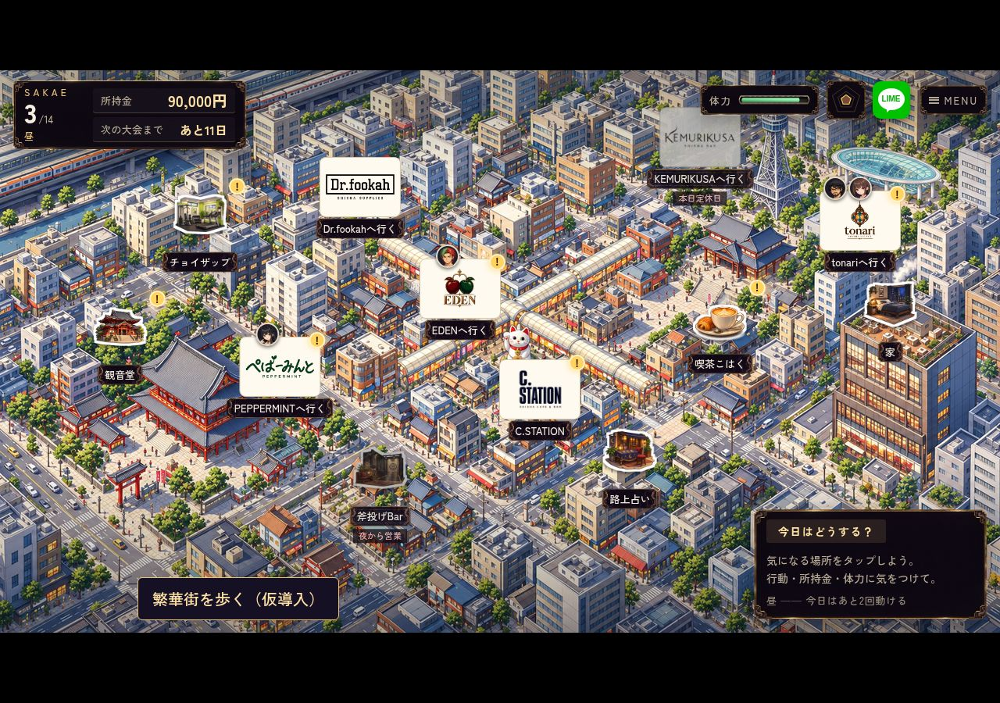 |
| PC 1280×900 夜 | 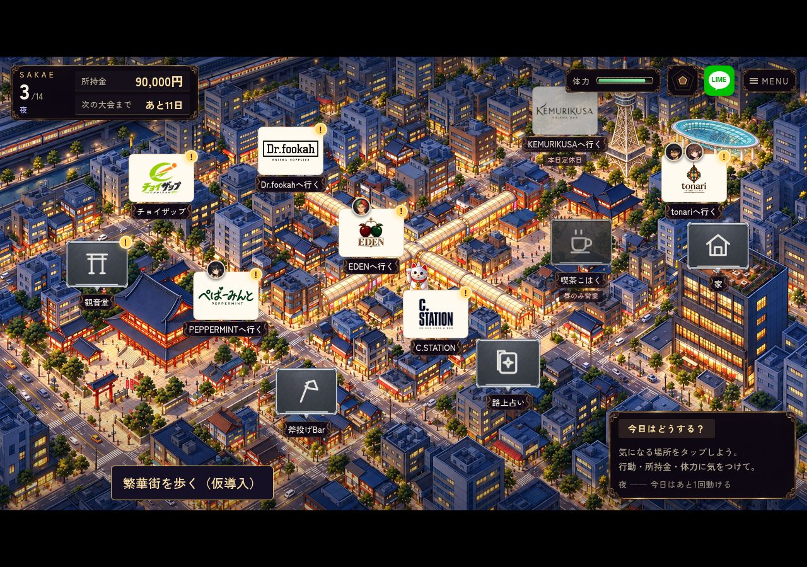 | 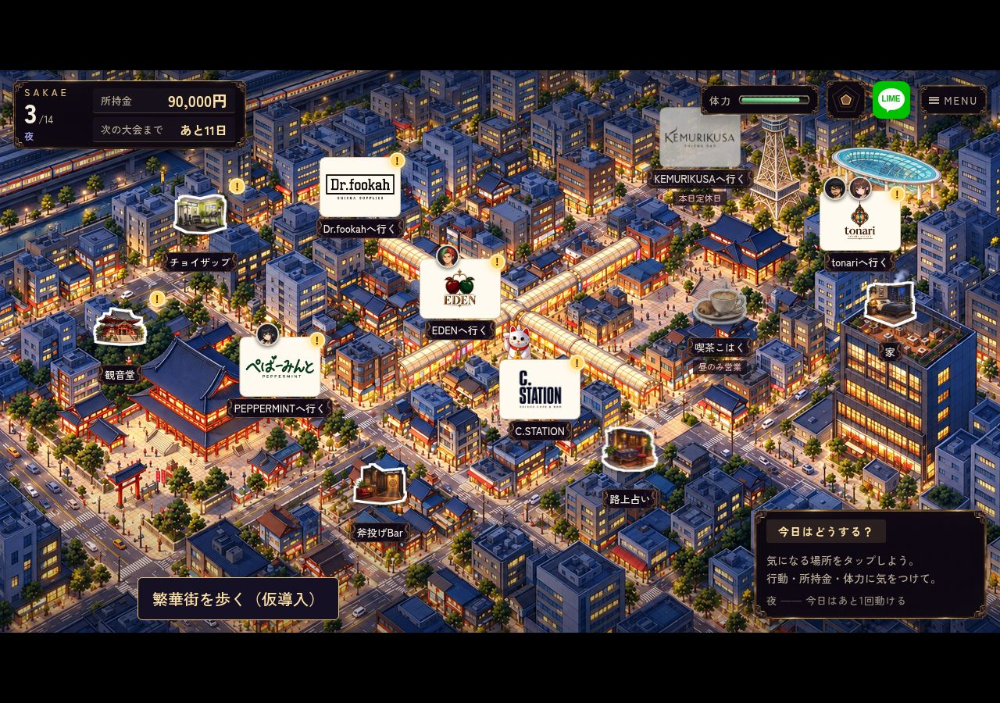 |
| PC DS | 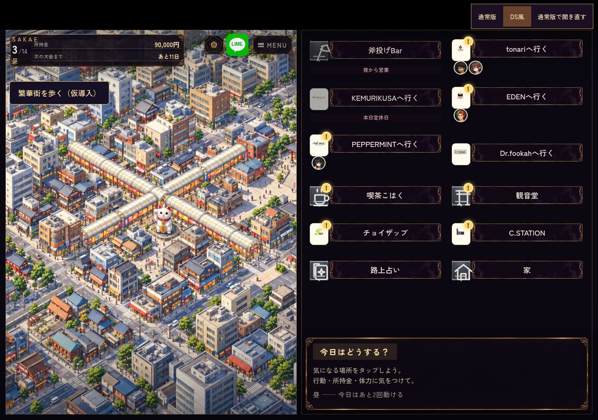 | 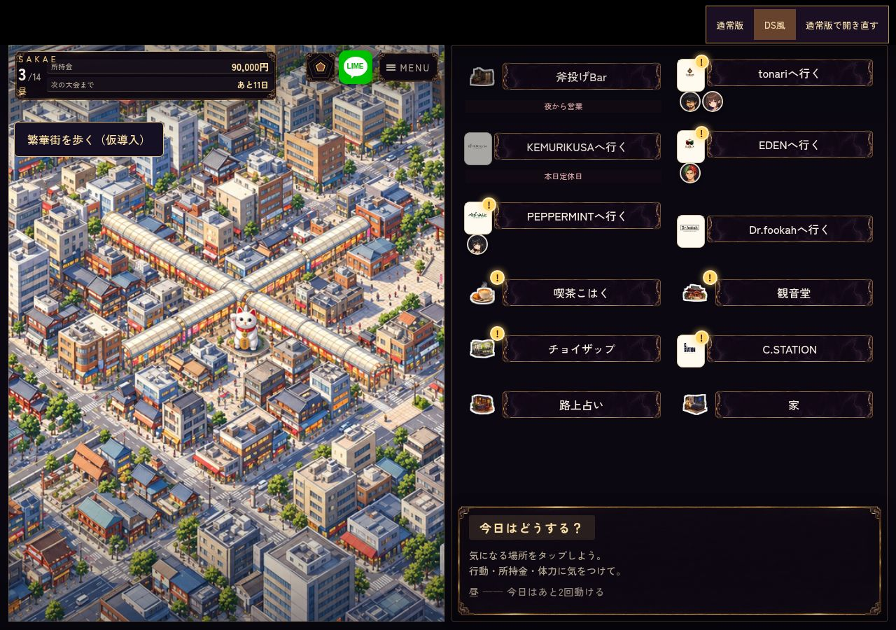 |
| タッチ横844×390 | 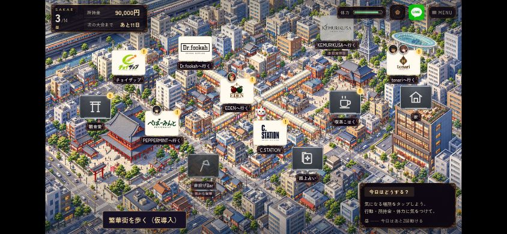 | 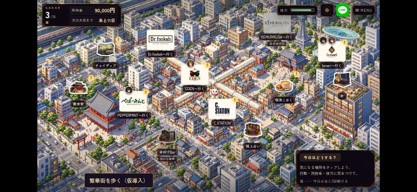 |
| タッチ横DS |  |  |
| タッチ縦390×844 DS | 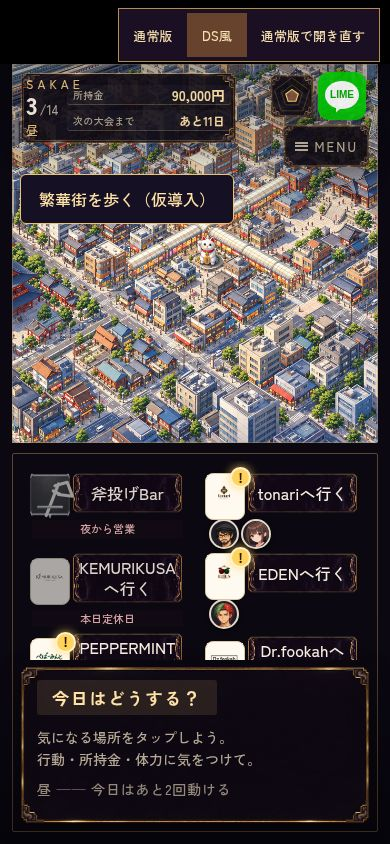 |  |
| 第2章の施設表示fixture | 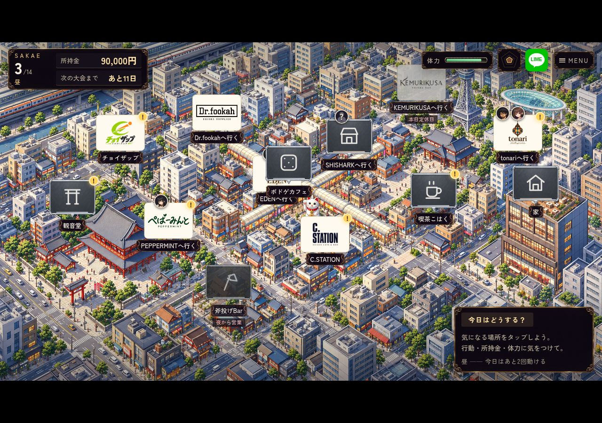 | 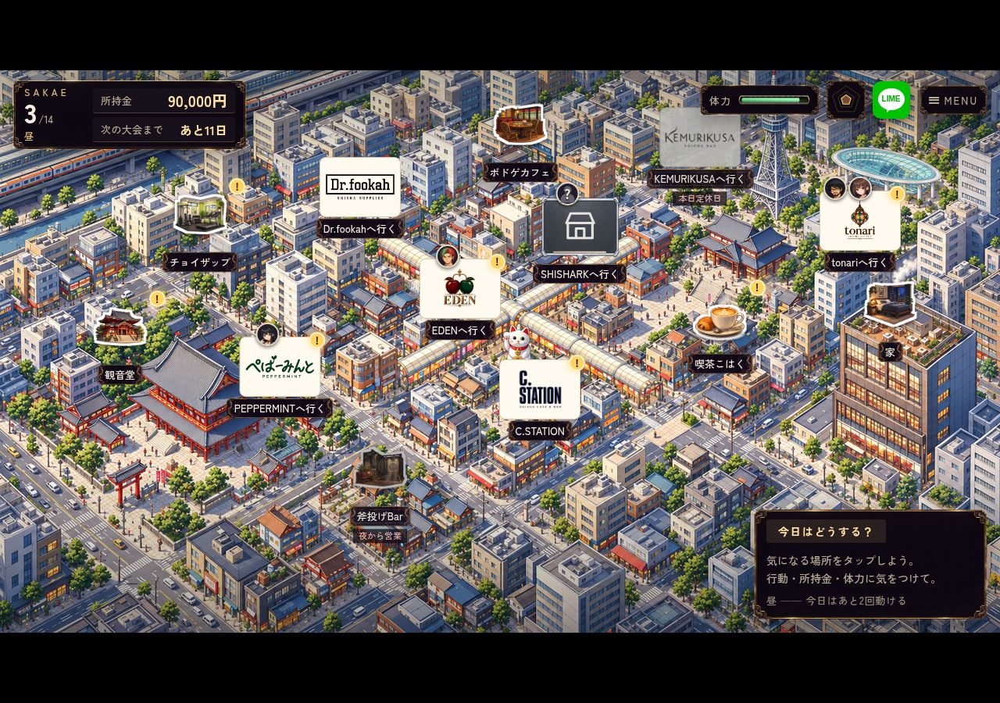 |
| 未解禁・未対面 | 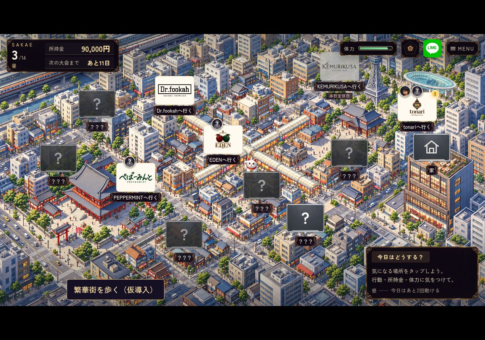 | 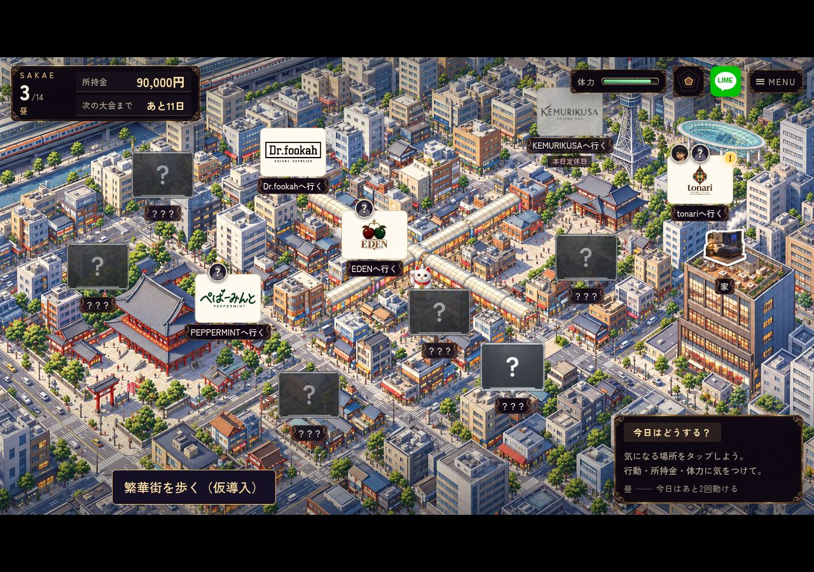 |

[通常縦の変更前](before-portrait-normal-day.jpg) / [変更後](after-portrait-normal-day.jpg)。通常縦は背面DOMと回転案内の維持だけを検証し、実タップ成功には含めていません。DS縦では実タップを検証しました。

## 検証

- `facility_icons.mjs`: 既存PNGの完全一致・元ハッシュ・アルファ領域・隣の絵の混入なし・追加WebPの透過一致・配信容量・施設対応と縦横比 PASS。
- `browser/facility_icons.mjs`: asset_sourcesなし、`/shisha-game/`配下に実行用5ファイルだけを置く公開相当検査。PC/タッチ横/縦×7施設×明暗×4サイズ＝各56選択、計168選択PASS。保存sentinel不変、ページ/通信エラー0。[比較PC](preview/pc.jpg) / [タッチ](preview/touch.jpg) / [縦](preview/portrait-touch.jpg)。
- `browser/facility_map.mjs`: PC/タッチ横/縦×通常/DSの6条件それぞれ昼・夜・第2章・未解禁・旧アクセスフラグ相当の5状態＝30状態PASS。前後で同じfixtureを使用。絵の表示・秘密の非表示・店舗ロゴ維持・論理タッチ領域・通常縦以外の画面上44px以上・施設ピン同士の重なりなし・表示/選択でstate不変を確認。
- 通常縦以外の5条件で、施設6か所の実クリック/タップ選択と、夜の旧アクセスフラグを持つ斧投げBarの行き先確定PASS。旧アクセスフラグfixtureであり、全世代のセーブ移行や自然進行の通しプレイではありません。
- `browser/map_guests.mjs`: 在店/未知人物・ゲストとイベントバッジ・保存・移動の6ケースPASS。
- `store_logos.mjs`: 地図・全7ブランドの来店演出・SKIP/動きを減らす設定・読込失敗等18 UIケースPASS。地図のジム表示への期待値だけ更新し、来店ロゴの検査対象は減らしていません。
- `navigation_transitions.mjs`: 通常速度の家/店/問屋・遅い画像・場面の置換・動きを減らす設定の7ケースPASS。
- `compact_gains_map.mjs`: 3画面サイズの通知・報酬・施設・既読・休業・移動PASS。地図のジム絵への期待値を更新。
- `git diff --check` / Git Safety PASS。

Chromiumエミュレーションで、実機Safariは未実施。AUTOを使った全シナリオ通し再生は未実施です。素材・地図表示の変更で、VN・会話送り・乱数・解禁判定は変更していません。

[変更前測定](before.json) / [変更後測定](after.json) / [独立配信検査](preview/browser-results.json)。実装検証コミットは`after.json`の`ref`を参照してください。

## 担当切替の記録

オーナーの「既存担当はもうわからない　ここでやって」に基づく引継ぎ作業です。[#579への記録](https://github.com/haseatsu114514-dot/shisha-game/issues/579#issuecomment-6246937158)。保存済みPR #585の絵と成果を保全して別ブランチで進めています。

bot予約は旧worker/run38764988212のままで、正式移管済みではありません。旧workerの停止や未公開差分の有無を確認したとは記録していません。CLI認証と接続ツールの制約によりActions切替は未実行。bot markerの手書き・旧ID流用・旧ブランチへの書込みは行っていません。

## 再実行

既存プレビュー`python3 remake/tools/serve_preview.py --port 8123`を起動した別端末で:

```sh
node remake/test/facility_icons.mjs
ARTIFACT_DIR=docs/qa/map-facilities-579/preview CHROME_EXECUTABLE_PATH=/usr/bin/chromium node remake/test/browser/facility_icons.mjs
TEST_REF=$(git rev-parse HEAD) CHROME_EXECUTABLE_PATH=/usr/bin/chromium node remake/test/browser/facility_map.mjs
```

変更前はbase用worktreeで`BASELINE=1`と別の`ARTIFACT_DIR`を指定してください。現在のコードで変更前画像を上書きしないでください。
