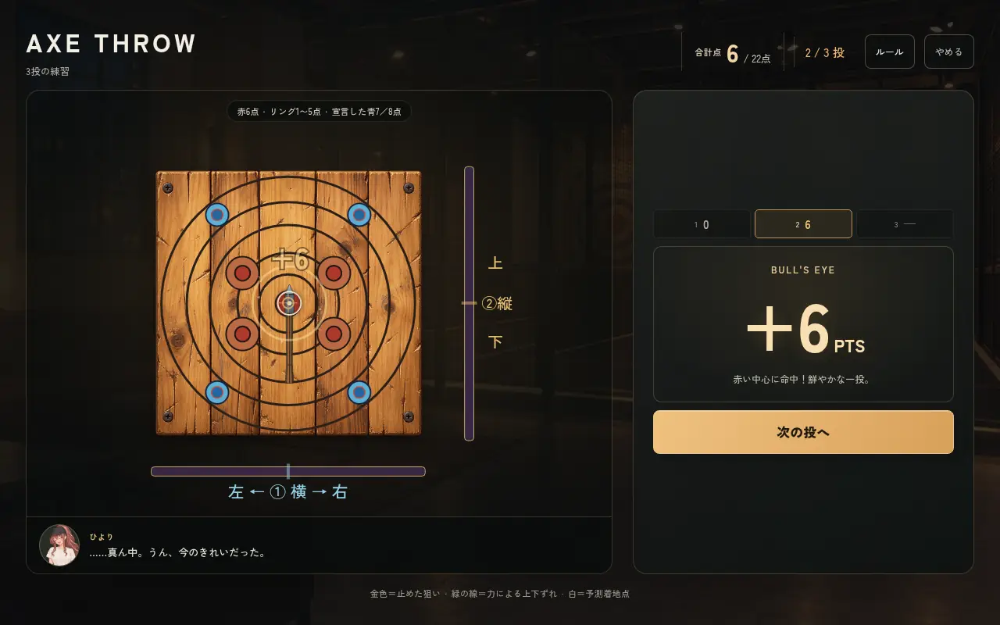
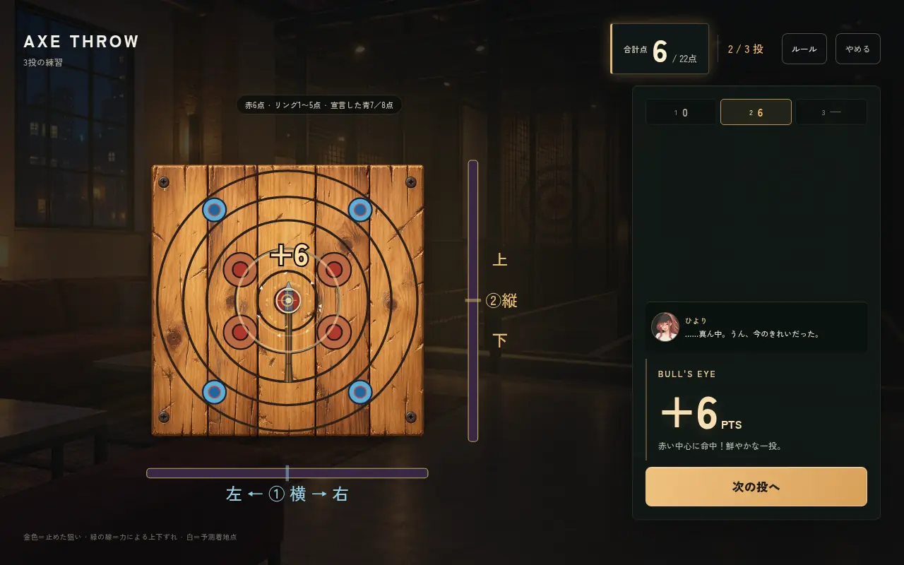
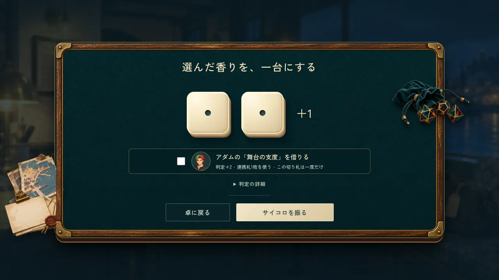
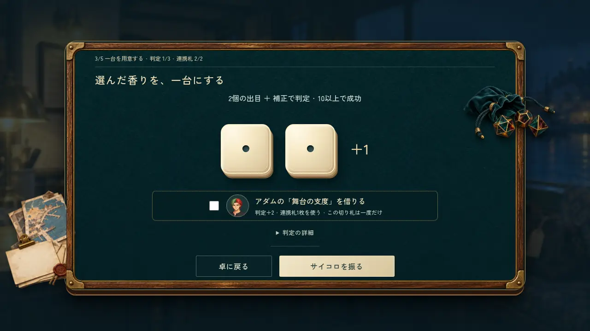
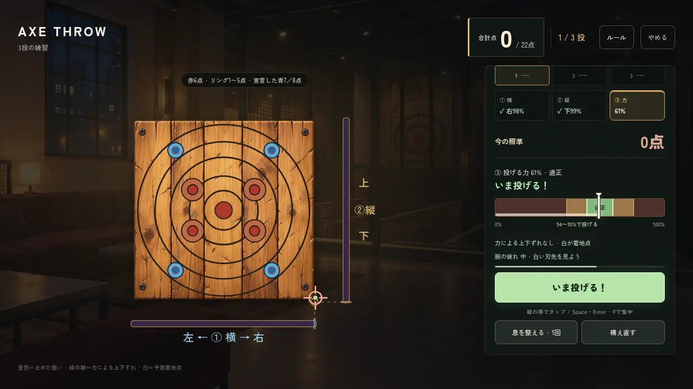
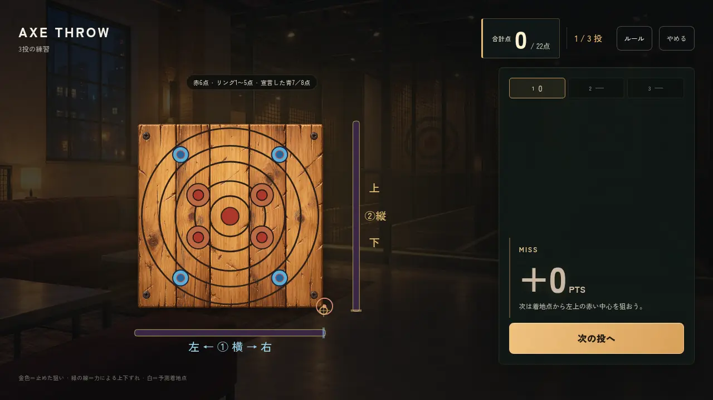
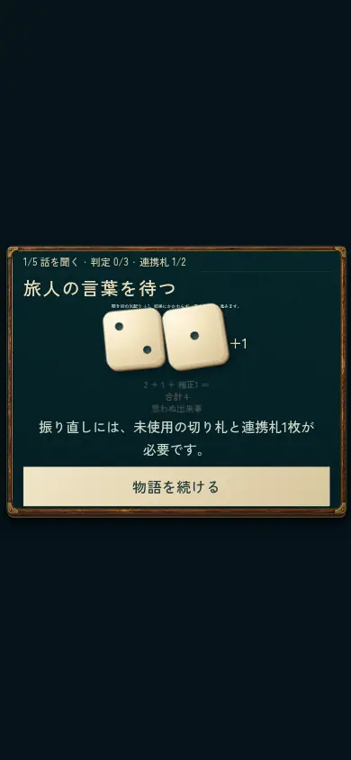

# 斧投げ・TRPGの体験改善 #649

実装の検証対象: `a802668ceb911a676b9b834c61572a30e0415855`。main `aac00135f5fb52196ff44935a112fffc6946b98d` を取り込み済み。以後のQAファイル・説明の追加は実装を変えない。

オーナーは本チャットで「#649に限り予約を省略して実装する」と明示回答した。予約取得済みという扱いはせず、例外はこのIssueだけ。既存Open PRの重複を確認し、#652の台詞改稿はmain経由で保持した。

## 変化

- 力: 自動往復の3ゲージとタップ／キー入力は維持。緑54〜70%の帯、現在値、投げる合図とボタン色を明確にする。押してためる方式への変更はしていない。
- 命中: 0点の板への接触で成功音を鳴らさない。透明余白の外では斧を残さず落下させる。見える予測着地点と返値のlandingを照合した。
- 競技画面: 大きな合計点を端へ、各投・コメント・操作を端の欄へ。的の表示領域を広げ、背景にある別の的は暗くする。
- 爽快感: 木片・粉塵・衝撃波・短い揺れ・軌跡・加点の光。ブル／キルショットほど強くし、0点では祝福演出を出さない。説明／背景中停止と動き軽減に対応。
- TRPG: 段階・判定数・連携札・危機、出目＋補正＝合計を表示。出目に応じた着地・光・音。助力／振り直し後の資源と実出目を一致させる。音は初期OFF。

## ローカル検証

system Chromium、Node 24、既存のPlaywrightを使用。新しいブラウザや素材の一括取得は行っていない。

| 対象 | 結果 |
| --- | --- |
| axe_throw / axe_match / axe_presentation / trpg / trpg_feedback / trpg_campaign | 60 PASS |
| trpg_campaign_save（--experimental-vm-modules） | schema13/14移行・schema15・不正43fixtureのauto/manual読込 PASS |
| axe_polish | PC1280×800・390×844・844×390、3投の合計、集中、説明中停止、動き軽減、0点の音・演出・板外落下。7ケースPASS、板外ケースは最終の実木寸法へ合わせて再実行PASS |
| axe_lesson | PC／縦横タッチ・無料実1投・保存不変・説明／中断／撤去など6ケースPASS（421359cc時点。後続は板外接触とQAのみ） |
| axe_versus | 横持ち844×390の実20投PASS（2ff5726a時点の表示修正）。最終の板外接触は単体とaxe_polishで追加確認 |
| trpg_experience | PCキーボード、横持ち・動き軽減、サメ編の見立て正誤、両作品の縦持ち判定・振り直し・残り札・背景中の演出停止。6ケースPASS。TRPG実装は上記検証対象と同一 |

実行には `CHROME_EXECUTABLE_PATH=/usr/bin/chromium` と `ARTIFACT_DIR` を指定した。各スイートの実行結果は results.json に収録。VM Modules指定を付け忘れた初回の保存テスト失敗は製品不具合ではなく、正規コマンドで再実行PASS。最初のaxe_polish実行は旧700ms前提の演出終了待ちで失敗し、新しい1150ms演出に合わせた待ちで再実行PASS。横持ち対戦のはみ出しも再現→修正→実20投で再確認した。

GitHub CIの最終結果・マージ状態はPR #653を参照。実機、音声の主観的な聞き比べ、全章通し、公開URLの確認は未実施。画像は生成せず既存素材を再使用し、下の画像は実ブラウザの画面キャプチャである。

## 画面

| 変更前 | 変更後 |
| --- | --- |
|  |  |
|  |  |

## 取得範囲

Gitの初回filtered fetch後に作業用packが約4.4GBへ膨らんだため中断。通信量は計測できず、packサイズを通信量とは扱わない。新mainのコミット・treeを再利用し、対象外の原画／他案件QAをsparse対象外にして、必要な38blob約1.7MBと後続5blob約203KBをraw URLから取得しGit blob SHAを照合。追加のmain更新はlazy fetchを止めた対象ref取得のみ。フルクローン・LFS全取得はしていない。
