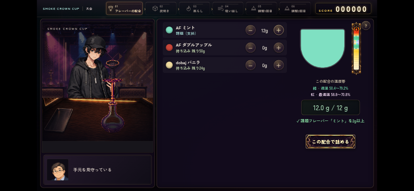
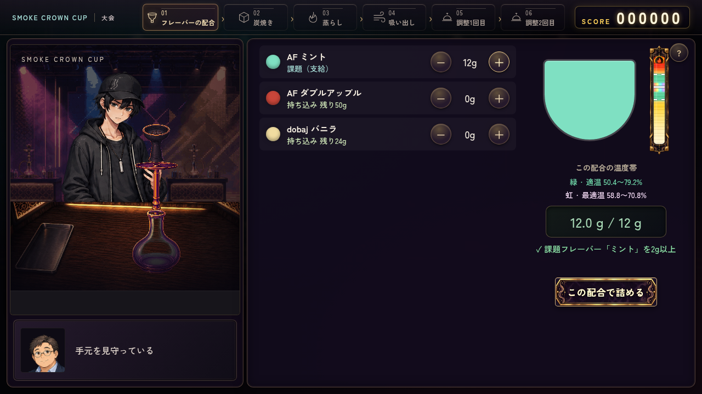

# Issue #401 温度帯モデルの検証

WORKER: `codex-401-20261012-0905-a76f`。正式claim [run 38227281653](https://github.com/haseatsu114514-dot/shisha-game/actions/runs/38227281653) SUCCESS。
開始main: `ea243fd208ff2df91458dea35e0c15191012e514`。ブランチ: `codex/issue-401-mix-temperature`。

既存heat_toleranceの正の有限なg加重平均tを使い、緑[.42*t,.66*t]、虹[.49*t,.59*t]、中心.54*tを一台ごとに算出する。実測温度や新規フレーバー数値は追加していない。未知の葉/未定義耐熱性はその葉を1、空配合を1とする。同比率の総g変更で帯は変わらず、温まり方だけが変わる。

旧.76の演出・熱すぎる吸引位置は、緑上端から絶対危険.90までの中の相対位置へ移す。危険.90・爆発1・冷え切り.06、葉の傷み、吸引回数、温度上昇曲線、得点の重みは維持する。

## 自動検証

```sh
node remake/test/mix_temperature.mjs
node remake/test/steam_temperature.mjs
CHROME_EXECUTABLE_PATH=/usr/bin/chromium node remake/test/browser/mix_temperature.mjs
```

- 純粋モデル: 全64種類、1種・複数種・比率変更・同比率の総g変更・空・未知/不正な耐熱性・旧データ・極端な正の有限g・支給ミント。緑/虹の上下端と直前/直後、計768ケース。判定、採点、背景、虹/炎/黒煙、絶対閾値、セッション分離がPASS。結果: [model-tests.txt](model-tests.txt)。
- 既存の物理温度: 11,340サンプル、連続上昇・気候・総g・炭形状/個数・旧セッション・予測の不確かさがPASS。結果: [steam-tests.txt](steam-tests.txt)。
- 新規ブラウザ: PC1280×720、タッチ横844×390、動きを減らす設定で実gボタンを操作。空→比率3:1→同比率の総g2倍→比率変更→支給ミント12gを選び、プレビュー、タイマー/予測、蒸らし、実吸引2回、提供、調整2回、採点まで確認。結果: [mix-temperature.json](mix-temperature.json)。
- ブラウザ境界: 全64種の768境界で温度計/蒸らし温度計/成功判定/採点/背景の一致を確認。古い過熱フラグより実温度の帯を採点が優先すること、同時に置いた別配合の温度計、古いセッションの非同期更新が新しい作業台へ漏れないことを確認。
- 旧セーブ: schema5の保存を本番loadで移行し、新規セッションがt=1を使うことを確認。バニラ/ミント/ダブルアップルのautoとcare開始温度が一台の中心を使う。
- 最大耐熱性t=1.3、緑上端.858の直下で実際のキープ吸引2回を行い、適温/過熱フラグ・背景・陽炎・吸引疲労を検証する。旧.76を超えても適温の葉を過熱扱いしない。
- 既存 `thermal_background.mjs` と `pull_draw.mjs`、`browser/thermometer_alignment.mjs` はPASS。`craft_focus.mjs` はmainの#394に追従して閉状態のヘルプボタンを期待し、PC/タッチ/縦持ちまでPASS。熱管理の準備文は別#399の文言変更と重複せず、調整準備という役割を確認する。

PCの蒸らしは実時計で完了まで確認。タッチ/動きを減らすケースの蒸らしと調整2回目は既存auto hookを使用し、本番温度計算/判定を通す。炭焼き・穴あけは正常な結果形式のfixtureで準備しており、新規プレイ全章の通し証拠ではない。スマホは実機ではなくChromiumタッチエミュレーション。

## 画面

支給ミントt=1.2: 緑50.4〜79.2%、虹58.8〜70.8%。読み上げも同じ値。現在温度を持たない配合プレビューでは針を表示しない。





既存回帰の詳細・最終head CI・最新main/競合/レビュー確認はIssue/PRに記録する。CIは `.github/workflows/mix-temperature.yml` で上記モデル・ブラウザ・既存背景/吸引/制作回帰を継続実行する。
