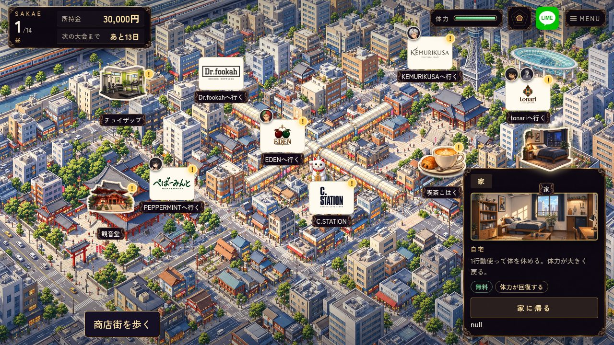
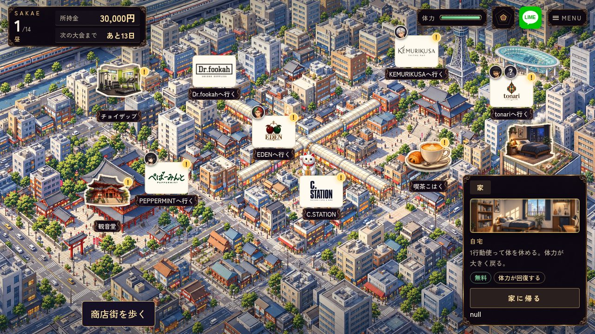
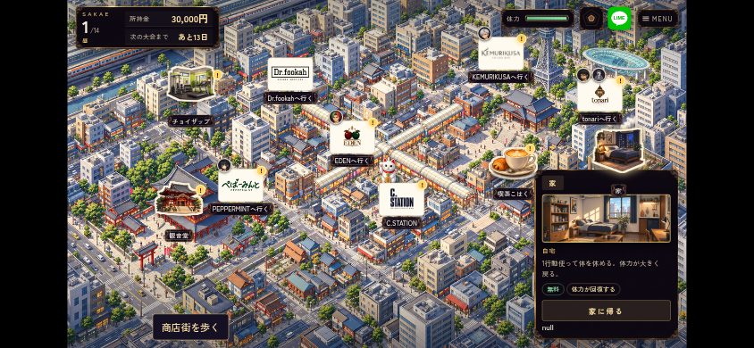
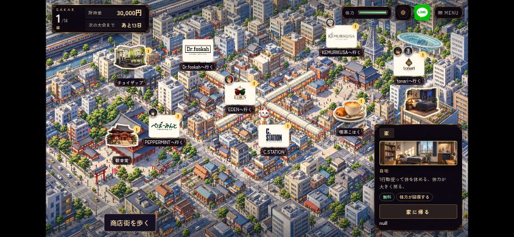

# 実プレイ修正 #733

基準 main: `97dba200e6b62ecde73ea69bc66183f96be86211`。worker `codex-feedback-20261019-a13f`、予約 run `39238617054` の success・CLAIMED_ISSUE・最新bot owner/run一致を確認して着手。

## 挙動

- 配合の比率行は0gから高さを確保。比率は従来どおり表示し、1g・2種類目の追加で枠や行を移動させない。決定は「このフレーバーで詰める」。ミント12g単体も実入力で決定できる。
- 初回注文の一台は必修。「練習しない」を削除。冒頭途中の旧skipは必修へ戻し、完成済みレッスン・結果読了・日常へ進んだ保存は繰り返さない。
- みんとの「もう１口、吸ってもいい？」を「つい、もう一口吸いたくなるね」に変更。
- 施設は面識だけで解放せず、自主来店で会話を終えたキャラの `_spot_guide_<id>` を使う。配達の実 `visitChar` は解放しない。旧保存の実施設訪問 `spotVisits` は保持し、面識から自主訪問を推測しない。
- 未解放施設はピンを作らない。人物未面識の店や、発見可能な路上占いの人影は従来の探索入口として維持。
- 家の練習は卓上台または大会公式モデルを所持した後だけ表示。実行入口でも所持条件を確認し、台なしでは体力・葉・行動を使わない。台入手前の練習案内の台詞も整合。
- スロットは昼夜とも `afterAction` で即時提示をawaitし、次のマップ・別イベント・翌朝より先に完了。中断/旧保存のpendingは `runDaily` の入口で朝や日付更新の前に提示し、再抽選・再付与しない。既存の「体力を使った自主行動」だけを回す条件は維持。
- マップ説明はアイコン層4より手前の7。幅300→270px、余白とプレビューを縮小。家の比較は高さ355→329px。文字サイズと操作ボタンを維持。

## マップ比較

同じ状態・現行JSでCSSだけを基準main/変更後に切り替えた比較。旧版全体の通し比較ではない。数値は [map-size.json](map-size.json)。

| | 前 | 後 |
|---|---|---|
| PC |  |  |
| 横持ちタッチ |  |  |

## 確認方法

システムChromium・既存Playwrightを使用。新しいブラウザ/依存/素材の外部ダウンロードなし。

```sh
python3 remake/tools/serve_preview.py --port 8123
# この環境では NODE_PATH=/opt/codex/cua_node/lib/node_modules と CHROME_EXECUTABLE_PATH=/usr/bin/chromium を指定
node remake/test/browser/play_feedback.mjs
node remake/test/browser/ch1_opening_resume.mjs
node remake/test/reel_lifecycle.mjs
node remake/test/browser/home_practice_leaves.mjs
node remake/test/paid_action_growth.mjs
node remake/test/browser/map_reveals.mjs
CASE_FILTER=first-customer-mint node remake/test/browser/first_brew.mjs
node remake/test/home_shisha.mjs
node --experimental-vm-modules remake/test/daily_consistency.mjs
```

検証結果: 専用8/8、冒頭保存/再開11/11、家練習の葉/中断9/9、解放演出4/4、初回ミント単1/1がPASS。スロット既存lifecycle＋導入10ケース、paid_action_growth、home_shisha、daily_consistencyもPASS。台詞lintはERROR0（ch1_mainの既存WARN6、remake_ch1はWARN0）、tidy dry-run変更0、agent docs・構文・diff・Git SafetyがPASS。

専用テストをprogression-recovery CIへ接続。既存の家練習/施設表示テストは、台の所持・自主訪問済みをfixtureへ明示し、旧「？？？」ピン期待を非表示へ更新。

実機Safari・公開版・全章通しは未実施。今回変更したfixtureを含む既存のDSパッキング/ゲーム全体レイアウト/店舗ロゴ/Issue439スイート全件も未実行。CI結果はPRで確認する。
