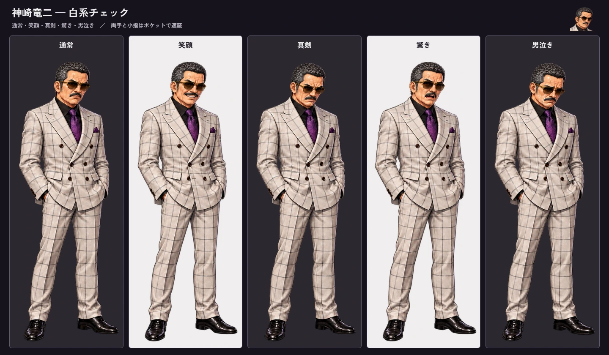
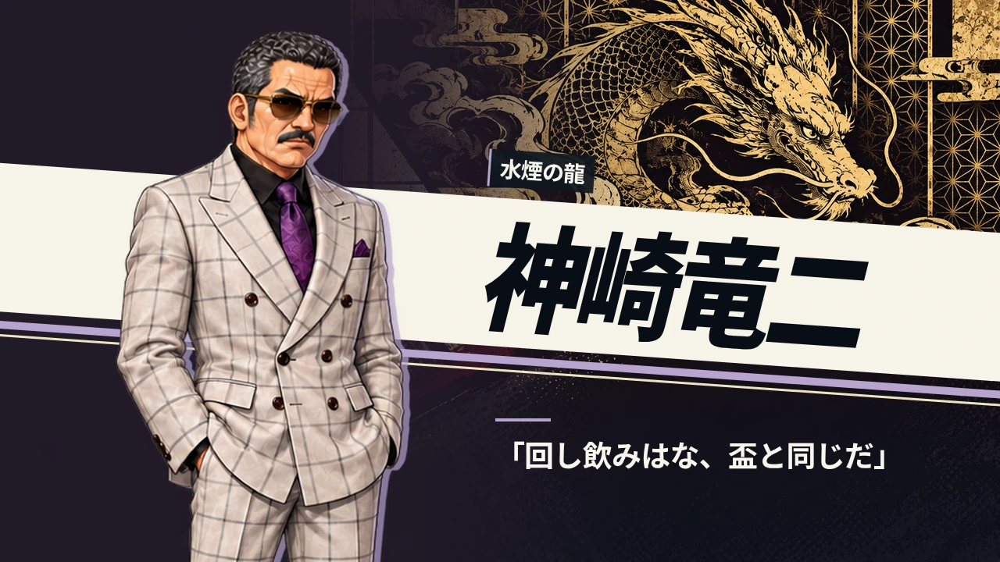
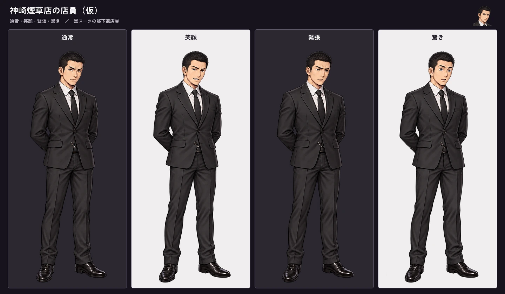
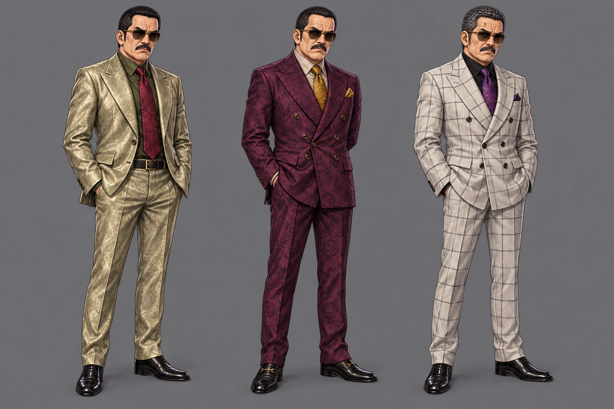
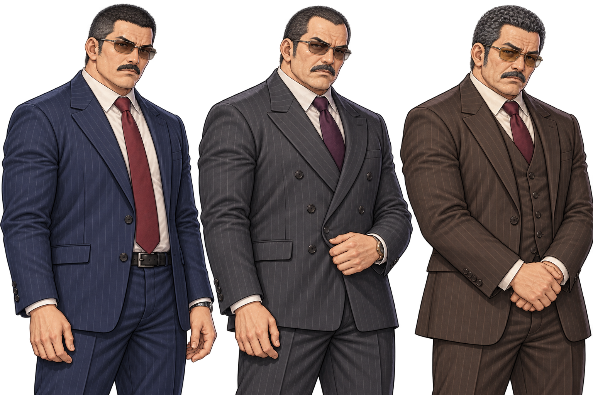
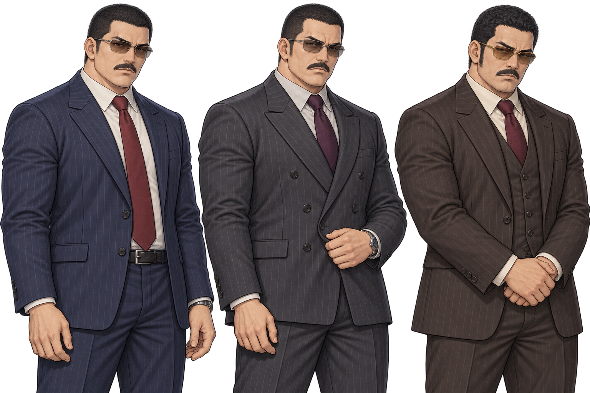
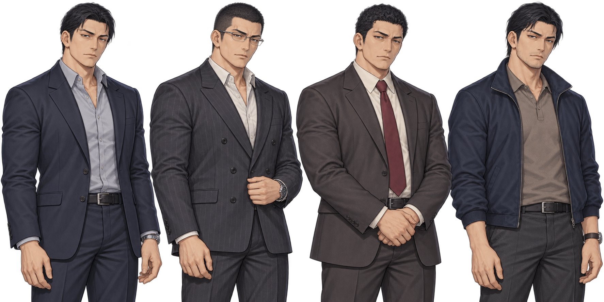
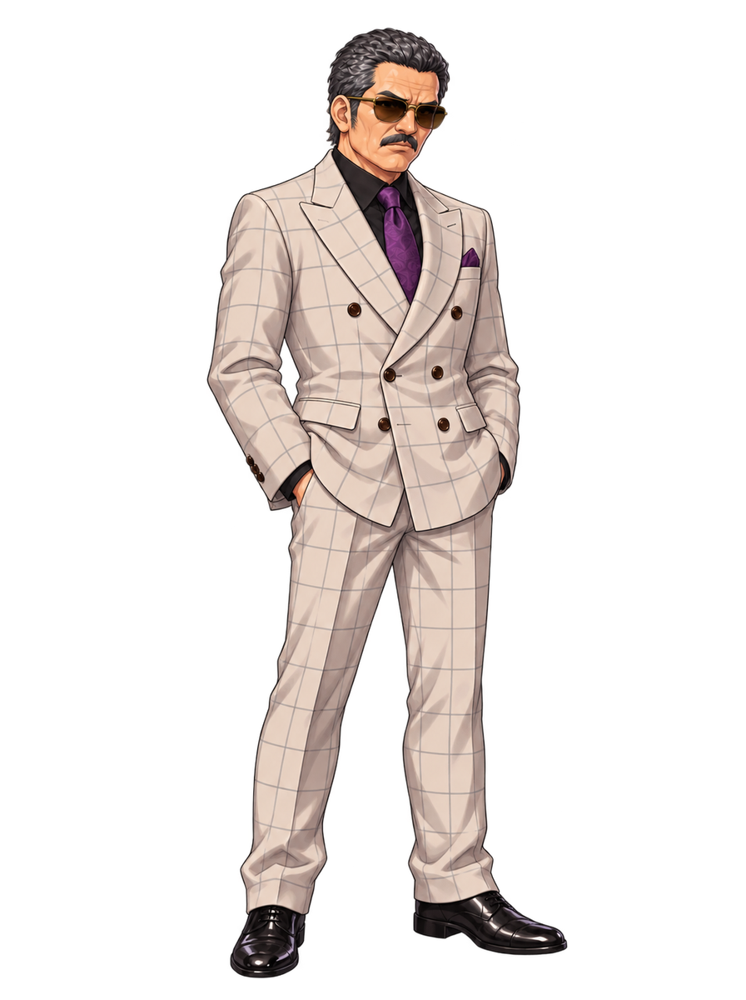

# 神崎竜二：外見の再設計候補

## 白系チェック採用：竜二一式と部下の立ち絵

白系大柄チェックの3番目を選択した指示に基づいて制作。肩書きはオーナー指定の **「水煙の龍」**。

### 竜二：5表情

### 登場カットイン：水煙の龍

[スマホ表示](white-check-set/cutin-touch.webp) ／ [会話画面](white-check-set/conversation-pc-normal.webp)

### 部下兼店員：4表情

[部下の会話画面](white-check-set/staff-conversation-pc-normal.webp)

### データ一式

- [竜二一式ZIP（約7.4MB）](white-check-set/ryuji-white-check-set.zip?raw=true)：透過立ち絵5枚と可逆WebP、顔アイコン、登場背景PNG/WebP、設定・目録の更新値、検証記録。
- [部下一式ZIP（約2.6MB）](white-check-set/kanzaki-staff-set.zip?raw=true)：透過立ち絵4枚と可逆WebP、顔アイコン、目録の追加値、検証記録。
- 顔アイコン：[竜二](white-check-set/face_kumicho.png) ／ [部下](white-check-set/face_kanzaki_staff.png)

竜二は53歳を基準に、白チェックのダブル・黒シャツ・紫のネクタイ・色付き眼鏡で統一。全表情とも小指はポケットで隠して有無を断定しない。登場文言は「水煙の龍／神崎竜二／回し飲みはな、盃と同じだ」。文字を背景へ焼き込まず、ゲーム既存のカットイン描画で表示している。

部下は仮ID `kanzaki_staff`、制作上は29歳・173cmの目安。黒スーツ・短髪で竜二と区別し、店員としての笑顔と構成員らしい硬い表情を用意。氏名・正式プロフィール・物語の登場箇所は勝手に決めていない。

### 確認済みの内容

- 全9枚896×1200 RGBA。人物ごとに共通倍率で整形し、足元の横ずれは竜二約0.70px、部下約0.31px。全画像の四辺に見切れなし。
- PNGとlossless WebPは全RGBA画素が一致。原画の低アルファを一括で削除・二値化していない。
- 明暗背景で全表情・同一人物性・小指の遮蔽を目視。画像表示ツールでだけ低アルファの赤黄が強く見える箇所も、ブラウザ合成では確認済み。
- 既存の会話エンジンでPC・タッチの竜二5表情と部下4表情を切り替え、配置枠が共通でブラウザエラーなし。既存カットイン描画でPC・タッチの「水煙の龍」を確認。
- 表示検証はローカルのプレビューで候補素材・目録値を差し込んで実施。本編の人物画像・設定・台詞・manifestはまだ差し替えていない。ZIPは想定導入先の構造を持ち、導入時はリポジトリのGit LFS規約に従って保存する。
- 原画は [竜二シート](white-check-set/source-boss-sheet.png)・[部下シート](white-check-set/source-staff-sheet.png)・[登場背景](white-check-set/source-intro-background.png)。生成指示と検証記録も同フォルダに保存。

---

## 採用デザインの比較時点：白系チェックを選択

[修正版PNGを原寸で開く・保存](flashy-slim-hidden-fingers.png?raw=true)

最新のオーナー指示は、添付の顔写真風参考に近い怖い顔、前案より小さい体格、より派手なスーツ、小指は有無が分からないよう意味深に隠すこと。

| 左から | スーツ | 手の構図 |
|---|---|---|
| A | シャンパン／淡いオリーブ色の光沢総柄、深緑シャツ、赤系ネクタイ | 両手をパンツのポケットに収める |
| B | ワイン色の総柄ダブル、金系ネクタイとポケットチーフ | 片手をポケット、もう片方を体の後ろへ |
| C | 白系の大柄チェックのダブル、黒シャツ、紫系ネクタイ | 両手をポケットへ収める |

- 太い首・肩幅・胴回りを抑え、普通〜細めの中年男性の全身を比較。
- 顔の眉間・目元・頬のしわ、口ひげ、下がった口角と色付き眼鏡で怖さを強める。
- 小指の輪郭は見せない。欠損の有無は描写・設定とも断定せず、ポケットや身体による遮蔽で曖昧にする。
- 年齢は53歳前後の仮案。正式な設定年齢はまだ選定前で、ゲーム側は未変更。
- 今回は比較用の灰色背景付き全身原画。採用後に選定案の透過・表情差分とゲーム配置を仕上げる。
- 全3案の頭から靴まで、体格・顔・スーツ・指の遮蔽を目視。PNGを無加工保存し、GitHubのblob SHAとローカルGitハッシュが一致。
- 生成指示は [prompt-flashy-slim-hidden-fingers.txt](prompt-flashy-slim-hidden-fingers.txt)。参考は最新のユーザー添付顔画像と前段の年齢3案。添付参考画像そのものは再配布しない。

## 前案：設定年齢を上げる3案

オーナー指示：スーツ姿、堂島宗兵の参考画像のように明確に極道らしい外見。年齢は見た目だけでなく「設定の」年齢を上げてもよい。

[PNG原寸を開く・保存](age-options-48-53-58.png?raw=true)

左から順に：

| 案 | 設定年齢候補 | 外見 |
|---|---|---|
| A | 48歳 | 短い角刈り、濃い口ひげ、紺ストライプのシングルスーツ。働き盛りの実務派。 |
| B | 53歳 | 高い額と後退した生え際、目元・頬の年季、チャコールのダブルスーツ。参考方向に近い重厚な中堅像。 |
| C | 58歳 | 白髪交じりの短いパンチ寄りの髪、深いしわ、茶系スリーピース。長い経験のある人物像。 |

全案：色付き眼鏡、口ひげ、厚い首と体格、襟を閉めたシャツとネクタイ。人物・服装を比較するための上半身〜腿のコンセプトで、ゲーム用の全身立ち絵ではありません。

**外見・具体的な年齢は選定前。現行設定の39歳はまだ書き換えていません。** 選ばれた案で設定年齢・全身・表情差分を仕上げ、採用後にゲームへ反映する段階です。物語上の肩書き・性格の変更指示としては扱っていません。

## 前段：スーツ限定の3案

## 最初の4案（履歴）

## 現行ゲームの立ち絵（比較用）

## 生成と確認

- 人物：神崎竜二（内部ID kumicho）、現行設定39歳・186cm。日本人のシーシャ店主で、怖い顔と丁寧な接客の両面を持つ。
- 初回は現行竜二をデザイン変更の対象、みんと・あげはを画風だけの参照に指定。
- スーツ3案はオーナーがチャットに添付した堂島宗兵のカード画像をデザイン方向、最初の4案をゲーム画風として参照。カード枠・文字・ロゴ・背景・3D画風の複製は指定していません。添付カード画像そのものはこのPRへ再配布していません。
- 年齢3案は前段のスーツ案を人物方向、みんと・あげはを画風だけの参照に使用。
- 元の生成PNGを無加工保存し、GitHubの各blob SHAとローカルGitハッシュが一致。
- 3案の顔・髪・服・眼鏡・口ひげを目視。RGBA形式だが最終立ち絵用の透過・余白・全身・表情・配置検品はこれから。半透明や背景状の部分も原画のまま保存しており、このままruntimeへ入れない。
- 画像生成指示は同フォルダの `prompt-*.txt`。未採用の候補で、ゲーム本体・人物設定・台詞・manifest・顔アイコンは未変更。実装テストは対象外。
