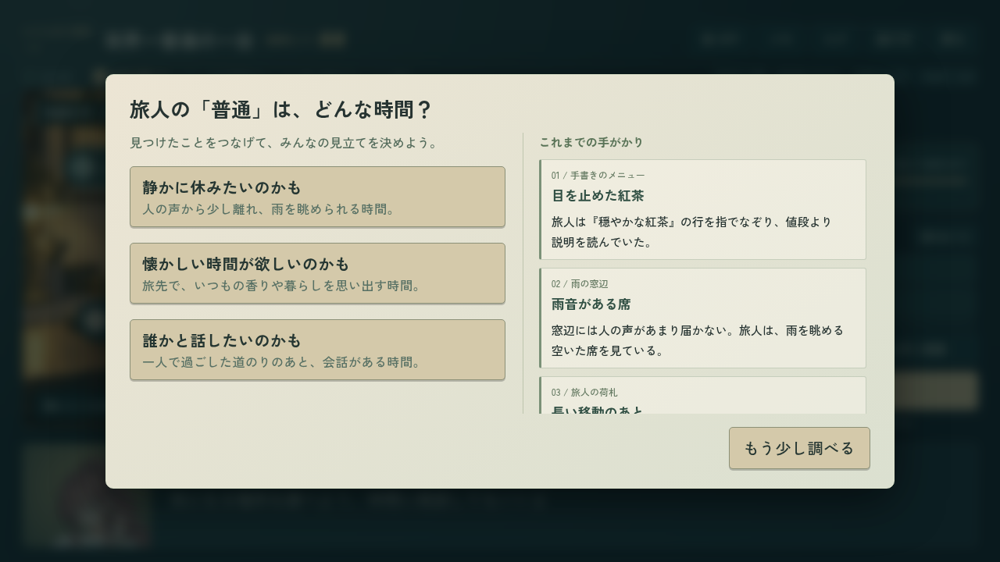
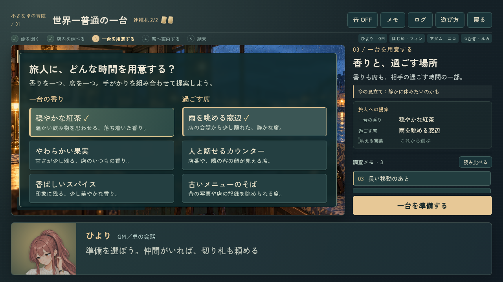
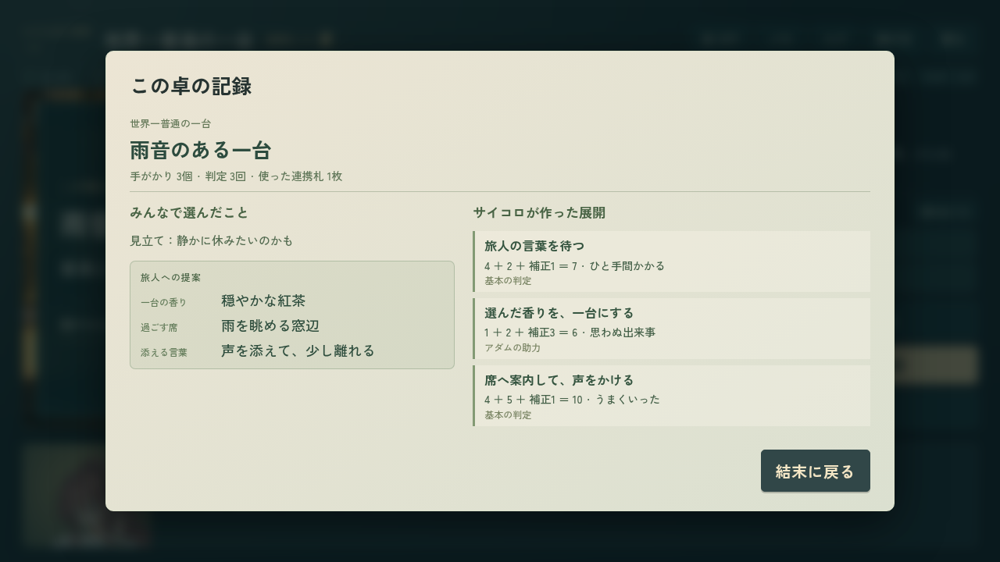

# TRPGの探索・判定・振り返り

[Issue #588](https://github.com/haseatsu114514-dot/shisha-game/issues/588) / [PR #592](https://github.com/haseatsu114514-dot/shisha-game/pull/592)。現行 `remake/` の短編2本が対象。

既存の背景・人物・物語を活かし、手がかりを読む、見立てる、作戦を選ぶ、サイコロを振る、結末を振り返る流れを整理した。
結末の計算・台詞・価格・行動枠・保存形式は変更していない。

## 画面

| 場面 | 変更前 | 変更後 |
| --- | --- | --- |
| 探索 | [数字だけの進行と0/6のボタン](before-explore.png) | [名前付き進行、必要3個、残り調査数](after-explore.png) |
| 判定 | [補正と助力の選択](before-check.png) | [閾値、概算確率、助力による変化](after-check.png) |

見立ての選択では、取得済みの手がかりを隣で読みながら考えられる。メモ欄は個別にスクロールでき、選択肢を画面内に保つ。



準備中は選んだ内容がサイドにまとまり、手がかりの再読へ戻れる。



[メモを並べて読む画面](memo-comparison.png) / [助力を使う判定](after-check.png)。
サメ編の見立ての追加補正は判定前に正誤を明かさず、成功率を28〜42%または58〜72%の範囲で示す。
振り直しでは、残すサイコロと実際の補正から成功の見込みを示し、新しい出目が低くなる可能性も伝える。

結末の記録には提案・3回の判定・切り札・取得したメモが残る。スクロール本文はTabで選択し、矢印・PageDown・Endでも読める。



[横持ちタッチの振り返り](table-recap-touch.png)。1280×720の既存ステージを拡縮する方式を維持している。

## 検証

ゲームUIの変更コミットは `8c34d2c7`。変更前画像は `42525242` のチェックアウトで撮影し、最新ベース `6b495588` とのTRPG実装・台本・CSSの差分がないことを確認した。
作業中に取り込んだ `3810c657` は別件のQA資料だけで、ゲーム実装の差分はない。

| 検査 | 結果 |
| --- | --- |
| `node --test remake/test/trpg.mjs remake/test/trpg_campaign.mjs remake/test/trpg_feedback.mjs` | 30件PASS。全提案・8結末・共有札・seed再現性・確率・隠し情報の非参照 |
| `node --experimental-vm-modules remake/test/trpg_campaign_save.mjs` | schema移行と43破損fixture PASS |
| `python3 tools/lint_dialogue.py trpg_` | 3ファイル、ERROR 0 / WARN 0 |
| `trpg_experience.mjs` | [4ケースPASS](experience-four-cases.json)。PC/横持ちタッチ、調査予算、再読、提案、助力、見立ての非漏洩、振り返り、保存不変 |
| キーボード追加確認 | [最終PC/タッチ2ケースPASS](experience-keyboard-final.json)。Enter長押し、Tab長押し、判定中のフォーカス、メモの比較、本文のEndスクロール |
| 既存 `trpg.mjs` | [初回15/16 PASS](stories-initial.json)、操作待機で時間切れになったcompanyは[単独再実行PASS](company-retry.json)。8結末、音、再挑戦、中断、通信/背景再試行を確認 |
| 既存 `trpg_main.mjs` | [初回記録](integration-initial.json)。10秒上限で3件が時間切れ。購入・少人数の検査は最後のスクリーンショットで時間切れ、代役は初期ロード、実訪問はアダムの初回会話中。再検証結果は下記 |
| GitHub TRPG専用CI | [run 38791884076](https://github.com/haseatsu114514-dot/shisha-game/actions/runs/38791884076) SUCCESS。UI実装head `8c34d2c7` で既存16ケース・追加4ケース・本編13ケースと純関数/移行/lintを一括実行。[取得した実行情報](ci-feature.json) |
| 構文 / `git diff --check` / `check_agent_docs.py` / Git Safety | PASS |

本編の通常会話はturboでも素材の準備を待ち、1枚の上限が15秒ある。共通ブラウザハーネスに `BROWSER_TIMEOUT_MS` を追加し、既定の10秒を維持したままTRPGのCIでは30秒を設定する。検査内容・初回会話・保存のassertは維持する。

30秒設定で、初回に時間切れとなった3件を単独で再実行し、すべてPASSした。
[実訪問・勧誘・保存](integration-visits-retry.json) / [購入・中断・二人卓](integration-small-table-retry.json) / [代役の配役](integration-replacement-retry.json)。
これで本編13ケースは各ケースの通過を確認できた。上記GitHub CIでは旧10秒設定でも13ケースを一括して通過している。

再現コマンド:

```bash
python3 remake/tools/serve_preview.py --port 8123
CHROME_EXECUTABLE_PATH=/usr/bin/chromium node remake/test/browser/trpg.mjs
CHROME_EXECUTABLE_PATH=/usr/bin/chromium node remake/test/browser/trpg_experience.mjs
BROWSER_TIMEOUT_MS=30000 CHROME_EXECUTABLE_PATH=/usr/bin/chromium node remake/test/browser/trpg_main.mjs
```

`CASE_FILTER` で既存ブラウザ検査を1件、`TRPG_EXPERIENCE_GROUP=ordinary|shark` で追加検査を2件に絞れる。既定は全件実行。
物理端末/Safariと公開デプロイは未検証。PCと横持ちタッチはChromiumによるブラウザ検証。

## 作業の記録

WORKER: `codex-trpg-experience-20261015-4f9d2c`。GitHub Actionsのclaimは環境認証でForbiddenとなり、オーナーが今回の依頼では予約ルールの免除を明示した。予約だけを免除し、Git Safety・最新mainからの分岐・hooks・通常push・PRでの共有は維持した。
Open PRの実変更ファイルを全ページ取得し、今回のゲーム実装・テスト・説明書と重複しないことを確認した。
