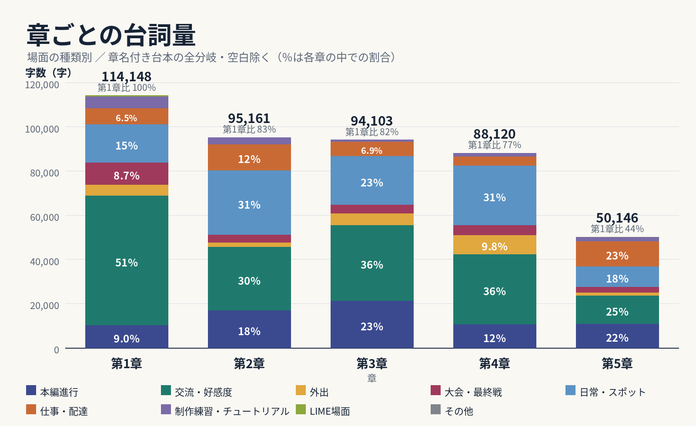

# 台詞量の内訳（章 × 場面の種類）

計測対象は main の `1a8299ad8864452220b71302d8ed97320eb740ed`。

章名付き台本の全分岐を集計。構成比は各章の総字数が分母で、小数第2位への丸めにより表示値の和に端数が出る。

## 字数

| 章 | 本編進行 | 交流・好感度 | 外出 | 大会・最終戦 | 日常・スポット | 仕事・配達 | 制作練習・チュートリアル | LIME場面 | その他 | 合計 |
| --- | ---: | ---: | ---: | ---: | ---: | ---: | ---: | ---: | ---: | ---: |
| 第1章 | 10,258 | 58,752 | 4,930 | 9,983 | 17,223 | 7,385 | 5,202 | 415 | 0 | 114,148 |
| 第2章 | 16,975 | 28,672 | 2,068 | 3,470 | 29,218 | 11,833 | 2,925 | 0 | 0 | 95,161 |
| 第3章 | 21,378 | 34,252 | 5,285 | 3,859 | 22,066 | 6,463 | 800 | 0 | 0 | 94,103 |
| 第4章 | 10,637 | 31,799 | 8,653 | 4,560 | 26,926 | 4,011 | 1,534 | 0 | 0 | 88,120 |
| 第5章 | 11,002 | 12,781 | 1,280 | 2,674 | 9,164 | 11,478 | 1,659 | 0 | 108 | 50,146 |

## 章ごとの構成比

| 章 | 本編進行 | 交流・好感度 | 外出 | 大会・最終戦 | 日常・スポット | 仕事・配達 | 制作練習・チュートリアル | LIME場面 | その他 | 合計 |
| --- | ---: | ---: | ---: | ---: | ---: | ---: | ---: | ---: | ---: | ---: |
| 第1章 | 8.99% | 51.47% | 4.32% | 8.75% | 15.09% | 6.47% | 4.56% | 0.36% | 0.00% | 100.00% |
| 第2章 | 17.84% | 30.13% | 2.17% | 3.65% | 30.70% | 12.43% | 3.07% | 0.00% | 0.00% | 100.00% |
| 第3章 | 22.72% | 36.40% | 5.62% | 4.10% | 23.45% | 6.87% | 0.85% | 0.00% | 0.00% | 100.00% |
| 第4章 | 12.07% | 36.09% | 9.82% | 5.17% | 30.56% | 4.55% | 1.74% | 0.00% | 0.00% | 100.00% |
| 第5章 | 21.94% | 25.49% | 2.55% | 5.33% | 18.27% | 22.89% | 3.31% | 0.00% | 0.22% | 100.00% |

## 要点

- 第1章は交流・好感度が最多で、58,752字（51.47%）。
- 第2章は日常・スポットが29,218字（30.70%）で、交流・好感度の28,672字を上回る。第3章は本編進行が5章中最多の21,378字。
- 第4章は外出が5章中最多の8,653字。第5章では仕事・配達が11,478字（22.89%）で、このうち出張シーシャの依頼と事業発足の台本が10,961字。
- その他は全4場面・108字。LIME場面の欄には章名付き台本内でLIMEのメッセージを読む場面が入る。LIME専用データは集計範囲外。

## グラフ

## 集計方法と分類の定義

[既存の章別計測](../../tools/chapter_volume.py)の `load_files`、`chapter_of`、`count_text` を再利用した。対象は `data/dialogue/` 直下の `chN*.json` と `remake_chN*.json`（Nは1〜5）。各 `dialogues[]` 要素の `text` 文字列を再帰走査し、Pythonの正規表現 `\s` に一致する空白を除いた文字数を足した。選択肢や条件で分かれる本文も、`text` で保存されていれば一律に含む。場面件数は `dialogues[]` の要素数で、分岐数・周回時の再生数・プレイヤーが一度のプレイで読む量には換算しない。台本内の置換用文字列は保存されている形で数えた。JS内の文言、章名のない台本、LIME専用データ（`lime_*.json` や `data/lime_messages.json`）は対象外。

章はファイル名で決める。例えば、`ch3_ch4_home.json` の `ch4_prep_adam` は第3章、`remake_ch1.json` にある第2〜5章用のシフト差分は第1章に入る。

| 種類 | 判定に使った場面・進行定義 |
|---|---|
| 本編進行 | 導入、日程に沿う事件、期限救済、物語の後日談。任意でも本筋を補う場面を含む。第1章の `NIGHT_EVENTS`、第2章の `CH2_NIGHTS`・`CH2_DAY_SCENES`、第3章の `CH3_DAILY_PLAN`、第4章の `ch4-progress.js`、第5章の `CH5_AFTERMATH` などを参照。 |
| 交流・好感度 | 人物の訪問・好感度段階、関係の締め、恋人・友人別の会話、交流の集まり。スミさんの訪問列は練習の話題も訪問列として扱う。`affinity-stages.js`、`ch3-story-wiring.js`、`ch3-party.js`、`ch4-lovers.js` などを参照。 |
| 外出 | 一緒に出かける約束、個別の寄り道、ツアーや章内旅行の移動。通常の再訪、散歩や施設の利用は日常・スポット。`outing_*`、`ch3-social.js`、`ch3-outing-progress.js`、`ch4-tour.js`、`ch5-travel.js` などの定義を参照。 |
| 大会・最終戦 | 受付、出場者説明会、前夜祭での大会側の受付、当日の対戦・審査・勝敗と当日挿入される回想。第1〜4章の大会進行、第5章の `CH5_MATCH_SCENES` と二杯目直前の試作回想を参照。 |
| 日常・スポット | 通常の来店・再訪、施設の利用、通勤、休養、散歩や現地のミニゲーム。 `daily/spots.js`、`ch2-outings.js`、`ch3-outing-progress.js`、`ch4-dubai-daily.js` などの巡回・場所定義を参照。 |
| 仕事・配達 | 店のシフト、店番・仕事の手伝い、買い出し・配達、出張シーシャ。`daily/calendar.js`、`ch3-outing-progress.js` の手伝い・店番、`ch4-staff-work-progress.js`、`ch5-catering.js` などを参照。 |
| 制作練習・チュートリアル | 初回の遊び方、成長盤の案内、制作の試作・リハーサルやその講評。`first-brew.js`、`daily/reflection.js`、`ch2-craft-prep.js`、`ch4-inn-trial.js`、`ch5-sumi-trial.js` などを参照。 |
| LIME場面 | 第1章の大会後、なる・アダムからのLIME本文を章名付き台本で再生する2場面。対面でLIMEを交換する場面は交流・好感度。 |
| その他 | 進行上の種類を割り当てられない未接続・テスト用・空の台本。下表に全件を記載。 |

進行・行動を確認してファイルごとに基本の種類を割り当て、複数の種類を含むファイルでは下表の場面IDを優先した。1つの要素は1種類にだけ入る。`*` は末尾の任意の文字列（0文字も含む）。ファイル名は `data/dialogue/` からの相対名で、拡張子 `.json` を省略した。

### ファイルごとの基本分類

| 種類 | ファイル |
| --- | --- |
| 本編進行 | `ch1_main`, `ch1_interval`, `ch2_choice_echoes`, `ch2_isolation`, `ch2_main`, `ch2_story_extra`, `remake_ch2`, `ch3_departure`, `ch3_double_apple`, `ch3_main`, `ch3_prologue`, `ch4_dubai_story`, `ch4_main`, `ch5_main`, `ch5_party` |
| 交流・好感度 | `ch1_adam`, `ch1_ageha`, `ch1_bonds`, `ch1_events`, `ch1_minto`, `ch1_naru`, `ch1_rio`, `ch1_sumi`, `ch1_tsumugi`, `ch2_ageha_story`, `ch2_kumicho`, `ch2_preparation`, `ch2_rei`, `ch3_ch4_home`, `ch3_growth_party`, `ch3_mashiro`, `ch3_rivals`, `ch3_saku_mashiro`, `ch3_tsumugi`, `ch3_volk`, `ch4_ageha_dubai`, `ch4_arrival_daily`, `ch4_companion`, `ch4_guests_dubai`, `ch4_longlong`, `ch4_lovers`, `ch4_mashiro_dubai`, `ch4_minto_dubai`, `ch4_prep_home`, `ch4_rio_dubai`, `ch4_tsumugi_dubai`, `ch4_visitors` |
| 外出 | `ch3_visits`, `ch4_beach`, `ch4_tour` |
| 大会・最終戦 | `ch1_tournament`, `ch2_tournament`, `ch4_morning` |
| 日常・スポット | `ch1_incognito`, `ch1_spots`, `ch2_city`, `ch2_city_guests`, `ch2_home`, `ch3_activities`, `ch3_club`, `ch3_mukai`, `ch3_outings`, `ch3_tokyo_daily`, `ch4_camel_race`, `ch4_desert`, `ch4_dubai_daily`, `ch4_spots`, `ch5_dubai`, `ch5_shops`, `ch5_tokyo`, `remake_ch1` |
| 仕事・配達 | `ch2_deliveries`, `ch2_tonari_talks`, `ch3_deliveries`, `ch4_staff_work`, `ch5_catering`, `ch5_catering_origin` |
| 制作練習・チュートリアル | `ch3_trials` |

### 場面IDで上書きする分類

| ファイル | 種類 | 場面ID |
| --- | --- | --- |
| `ch1_adam` | 外出 | `ch1_adam_outing_dagurikura` |
| `ch1_events` | 外出 | `outing_*` |
| `ch1_interval` | LIME場面 | `interval_day1_naru_lime`, `interval_day2_adam_lime` |
| `ch1_main` | 制作練習・チュートリアル | `ch1_tutorial_oneesan*` |
| `ch1_main` | 大会・最終戦 | `ch1_meet_rivals` |
| `ch1_rio` | 日常・スポット | `ch1_shop_rio_first`, `ch1_shop_rio_return`, `ch1_shop_rio_monitor`, `ch1_shop_clerk` |
| `ch1_rio` | 仕事・配達 | `ch1_shop_rio_errand`, `ch1_shop_rio_delivery` |
| `ch1_spots` | 交流・好感度 | `samechan_minto_followup`, `hiyori_minto_seat_followup` |
| `ch1_spots` | 制作練習・チュートリアル | `kannon_growth_intro` |
| `ch1_sumi` | 制作練習・チュートリアル | `ch1_sumi_attack` |
| `ch1_sumi` | 本編進行 | `ch1_sumi_eve` |
| `ch1_tsumugi` | 本編進行 | `ch1_tsumugi_eve`, `ch1_tsumugi_work_in_progress` |
| `remake_ch1` | 制作練習・チュートリアル | `remake_tutorial_*`, `remake_first_brew_*`, `remake_midcheck*`, `remake_rehearsal_*`, `remake_preparation_*`, `remake_naru_match*`, `remake_staff_practice` |
| `remake_ch1` | 大会・最終戦 | `remake_round*`, `remake_judging_intro`, `remake_defeat_follow`, `remake_sick_tournament` |
| `remake_ch1` | 本編進行 | `remake_sick_half`, `remake_sick_full`, `remake_homecoming_*` |
| `remake_ch1` | 仕事・配達 | `remake_baito*`, `remake_day1_errand_*`, `remake_delivery_*`, `remake_lemon_gift`, `shift_flavor_*`, `shift_recall_*`, `shift_return_*` |
| `remake_ch1` | 交流・好感度 | `remake_shuraba_*` |
| `ch2_ageha_story` | 本編進行 | `remake_ch2_ageha_scout`, `remake_ch2_ageha_tasting`, `remake_ch2_ageha_slump` |
| `ch2_deliveries` | 日常・スポット | `remake_ch2_aquarium_*`, `remake_ch2_sento_*`, `remake_ch2_chain_*`, `remake_ch2_purikura_solo` |
| `ch2_deliveries` | 外出 | `remake_ch2_ageha_purikura`, `remake_ch2_purikura_invite`, `remake_ch2_purikura_pair`, `remake_ch2_purikura_guest`, `remake_ch2_purikura_ryuji`, `remake_ch2_rei_purikura_after` |
| `ch2_deliveries` | 交流・好感度 | `remake_ch2_rei_trpg`, `remake_ch2_ageha_aquarium`, `remake_ch2_kumicho_sento`, `remake_ch2_ryuji_melty_greeting`, `remake_ch2_rei_melty_greeting` |
| `ch2_home` | 交流・好感度 | `ch2_rio_taste`, `ch2_rio_strawberry` |
| `ch2_home` | 制作練習・チュートリアル | `ch2_prep_*` |
| `ch2_kumicho` | 外出 | `outing_*` |
| `ch2_main` | 制作練習・チュートリアル | `ch2_strawberry_trial_*` |
| `ch2_rei` | 外出 | `outing_*` |
| `ch3_main` | 大会・最終戦 | `ch3_registration`, `ch3_tournament_day`, `ch3_national_*` |
| `ch3_mukai` | 本編進行 | `ch3_mukai_intro`, `ch3_cigarman_rumor`, `ch3_cigarman_shadow`, `ch3_cigarman_trace` |
| `ch3_outings` | 仕事・配達 | `ch3_outing_mukai_help*`, `ch3_outing_mukai_steve*` |
| `ch3_outings` | 外出 | `ch3_outing_enmaku_notes`, `ch3_outing_enmaku_answer`, `ch3_outing_steve_timer` |
| `ch3_rivals` | 本編進行 | `ch3_saku_first`, `ch3_saku_advice`, `ch3_steve_low_heat` |
| `ch3_rivals` | 外出 | `outing_*` |
| `ch3_volk` | 本編進行 | `ch3_volk_first` |
| `ch3_volk` | 外出 | `outing_*` |
| `ch4_desert` | 交流・好感度 | `ch4_noor_*` |
| `ch4_desert` | 外出 | `ch4_desert_sunset_*` |
| `ch4_dubai_daily` | 交流・好感度 | `ch4_naru_dubai_*`, `ch4_sumi_call_*` |
| `ch4_dubai_daily` | 制作練習・チュートリアル | `ch4_inn_trial_*`, `ch4_rehearsal_*` |
| `ch4_longlong` | 日常・スポット | `ch4_longlong_visit_*` |
| `ch4_main` | 大会・最終戦 | `ch4_wang_reception*`, `ch4_tournament_start`, `ch4_final`, `ch4_result`, `ch4_defeat`, `ch4_sui_old_rival` |
| `ch4_main` | 日常・スポット | `ch4_festa_revisit`, `ch4_alley_cafe_quiet`, `ch4_dubai_souq_revisit`, `ch4_dubai_cafe_revisit`, `ch4_inn_tool_care` |
| `ch4_main` | 交流・好感度 | `ch4_samechan_dubai_evening`, `ch4_hiyori_dubai_evening` |
| `ch4_spots` | その他 | `ch4_return` |
| `ch5_dubai` | 外出 | `ch5_dubai_go`, `ch5_dubai_back`, `ch5_dubai_arrival` |
| `ch5_dubai` | 交流・好感度 | `ch5_noor_*`, `ch5_dubai_sheikh*`, `ch5_dubai_taiyo*` |
| `ch5_main` | 大会・最終戦 | `ch5_match_day_arrival`, `ch5_copy_first_cup`, `ch5_relationship_before_second_cup`, `ch5_second_cup_*`, `ch5_prep_recall_*`, `ch5_sumi_trial_recall_*` |
| `ch5_main` | 日常・スポット | `ch5_wang_tonari_visit`, `ch5_free_first_visitor` |
| `ch5_main` | 交流・好感度 | `ch5_free_mashiro_visit*`, `ch5_free_eden_adam`, `ch5_tsumugi_*` |
| `ch5_main` | 制作練習・チュートリアル | `ch5_free_tonari_practice`, `ch5_prep_trial_*`, `ch5_prep_adjust_*`, `ch5_prep_keep`, `ch5_sumi_trial_intro`, `ch5_sumi_trial_great`, `ch5_sumi_trial_holes`, `ch5_sumi_trial_heat`, `ch5_sumi_trial_steam`, `ch5_sumi_trial_pull`, `ch5_sumi_trial_failed` |
| `ch5_main` | その他 | `ch5_dream_in`, `ch5_dream_out`, `ch5_reflection_placeholder` |
| `ch5_shops` | 交流・好感度 | `ch5_ageha_lover_*`, `ch5_rio_naru_*` |
| `ch5_tokyo` | 外出 | `ch5_tokyo_van_first`, `ch5_tokyo_go`, `ch5_tokyo_back`, `ch5_tokyo_arrival` |
| `ch5_tokyo` | 仕事・配達 | `ch5_tokyo_mukai_help*` |
| `ch5_tokyo` | 交流・好感度 | `ch5_tokyo_steve*`, `ch5_tokyo_volk*`, `ch5_tokyo_saku*`, `ch5_steve_bond_finale`, `ch5_volk_bond_finale` |

### その他の件数と字数

| 章 | 件数 | 字数 |
| --- | ---: | ---: |
| 第1章 | 0 | 0 |
| 第2章 | 0 | 0 |
| 第3章 | 0 | 0 |
| 第4章 | 1 | 0 |
| 第5章 | 3 | 108 |
| 合計 | 4 | 108 |

| ファイル | 場面ID | 字数 | 理由 |
| --- | --- | --- | --- |
| `ch4_spots.json` | `ch4_return` | 0 | 空の台本（`ch4-progress.js` に未接続の記載） |
| `ch5_main.json` | `ch5_dream_in` | 40 | 挿入位置未定（`ch5-progress.js`） |
| `ch5_main.json` | `ch5_dream_out` | 31 | 挿入位置未定（`ch5-progress.js`） |
| `ch5_main.json` | `ch5_reflection_placeholder` | 37 | テスト専用（`ch5-progress.js`） |

## 検算

全78ファイル・1,465場面を集計し、第1〜5章で既知の総量および `tools/chapter_volume.py` の再実行結果と一致（各章の差は0字）。 各ファイルで場面ごとの総和がJSON全体の `text` の字数と等しいこと、分類規則に重複がないことも確認した。

| 章 | 分類の合計 | 既知の総量 | 差 |
| --- | ---: | ---: | ---: |
| 第1章 | 114,148 | 114,148 | 0 |
| 第2章 | 95,161 | 95,161 | 0 |
| 第3章 | 94,103 | 94,103 | 0 |
| 第4章 | 88,120 | 88,120 | 0 |
| 第5章 | 50,146 | 50,146 | 0 |
