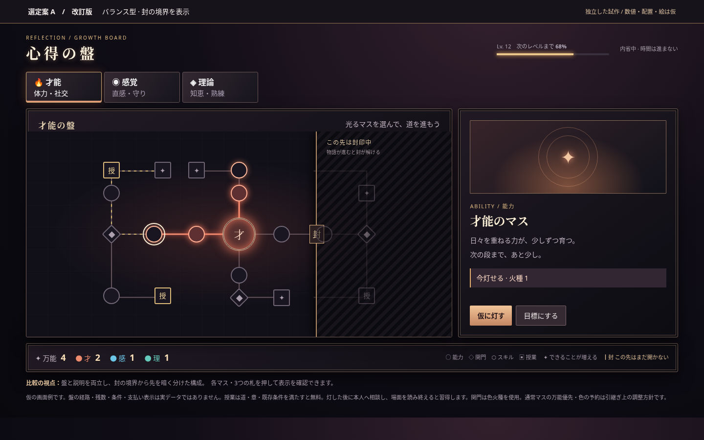
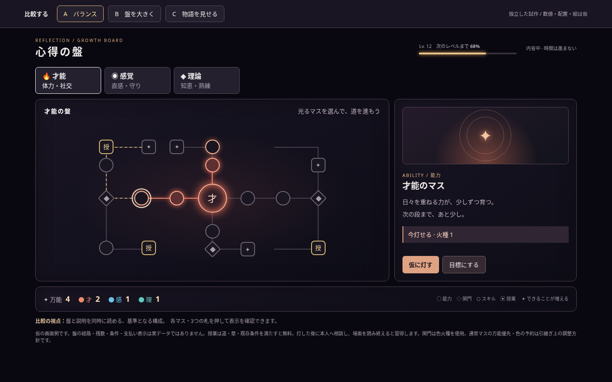
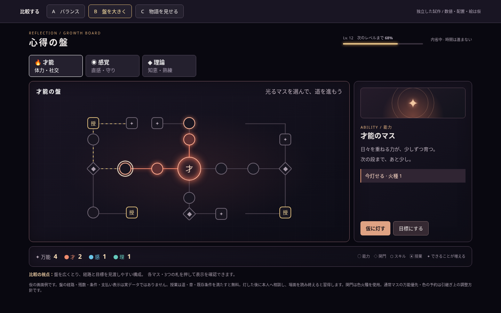
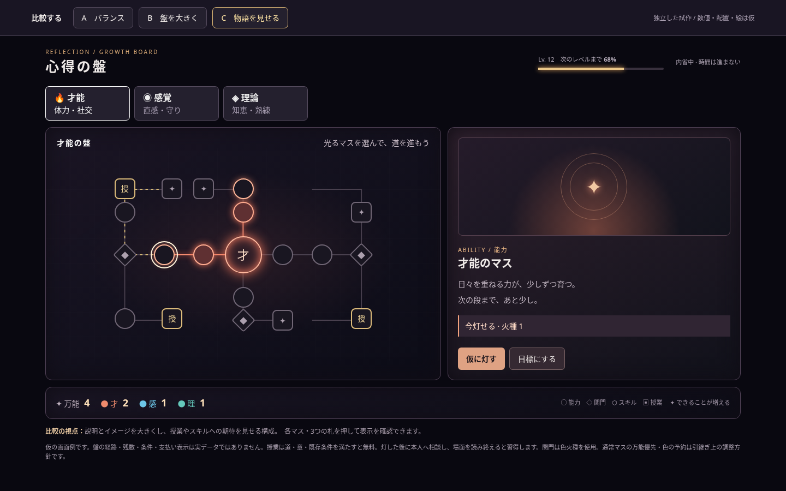

# 心得の盤 — 仮デザイン比較

Issue #1801 の検討用。盤の経路・数値・条件・絵は仮で、本編への採用ではありません。

## 選定案 A — 改訂版
章による封の境界と、未開放領域を明示。黒いスモークガラス、ネオン、金属の枠を使ったラウンジ風の画面です。

[a-refined.html](a-refined.html) をダウンロードしてブラウザで開くと、マスや盤を選べます。実ゲームへの接続はありません。

## 以前の比較案

### A — バランス

### B — 盤を大きく

### C — 物語を見せる

